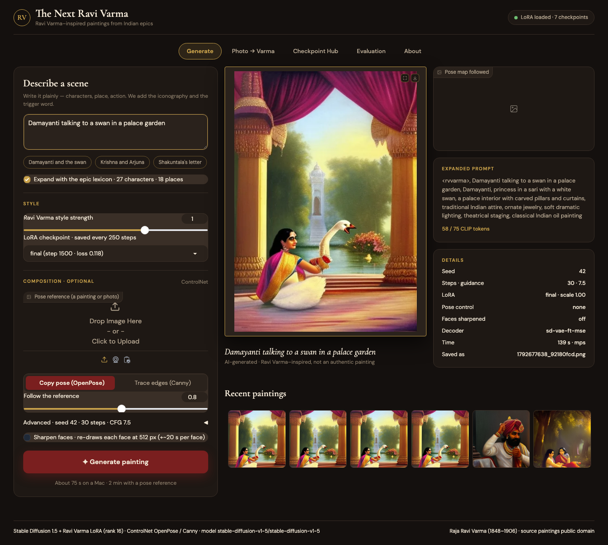
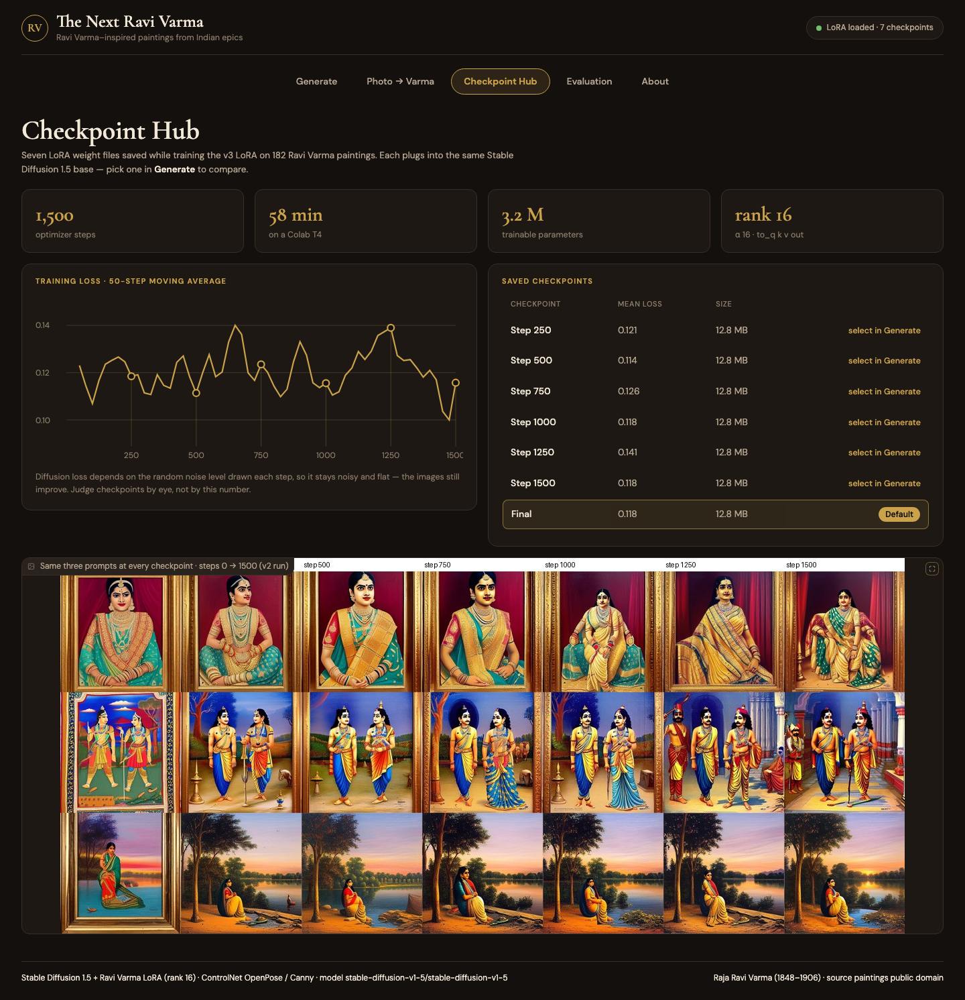
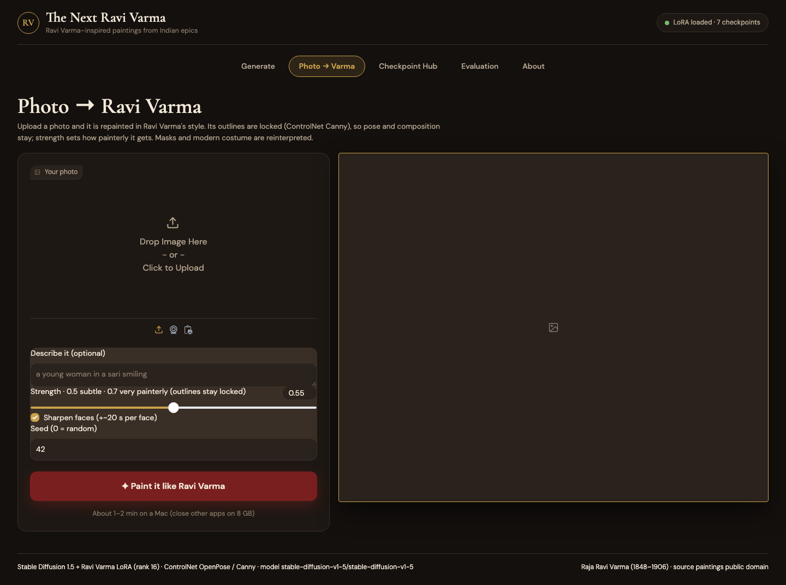
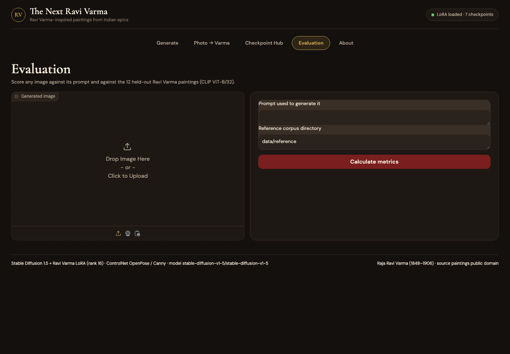
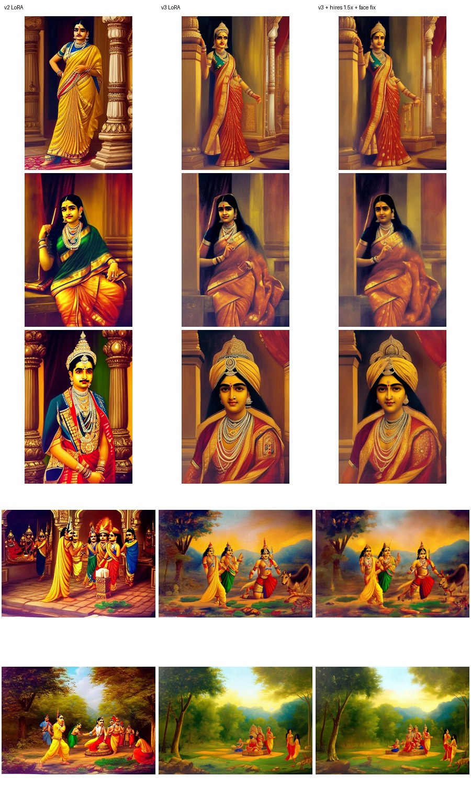

# The Next Ravi Varma

Generate new paintings in the style of **Raja Ravi Varma** (1848–1906) from a text description, a pose
reference, or a photo. It works by adapting **Stable Diffusion 1.5** with a small **LoRA** adapter trained on 182 of
his public-domain paintings.

> All generated images are AI-generated, Ravi Varma–*inspired* artwork. They are **not** authentic paintings by
> Raja Ravi Varma and must not be presented as such.

**Docs:**
- [User Manual](docs/USER_MANUAL.md): how everything works, from the basics.
- [Design decisions](docs/DECISIONS.md): why each choice was made.
- [Detailed results](docs/RESULTS.md): every experiment and the project history.
- [Evaluation protocol](docs/EVALUATION.md).
- [Dataset](data/README.md).
- [Viva guide](docs/VIVA_GUIDE.md).

---

## The problem

General text-to-image models know Ravi Varma only vaguely. Prompted for "a Ravi Varma painting", Stable Diffusion
1.5 produces glossy calendar art, often inside a gilt frame. It doesn't reproduce his academic oil technique,
soft skin modelling or theatrical staging.

This project, inspired by *The Next Rembrandt* (2016), asks whether a small, curated corpus and a
parameter-efficient adapter can teach a diffusion model one artist's visual language. It also asks whether this
can be done on free hardware (a Colab T4 for training, an 8 GB laptop for generation), honestly measured against
the base model.

## What works (verified)

| Feature | How to try it | Evidence |
|---|---|---|
| **Style LoRA (v3)**: text → Varma-style image | `scripts/generate.py`, app *Generate* tab | Style similarity to 12 held-out paintings 0.669 (base) → **0.701**, with no loss in prompt adherence ([table](#results)) |
| **Prompt expansion** (Milestone 3): plain story → detailed prompt (27 characters, 18 places), optional LLM | `--expand` | Works; **no measurable CLIP gain** on 4 scenes, reported as such ([details](docs/RESULTS.md#milestone-3--prompt-expansion)) |
| **Pose control** (Milestone 4): copy the pose of a reference image (ControlNet OpenPose / Canny) | `--pose-image`, app | Pose adherence (PCK) **0.17 → 0.86** on 6 held-out paintings |
| **Photo → Ravi Varma**: repaint a photo, with outlines locked by ControlNet Canny | `--init-image`, app *Photo → Varma* tab | Pose, composition and likeness kept on two test photos ([image](#results)) |
| **Face fix**: redraw each face at 512 px | `--face-fix`, on by default in the app | Before/after crops: clear eyes, defined lips |
| **Web app** (Gradio) with a Checkpoint Hub | `python app/app.py` | Tested in a browser |
| **Reproducible data pipeline**: download with provenance, validation, de-duplication, captioning | `scripts/*.py` | `data/metadata/validation_report.json` records the reason for every exclusion |

All four proposal milestones are implemented. See [Known limitations](#known-limitations) for what does *not* work well.

### Screenshots

These are real screenshots of `python app/app.py` at 1440 px. The Generate result is a real v3 render (seed 42, 139 s on an Apple-silicon Mac).

| Generate (text → painting, expanded prompt, run details) | Checkpoint Hub (v3 checkpoints, loss, progression) |
|---|---|
|  |  |
| **Photo → Varma** (outline-locked repaint) | **Evaluation** (CLIP prompt and style scores for any image) |
|  |  |

The About tab: [docs/screenshots/05_about.png](docs/screenshots/05_about.png).

---

## Quick start

**Prerequisites:**
- Python **3.11** (tested 3.11.16 on macOS / Apple silicon; CI runs 3.11 on Ubuntu).
- About **6 GB free disk** for model downloads: Stable Diffusion 1.5, the fine-tuned VAE and CLIP. The ControlNet features add about 3 GB more on first use.
- Internet on first run, to download public models from Hugging Face. **No API keys are needed.**
- To generate images in reasonable time: an Apple-silicon Mac (MPS) or an NVIDIA GPU (CUDA). CPU works but is slow. On an 8 GB Mac, close other heavy apps: SD + ControlNet needs about 3.5 GB.

```bash
git clone https://github.com/f20240684-cmd/the-next-ravi-varma-v2.git
cd the-next-ravi-varma-v2
python3.11 -m venv .venv && source .venv/bin/activate
pip install -r requirements.txt && pip install -e .

pytest -q                       # ~1–2 min; first run downloads a 1 MB test model and CLIP
```

The trained **v3 LoRA ships with the repo** (`checkpoints/lora/ravi_varma_v3/`, 12.8 MB), so generation works
straight after install:

```bash
# Text -> painting (~1–2 min on an Apple-silicon Mac; the first run downloads SD1.5)
python scripts/generate.py --prompt "<rvvarma>, portrait of a royal Indian woman in a silk sari, classical oil painting" \
    --seed 42 --width 448 --height 640 --face-fix

# Prompt expansion only (no model download): prints the prompt that would be used
python scripts/generate.py --prompt "Saraswati playing the veena by a lotus lake" --expand --dry-run

# Photo -> painting
python scripts/generate.py --prompt "<rvvarma>, classical oil painting" --init-image path/to/photo.jpg --strength 0.55 --face-fix

# Copy the pose of a held-out painting
python scripts/generate.py --prompt "<rvvarma>, a queen holding a lamp, classical oil painting" \
    --pose-image data/reference/0225.jpg --controlnet-type openpose

# Web app -> http://127.0.0.1:7860 (local only; nothing is exposed unless you pass --share)
python app/app.py
```

**Outputs:** every image is saved to `outputs/generated/` with a `.json` sidecar holding the full settings (prompt,
seed, steps, LoRA, decoder, ControlNet). Seeds use a CPU random generator, so the same seed gives the same starting
noise on CUDA, MPS and CPU. Pixel-level results can still differ slightly between devices.

Without `--lora-path` the v3 LoRA is used. `--no-lora` renders the plain base model for comparison.

### Configuration

| File | What it controls |
|---|---|
| `configs/generation.yaml` | Base model, LoRA path (v3 by default), decoder (VAE), scheduler, steps, negative prompt, ControlNet |
| `configs/lora_sd15.yaml` | Training hyperparameters (rank, LR, steps, Min-SNR, noise offset, caption dropout) |
| `configs/dataset.yaml` | Curation: exclusions, duplicate groups, held-out set, caption notes |
| `configs/epic_lexicon.yaml` | Characters and places for prompt expansion |
| `.env` (optional; copy `.env.example`) | Only for the **optional** LLM prompt expansion: `PROMPT_EXPANSION_PROVIDER`, `OPENAI_API_KEY` / `ANTHROPIC_API_KEY`, `OPENAI_BASE_URL` (any OpenAI-compatible API, e.g. Gemini's free tier). Without it, expansion uses the offline lexicon |

---

## Results

Paired evaluation: the same 5 prompts × 3 seeds rendered with and without the LoRA, scored with CLIP ViT-B/32
against **12 held-out paintings that were never trained on** (`outputs/evaluations/lora_v3_vs_base/summary.json`).

| Metric | Base SD1.5 | v2 LoRA (122 images) | **v3 LoRA (182 images)** |
|---|---|---|---|
| Style similarity to held-out paintings | 0.669 | 0.681 (higher than base in 7/15 pairs) | **0.701 (12/15)** |
| Style, 3 nearest references | 0.734 | 0.746 | **0.770 (13/15)** |
| Prompt adherence (image–text) | 0.328 | 0.317 | **0.330** |
| Diversity across seeds | 0.106 | 0.119 | 0.092 |
| Max similarity to any training image (> 0.95 would be a copy) | – | 0.884 | 0.898 |

**What this shows:**
- v3 moves about three times further toward the held-out paintings than v2, without losing prompt adherence.
- Variety across seeds dropped.
- No training image is copied.
- CLIP is a coarse judge of painting style, so the side-by-side images are the stronger evidence.
- The v3 data changes and training changes went into the same run, so their effects cannot be separated.

<p align="center"><br>
<sub>v2 → v3 → v3 with hires + face fix; same prompts and seeds.</sub></p>

**Pose control** (Milestone 4; 6 held-out paintings as pose references, seed 42, `outputs/evaluations/m4_controlnet/`):

| Variant | Pose adherence (PCK) ↑ | Style ↑ | Prompt ↑ |
|---|---|---|---|
| LoRA only | 0.17 | 0.704 | 0.324 |
| **LoRA + OpenPose** | **0.86** | 0.692 | 0.339 |
| LoRA + Canny (traces the reference) | 0.86 | 0.714 | 0.352 |

<p align="center"><br>
<sub>Photo → Ravi Varma: a public-domain photograph of Ravi Varma, and a Spider-Man image. Outlines are locked by
ControlNet Canny; the LoRA repaints colour, texture and light.</sub></p>

The full record, including the v1/v2 history, prompt-expansion results, face fix and failure analysis, is in
[docs/RESULTS.md](docs/RESULTS.md).

---

## How it works

```
Wikimedia Commons + Wellcome Collection (open APIs, per-image licence)
        │ download_dataset.py
        ▼
data/raw/ ──validate_dataset.py──▶ accepted / excluded + reason   (size checked against the ORIGINAL scan,
        │                                                          exact + perceptual + curated duplicates)
        │ generate_captions.py: BLIP-large sentence + 12 BLIP-VQA questions, fit to CLIP's 77 tokens
        ▼
data/processed/ (aspect buckets, 182 train)  +  data/reference/ (12 held out)
        │ train_lora.py on a Colab T4: SD1.5 frozen (fp16) + LoRA r=16 on UNet attention (fp32), 1500 steps
        ▼
checkpoints/lora/ravi_varma_v3/pytorch_lora_weights.safetensors (12.8 MB)
        │
        ▼
RaviVarmaGenerator (src/ravi_varma/generation/pipeline.py): ONE loaded SD1.5 + LoRA, shared by
   txt2img · img2img (hires, face fix) · ControlNet OpenPose/Canny · ControlNet-Canny img2img (photo mode)
        │                         ▲ PromptExpansionEngine (lexicon / optional LLM) for --expand
        ▼
outputs/generated/*.png + .json ──evaluate.py / eval_controlnet.py──▶ outputs/evaluations/
                                   CLIP style & prompt scores, memorisation check, pose PCK
```

| Path | Responsibility |
|---|---|
| `src/ravi_varma/data/` | validation & curation, captioning, preparation (buckets, manifest) |
| `src/ravi_varma/training/` | LoRA trainer (checkpoint/resume, validation images, Min-SNR, noise offset, caption dropout) |
| `src/ravi_varma/generation/` | generator, prompt expansion, ControlNet conditioning, face detection |
| `src/ravi_varma/evaluation/` | CLIP metrics, style similarity, pose PCK |
| `scripts/` | command-line entry points for each stage |
| `app/` | Gradio web app (generate, photo, checkpoint hub, evaluation) |
| `tests/` | 121 tests, including a real LoRA training run on a 1 MB test model |

Key design choices are explained in [docs/DECISIONS.md](docs/DECISIONS.md):
- SD1.5 + LoRA (not SDXL or full fine-tuning) to fit free hardware and a dataset under 200 images.
- Resolution checked against the original scan, which excluded 26 upscaled copies.
- Aggressive de-duplication: 7 copies of one print existed.
- Artefacts such as frames and printed text are *named in captions*, so the trigger word does not absorb them.
- All generation features share a single loaded model, which is what lets them run on an 8 GB Mac.

### Reproducing the training

Data preparation runs locally; training needs a CUDA GPU (a free Colab T4 takes about 58 min):

```bash
python scripts/download_dataset.py --from-metadata   # rebuilds data/raw from the committed metadata (~1 h, Wikimedia rate limits)
python scripts/validate_dataset.py && python scripts/generate_captions.py && python scripts/prepare_dataset.py
python scripts/package_dataset.py                    # -> dist/ravi_varma_dataset.zip for Colab
# On Colab (T4, runtime 2026.07), from the project root with the dataset unzipped:
TAG=v3 bash scripts/colab_train.sh                   # smoke test -> training -> samples -> evaluation -> results zip
```

Step-by-step instructions, including the Colab upload, keeping the runtime alive and downloading the results, are in the
[User Manual, Part C](docs/USER_MANUAL.md#part-c--running-it). `notebooks/03_lora_training.ipynb` is the older v2
notebook; `scripts/colab_train.sh` is the maintained path.

---

## Testing

```bash
pytest -q                                  # full suite
python -m pyflakes src scripts app tests   # lint (also: make lint)
```

**Coverage:**
- dataset validation and curation, captions and token budgets, aspect buckets
- generation settings: negative prompt ≤ 77 tokens, LoRA path resolution, photo sizing for any aspect ratio, input validation
- the face-fix blend, prompt expansion, CLIP evaluation, pose PCK, the checkpoint hub
- a **real end-to-end LoRA training run** on Hugging Face's 1 MB tiny Stable Diffusion: freezing, checkpointing, resume, Min-SNR / noise offset / caption dropout, and that the exported LoRA loads

**Not covered by tests:** fp16 CUDA training (verified on Colab), and the visual quality of real generations
(checked by eye and with the CLIP evaluation above).

**CI:** `.github/workflows/tests.yml` runs lint and the full suite on Ubuntu with CPU PyTorch, on every push and pull
request, with no secrets.

---

## Known limitations

- **Hands and crowds:** Stable Diffusion 1.5 still draws hands and crowded scenes poorly. Pose control fixes figure count and pose, not hands. Use portraits, or a pose reference, for best results.
- **Complex actions** ("weeping over Karna", "driving a chariot") fail with or without prompt expansion.
- **Resolution:** native output is about 448×640. The hires fix (1.5×) needs more than 8 GB, so it is run on Colab.
- **Photo mode** reinterprets masks and modern costume, because the LoRA has only seen Varma paintings. At high strength, small round objects can become tiny faces.
- **Evaluation:** CLIP-based scores are coarse, and sample sizes are small (15 pairs; 6 pose references; 4 expansion scenes). No human study has been run yet.
- **Dataset:** 29 of the 182 training images are chromolithograph prints, which may flatten colours. Their effect hasn't been isolated.
- **Seed diversity** dropped in v3 (0.119 → 0.092).
- **Faces:** the Haar face detector misses profiles and some faces in crowds.

## Security and privacy

- **No secrets are needed or committed.** `.env` is git-ignored; `.env.example` contains no values; git history has been checked for API-key patterns.
- **The web app binds to `127.0.0.1`.** `--share` would create a public Gradio link; only use it deliberately.
- **Uploaded photos are processed locally** and are not sent anywhere. The generated image, its settings and the photo's **edge map** (`*_control.png`, an outline drawing) are saved to `outputs/generated/`; the uploaded photo itself is not stored.
- **Optional LLM prompt expansion** sends the *scene text only* (never images) to the configured provider.
- **Large or malformed images:** Pillow's decompression-bomb protection applies, and very wide or tall photos are centre-cropped to 2:1 before processing.

## Roadmap

- A blind human evaluation (real vs generated; base vs v3).
- Ablations: LoRA rank 8/16/32; v3 with and without prints; data changes vs training changes.
- A "closest real painting" panel next to each generation, to show the model creates rather than copies.
- SDXL with a 24 GB+ GPU, for native 1024 px faces and hands.

## Ethics, licensing and attribution

- **Source images:** Raja Ravi Varma's works are in the public domain. The reproductions come from Wikimedia Commons and the Wellcome Collection: 250 public domain and 39 Public Domain Mark; the rest are CC BY 4.0, CC BY-SA 2.0/4.0 or GODL-India.
- **Provenance:** recorded per image in `data/metadata/metadata.jsonl`. Raw images are not redistributed here; `download_dataset.py --from-metadata` re-fetches them from the sources.
- **Labelling:** generated images carry an AI-generated disclaimer in their metadata.
- **Licence:** code is released under the [MIT License](LICENSE).
