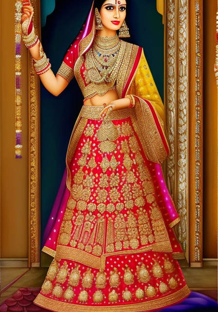
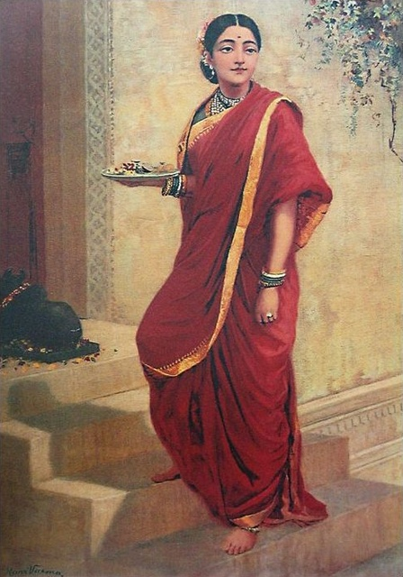
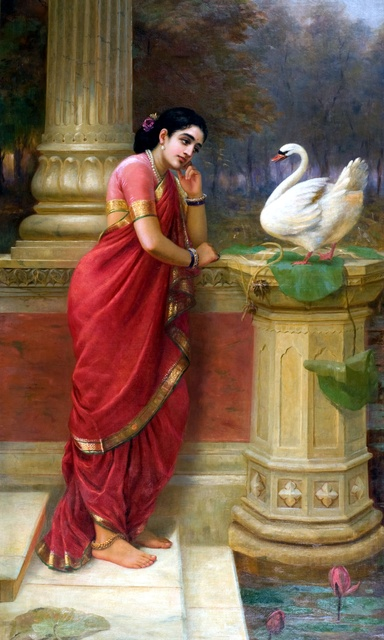

# The Next Ravi Varma: demo

## 1. Problem

| Stable Diffusion 1.5 (no fine-tuning) | Raja Ravi Varma, *Lady Going for Pooja* |
|:---:|:---:|
|  |  |

**Can under 200 paintings teach the style, without the model memorising them?**

---

## 2. Data: separating style from content

**300** collected → **194** kept → **182** training + **12** held out

| *Hamsa Damayanti* (training image) | Its caption |
|:---:|:---|
|  | **Trigger (learns the style):** `<rvvarma>`  **Content words (explain the picture):** Hamsa Damayanti, a woman in a `red sari` feeding a `white swan`, wearing red dress, `necklace` jewelry, `sitting`, calm expression, in park, single-figure composition, vertical format, mid-tone lighting, warm red and ochre palette |

- Words explain the content, so the trigger is left with what all the paintings share: **the style**.
- Duplicates removed: one print appeared **7 times**.

---

## 3. Model: LoRA on Stable Diffusion 1.5

**Frozen weight + small low-rank update**

$$W' = W + \frac{\alpha}{r}\,B A \qquad r = \alpha = 16$$

**Training loss: noise prediction with Min-SNR weighting**

$$\mathcal{L} = \mathbb{E}\left[\frac{\min(\mathrm{SNR}_t,\ \gamma)}{\mathrm{SNR}_t}\ \lVert \epsilon - \epsilon_\theta(z_t, t, c) \rVert^2\right] \qquad \gamma = 5$$

| Trained | Where | Caption dropout | Steps | Time |
|:---:|:---:|:---:|:---:|:---:|
| 3.2 M parameters (**0.37 %**) | UNet attention layers | 10 % trigger only | 1500 | 58 min on a T4 |
