# Detailed results and project history

The [README](../README.md) gives the summary. This file keeps the full record:
- every experiment, with what worked and what did not
- the v1 → v2 change log

All image paths are relative to the repository root.

## Contents
- [Milestone 3 — prompt expansion](#milestone-3--prompt-expansion)
- [Milestone 4 — ControlNet, evaluation, web panel, image-quality and photo features](#milestone-4--controlnet-guardrailing-evaluation--web-panel)
- [v2 LoRA vs base model](#v2-lora-vs-base-model-same-prompts-same-seeds)
- [v1 preliminary results](#v1-preliminary-results-earlier-colab-run-39-image-dataset)
- [Base-model baseline](#base-model-baseline-on-its-own-sd15-no-lora)
- [What changed for v2 (and why)](#what-changed-for-v2-and-why)

---

## Milestone 3 — prompt expansion

`python scripts/generate.py --prompt "Krishna guiding Arjuna in his chariot" --expand` turns a plain story
description into a Stable Diffusion prompt:

1. **Parse** the scene for characters (by name or alias, e.g. "Droupathi" → Draupadi) and places, using the
   editable lexicon `configs/epic_lexicon.yaml` (27 characters, 18 places, standard iconography).
2. **Expand**: add each character's look ("blue-skinned Krishna with peacock-feather crown and yellow silk dhoti"),
   the setting, and short style cues; the trigger `<rvvarma>` and the user's scene stay first and verbatim.
3. **Fit CLIP's 77-token window**: lowest-priority parts are dropped first (an older version produced ~120-token
   prompts, so most of the expansion was silently ignored).

`--dry-run` prints the expanded prompt without loading the model.

**Optional LLM mode** (`PROMPT_EXPANSION_PROVIDER` in `.env`; any OpenAI-compatible API via `OPENAI_BASE_URL`,
e.g. Google Gemini's free tier). The LLM is grounded in the lexicon: detected characters' iconography is always
inserted deterministically and shown to the LLM as context, and the LLM only adds short visual phrases (setting,
pose, clothing, lighting). The user's scene is kept verbatim and the configured negative prompt is never replaced.
Any failure (no key, quota, outage) falls back to local mode.

**Result** (`outputs/evaluations/m3_raw_vs_expanded.jpg`, 4 scenes, seed 42): expansion clearly improves single
iconic figures (Saraswati gets her white sari, veena, swan and lotuses), is mixed for two-figure scenes, and does
not fix complex actions ("Yudhishthira weeping over Karna" fails both ways). CLIP similarity to the story text:
0.326 raw vs 0.317 expanded — no measurable gain on 4 images. Composing multi-person actions is a model limit that
ControlNet pose control (Milestone 4) is meant to address.

**LLM mode** (`outputs/evaluations/m3_raw_local_llm.jpg/.json`, `gemini-3.5-flash-lite`, same 4 scenes and seed):
it gives richer settings — an open battlefield sky for Kurukshetra, a full lotus lake for Saraswati — but no
better actions (still no chariot, no weeping, no kneeling Draupadi), and it can drift from Varma's look (its
Saraswati wears pink and stands, local mode's is seated in white). CLIP similarity: raw 0.326, local 0.317,
LLM 0.320 — within noise on 4 images. Verdict: neither mode beats the raw scene on this metric; local mode is
deterministic, free and offline, so it stays the default. LLM output also varies run to run (temperature 0.4).

<p align="center">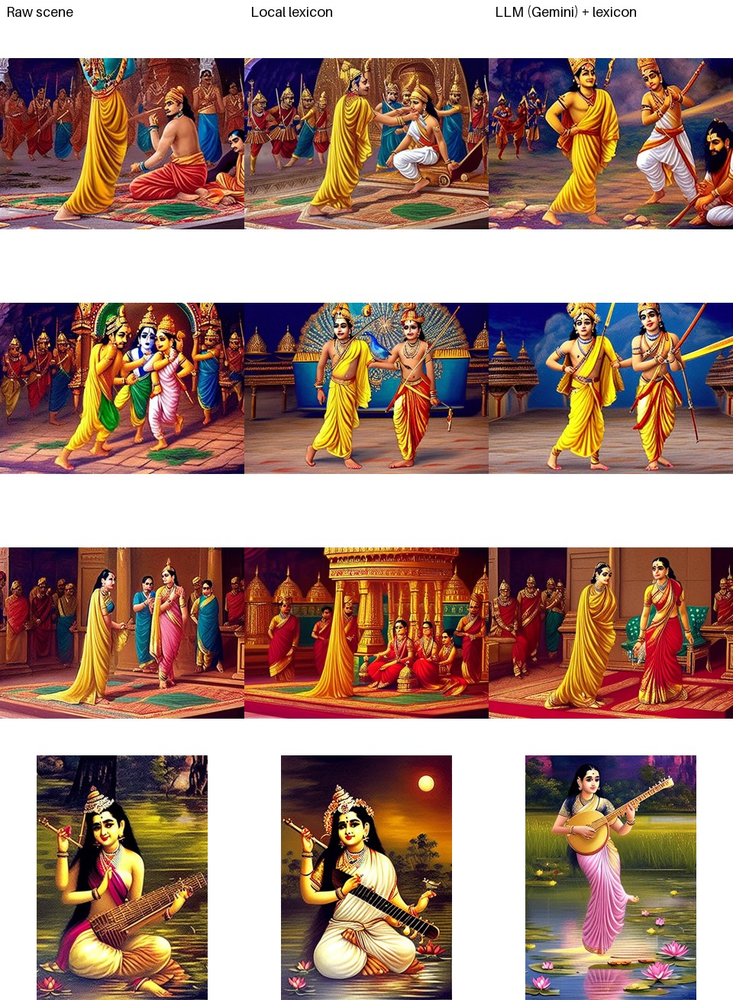</p>

## Milestone 4 — ControlNet guardrailing, evaluation & web panel

**Pose control.** `--pose-image` (CLI) or the *pose reference* box (web panel) adds a pre-trained SD1.5
ControlNet next to our LoRA: the LoRA decides *how it looks*, ControlNet decides *where people are*.
- **OpenPose** (`lllyasviel/control_v11p_sd15_openpose`): extracts an 18-joint skeleton from the reference
  and keeps only the pose. This is the intended mode, because it transfers a pose without copying the picture.
- **Canny** (`control_v11p_sd15_canny`): keeps every outline of the reference, so it nearly traces it.
- The reference is cropped to the output's aspect ratio first, so poses are not stretched.
- The pose/edge map is saved next to the image (`*_control.png`) and shown in the panel.
- ControlNet reuses the already-loaded UNet, VAE and text encoder instead of loading a second copy of SD1.5.
  This halves memory, so it runs on an 8 GB Mac at about 1.5–2 minutes per image.

```bash
python scripts/generate.py --prompt "<rvvarma>, a royal Indian woman in a silk sari holding a plate of flowers, classical oil painting" \
    --seed 42 --width 448 --height 640 --pose-image data/reference/0225.jpg --controlnet-type openpose
```

**Evaluation** (`scripts/eval_controlnet.py` → `outputs/evaluations/m4_controlnet/`).
- **Setup:** 6 held-out paintings (never seen in training) are used as pose references. Each is rendered from its
  own caption with seed 42 three ways: LoRA only, LoRA + OpenPose, LoRA + Canny.
- **Pose adherence (PCK)** is a new metric (`evaluation/pose_score.py`). OpenPose runs on the reference and on the
  output, and PCK is the share of the reference's body joints that reappear within 0.1 of the image size.
- **Style** is the mean CLIP similarity to the *other* 11 held-out paintings; the pose source is excluded,
  otherwise Canny, which traces it, would score itself.

| Variant | Pose adherence (PCK) ↑ | Style similarity ↑ | Prompt adherence ↑ |
|---|---|---|---|
| LoRA only | 0.17 | 0.704 | 0.324 |
| **LoRA + OpenPose** | **0.86** | 0.692 | 0.339 |
| LoRA + Canny | 0.86 | 0.714 | 0.352 |

**What the numbers show:**
- **Without guidance the composition is lost:** three women reading become one woman, and a mother adorning her
  child becomes a deity close-up.
- **OpenPose restores the pose and the number of people in every case**, including the multi-figure scenes that
  were the main weakness at Milestone 2.
- **The style cost is small** (0.704 → 0.692).
- **Canny matches it on pose** and scores higher on style and prompt, but only because it copies the reference
  painting's layout; it is a tracing tool, not pose transfer.
- **Caveat:** this is 6 images and one seed. PCK depends on OpenPose detecting people in a painting, which works
  for these clear figures but would not for crowded scenes.

<p align="center">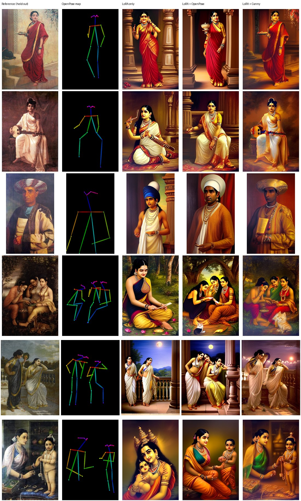</p>

**Web panel** (`python app/app.py` → http://127.0.0.1:7860), styled after the Figma design ["The Next Ravi Varma – App UI"](https://www.figma.com/design/04HJ8zohxGYPrEvUOXEtoB): a dark "gallery at night" theme with gold accents, the result shown in a gilt frame, and a recent-paintings gallery. The **Generate** tab takes:
- a scene description (expanded by Milestone 3)
- style strength, seed, steps, guidance and size (defaults 448 × 640, seed 42)
- an optional pose reference and ControlNet type/strength
- the **LoRA checkpoint** to use

It returns the image, the expanded prompt, the pose map and the full metadata.

The other tabs:
- **Checkpoint Hub:** every saved checkpoint (steps 250–1500) with its mean training loss and size, plus the
  loss curve and the same-prompt-per-checkpoint progression image.
- **Evaluation:** CLIP prompt and style scores for any image.

The panel was tested in a browser: text → image, and pose + checkpoint switching through the same code path.

**Face fix** (`generate.py --face-fix`, on by default in the web panel). At 448×640 a full-body face is only about
40 px, which is why faces looked mushy. Each face is found with OpenCV's face detector, cropped with some margin,
re-drawn at 512 px (img2img, strength 0.4, same prompt with "detailed face"), and blended back with a feathered oval
mask. It reuses the loaded model, so it runs on the 8 GB Mac and adds about 20 s per face. In the before/after crops
(`outputs/evaluations/face_fix_compare.jpg`) the eyes become clear and symmetric and the lips defined. Limits: the
detector misses profiles and some faces in crowds. A detection is only redrawn if an eye is found inside it: without
that check a medal in a photo once got a face painted onto it.

<p align="center">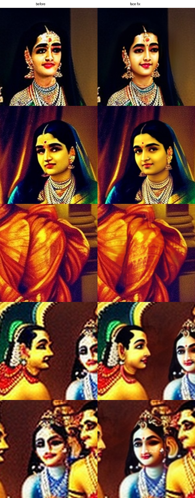</p>

**Hires fix** (`--hires-scale 1.5`): upscale, then re-draw the whole image at 0.4 strength. It needs more than 8 GB,
so it runs in the Colab script (step 7b), not on the Mac.

**Photo → Ravi Varma** (the "Photo → Varma" tab in the app; `generate.py --init-image photo.jpg --strength 0.55`).
- **How:** the photo is resized to about the 448×640 training area (keeping its aspect ratio). It is repainted with the v3 LoRA using img2img while a **Canny ControlNet locks its outlines**. The edges keep pose, composition and likeness; the LoRA repaints colour, texture and light. The face fix then sharpens faces.
- **Why the lock:** the first version was plain img2img. With a Spider-Man photo at strength 0.7 it returned a completely different picture (a turbaned man), because nothing held the structure and the default prompt asked for "Indian attire".
- **Prompt:** now neutral (`<rvvarma>, classical oil painting, …` plus the user's optional description).
- **Facial hair:** in photo mode the facial-hair terms are dropped from the negative prompt, so a real moustache survives.
- **Face fix:** it only redraws boxes in which an eye is found.
- **Result** (`outputs/evaluations/photo_to_varma.jpg`, rendered on a T4): the Ravi Varma photograph keeps his face, moustache, turban, cane, chair and medal as a warm oil portrait. Spider-Man keeps the exact crouch, pillar, buildings and light.
- **Limit:** the LoRA has only seen Varma paintings, so masks and modern costumes are reinterpreted (Spider-Man becomes a man in a red-and-gold costume).
- **Speed:** about 15 s per image on a T4. On the 8 GB Mac it needs other apps closed (SD + ControlNet ≈ 3.5 GB); otherwise it swaps heavily.

<p align="center">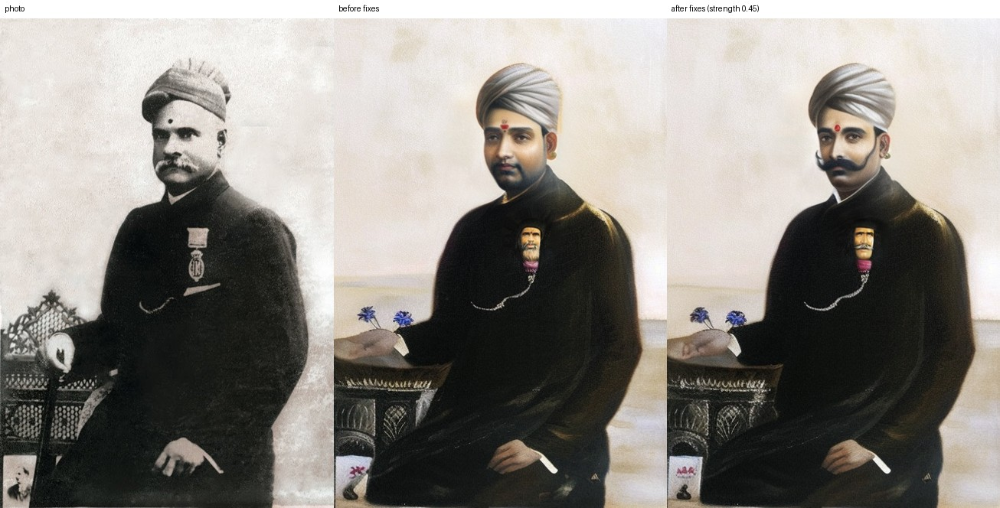</p>

**Inference improvement:** `model.vae` in `configs/generation.yaml` now loads `stabilityai/sd-vae-ft-mse`. It is
the same latent space as SD1.5's decoder, fine-tuned for cleaner faces and detail, so no retraining is needed.
The change is subtle (checked visually, not measured). Set `vae: null` to reproduce images made before it.

---

### v2 LoRA vs base model (same prompts, same seeds)

<p align="center">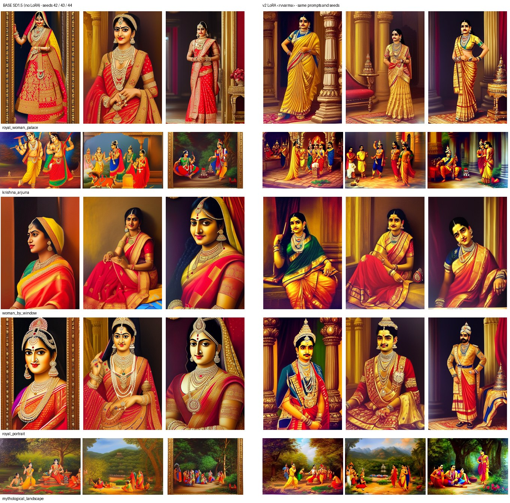</p>

**What the LoRA changes, consistently across seeds:**

- **Composition and staging move toward Varma.** "Royal woman in a palace" goes from a glossy bridal close-up to
  full-length standing figures with pillars, carpets and lamp stands; "royal portrait" becomes standing / seated
  maharaja-style court portraits; Krishna & Arjuna move into a pillared court interior.
- **No gilt frames: 0 / 15 LoRA images vs 5 / 15 for the base model** (same negative prompt). Frames were named in
  the training captions where present, so the trigger token did not absorb them.
- **Warmer, darker, painted backgrounds** instead of glossy digital rendering.

**Problems the LoRA introduces or keeps (not fixed at this milestone):**

- **Facial artifact:** several *women's* faces get a dark, moustache-like shadow on the upper lip
  (royal_woman_palace seeds 42–44, woman_by_window 42/43). The base model does not do this.
  **Update:** the configured negative prompt was 100 tokens but CLIP reads only 77, so its second half
  (incl. `frame, blurry, lowres`) was never applied. A shorter 66-token negative prompt with `moustache, facial hair`
  first removes the shadow in 3 of the 5 affected images and makes it much fainter in the other 2
  (`outputs/generated/lipfix/`, same seeds). A test now fails if the negative prompt exceeds 77 tokens.
- **Signature-like scribbles** in bottom corners (woman_by_window 43/44, local check image): many training
  oleographs carry printed signatures/captions, and the captions do not mention them.
- Multi-figure mythological scenes stay saturated "poster" compositions; hands and faces in crowds remain weak.

**Training progression** — the 3 fixed validation prompts at every checkpoint (step 0 = untrained adapter;
the validation negative prompt does *not* exclude frames):

<p align="center">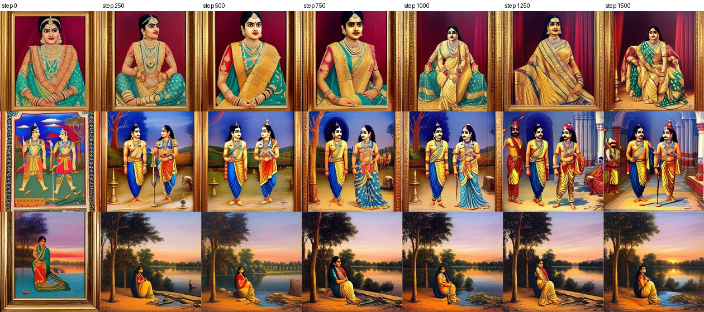</p>

The style develops steadily up to step 1500 (frames disappear, the seated maharani composition and the pillared court
appear only after step 1000), so the final checkpoint is used by default. The loss stays flat around 0.17–0.18
throughout (mean 0.185 over steps 1–100, 0.174 over 1001–1500; `outputs/evaluations/lora_vs_base/loss_curve.png`),
which is normal for diffusion LoRA training — the per-step noise-prediction loss does not track style.

Local check on the Mac with the downloaded weights (seed 7, not one of the evaluation seeds):

<p align="center">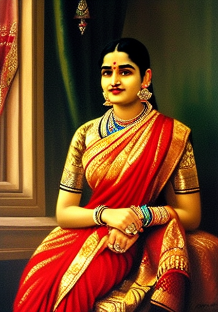</p>

**Automatic metrics** (CLIP ViT-B/32; 15 paired images, `outputs/evaluations/lora_vs_base/summary.json`):

| Metric | Base SD1.5 | v2 LoRA | Δ (LoRA higher in) |
|---|---|---|---|
| Prompt adherence (image–text cosine) | 0.328 | 0.317 | −0.011 (5/15) |
| Style similarity to 12 held-out paintings, mean | 0.669 | 0.681 | +0.012 (7/15) |
| Style similarity, top-3 references | 0.734 | 0.746 | +0.012 (7/15) |
| Diversity across seeds | 0.106 | 0.119 | +0.013 |
| Max similarity to any training image | — | 0.884 | no near-copies (threshold 0.95) |

Read honestly: the CLIP metrics show only a **small, inconsistent** shift — they barely register the composition,
framing and rendering changes that are obvious in the side-by-side, and the slight drop in prompt adherence is within
noise for 15 pairs. CLIP ViT-B/32 is a weak judge of painting style (see [docs/EVALUATION.md](EVALUATION.md));
the human rubric in `outputs/evaluations/lora_vs_base/qualitative_review.csv` is still to be filled in.

### v1 preliminary results (earlier Colab run, 39-image dataset)

<p align="center">
  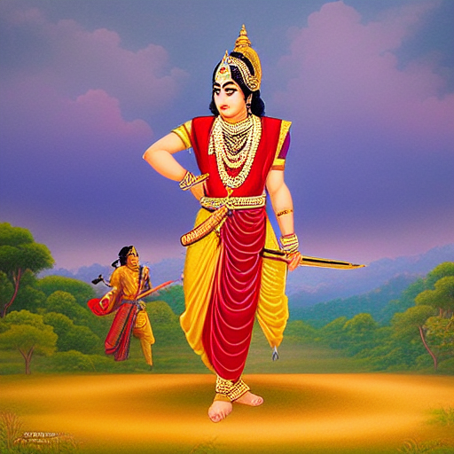
  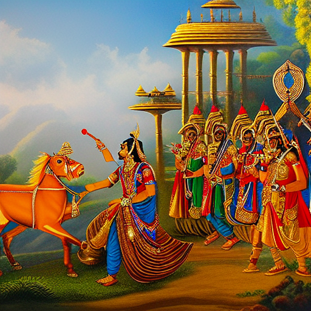
  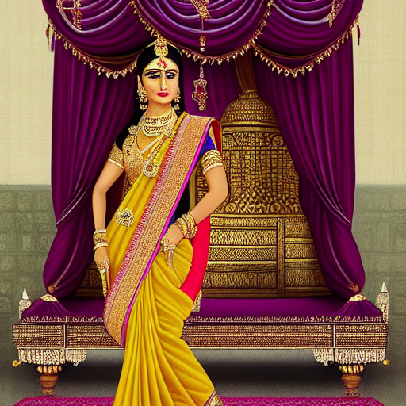
  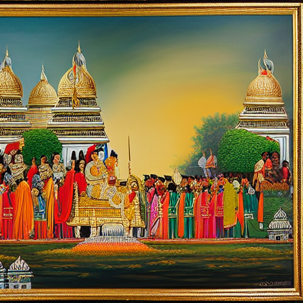
</p>

Honest assessment of v1: the images show Indian-epic subject matter (ornate jewelry, saris, warm
saturated palette) but read as modern calendar/poster art rather than Varma's academic oil technique;
faces in multi-figure scenes are distorted (2nd image) and the 4th image has a painted gilt frame.
**Compared with the base-model baseline below, the v1 look is close to what plain SD1.5 already produces
for such prompts** (base SD1.5 also paints gilt frames), so the v1 adapter's style effect appears weak.
No paired base-vs-v1 comparison exists (different prompts/seeds, and the v1 weights were not kept), so this
is a qualitative judgement. It motivated the v2 data work below: more and cleaner data, real captions
(the frame is now named in captions where present) and aspect-correct crops.

### Base-model baseline on its own (SD1.5, no LoRA)

Rendered locally (Apple MPS, fp16, 30 steps, guidance 7.5) for the 5 prompts in
`configs/prompts/sample_prompts.yaml` × seeds 42/43/44 → `outputs/generated/baseline/` (15 images with sidecar JSON).

<p align="center">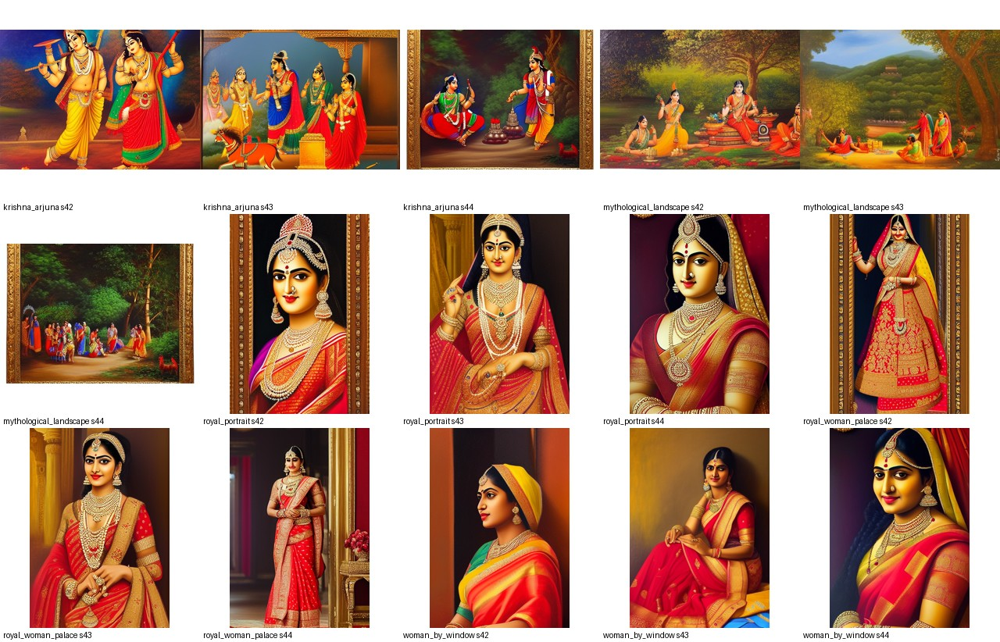</p>

What base SD1.5 does with these prompts: a glossy, frontal, saturated "calendar art" look with hard
lighting — none of Varma's soft academic modelling of skin and drapery; gilt **frames in 5 of 15 images**
despite `frame, border` in the negative prompt (the phrase "classical oil painting" pulls frames in);
ambiguous identities in the multi-figure mythological scenes. This is the reference the v2 LoRA has to beat.

Automatic metrics for this baseline (`outputs/evaluations/baseline_sd15/summary.json`, CLIP ViT-B/32):

| Metric | Baseline (SD1.5, no LoRA) |
|---|---|
| Prompt adherence (image–text cosine) | 0.328 |
| Style similarity to 12 held-out paintings (mean / top-3) | 0.669 / 0.734 |
| Diversity across seeds (mean pairwise distance) | 0.106 |
| Max similarity to any training image | 0.868 (no near-copies) |

These are the base-model columns of the paired table above.

---

## What changed for v2 (and why)

| Problem found | Fix |
|---|---|
| Uncommitted manifest had placeholder captions ("unknown (no VLM available…)") for all 200 images and the metadata file was emptied | Metadata rebuilt from verifiable sources (committed records + download log); captioner now refuses to silently fall back to placeholder captions |
| 26 local images were upscaled from originals as small as 200 px, passing the 384 px check | Original sizes fetched from Commons into metadata; validation checks the original resolution |
| Same artwork present 2–5× (prints, crops, re-scans) | 22 curated duplicate groups + automatic dHash near-duplicate detection; highest-resolution copy kept |
| Stamps, gallery photos, multi-panel grids, text-labelled prints in the corpus | Curated exclusion list with a reason per file (`configs/dataset.yaml`) |
| Square 512 center-crop cut heads/feet off the mostly tall canvases | Aspect-ratio buckets (448×640, 512×512, …); scanner margins trimmed |
| Captions were a single BLIP sentence | BLIP sentence + fixed BLIP-VQA template (clothing, colour, jewelry, posture, action, expression, held object, setting, day/night) + measured palette, fit to CLIP's 77 tokens; artwork title from provenance |
| `runwayml/stable-diffusion-v1-5` no longer exists on the Hub | Switched to the official mirror `stable-diffusion-v1-5/stable-diffusion-v1-5` (identical weights) |
| LR warm-up silently 4× too long (multiplied by grad-accumulation) | Warm-up/total steps expressed in optimizer steps, as in the Diffusers reference |
| Loss logged from one micro-batch only; no loss file | Mean over accumulated micro-batches, `loss_history.csv` + TensorBoard |
| Only final weights exportable; validation rebuilt the pipeline from disk with mixed dtypes | Every checkpoint saves a loadable `pytorch_lora_weights.safetensors`; fixed-seed multi-prompt validation re-uses loaded modules, incl. a step-0 baseline |
| `xformers==0.0.27.post2` in Colab requirements pins `torch==2.4.0` → downgraded Colab torch → torchao mismatch | xformers removed (PyTorch SDPA used); guarded torchao check kept in the notebook |
| `bitsandbytes==0.43.3` has no CUDA 12.8 binary and imports `triton.ops` (gone in Triton 3); PEFT imports it when installed → LoRA injection crashed on Colab | bitsandbytes dropped, `use_8bit_adam: false` (8-bit Adam saved only ~19 MB for 3.2M LoRA params) |
| No held-out data for evaluation | 12 accepted paintings held out in `data/reference/`, never trained on |
