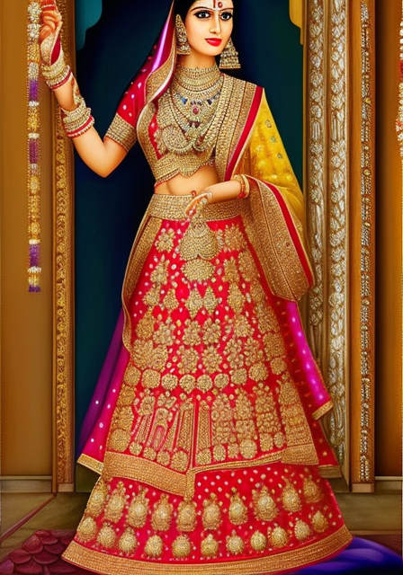
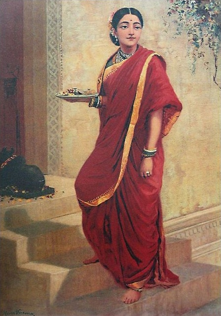
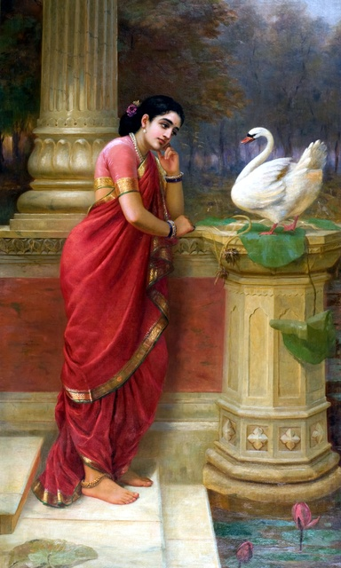
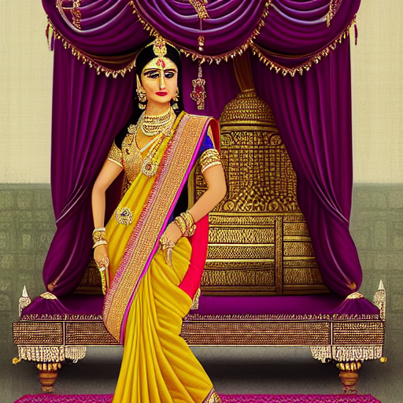
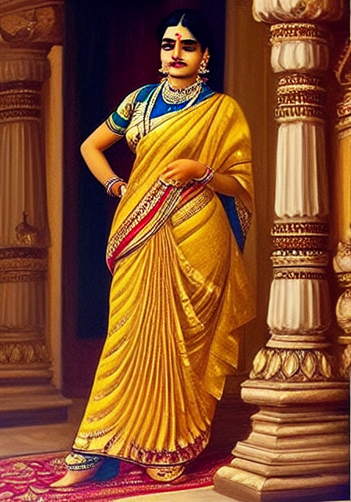
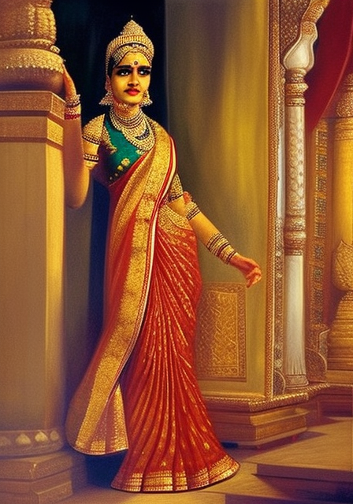
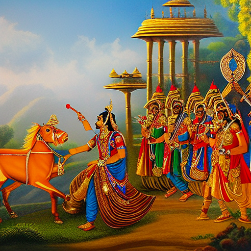
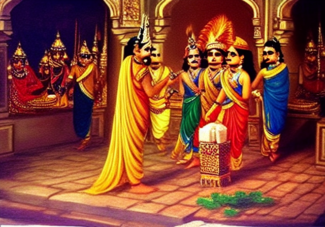
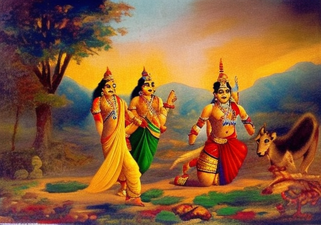

# The Next Ravi Varma: demo

## 1. Problem

| Stable Diffusion 1.5 (no fine-tuning) | Raja Ravi Varma, *Lady Going for Pooja* |
|:---:|:---:|
|  |  |

**Can under 200 paintings teach the style, without the model memorising them?**

---

## 2. Data: separating style from content

**300** collected → **194** kept → **182** training + **12** held out



***Hamsa Damayanti* (training image) and its caption**

**Trigger (learns the style):** `<rvvarma>`

**Content words (explain the picture):** Hamsa Damayanti, a woman in a `red sari` feeding a `white swan`, wearing red dress, `necklace` jewelry, `sitting`, calm expression, in park, single-figure composition, vertical format, mid-tone lighting, warm red and ochre palette

- Words explain the content, so the trigger is left with what all the paintings share: **the style**.
- Duplicates removed: one print appeared **7 times**.

<br clear="both">

---

## 3. Model: LoRA on Stable Diffusion 1.5

**Frozen weight + small low-rank update**

```math
W' = W + \frac{\alpha}{r}\,B A \qquad r = \alpha = 16
```

**Training loss: noise prediction with Min-SNR weighting**

```math
\mathcal{L} = \mathbb{E}\left[\frac{\min(\mathrm{SNR}_t,\ \gamma)}{\mathrm{SNR}_t}\ \lVert \epsilon - \epsilon_\theta(z_t, t, c) \rVert^2\right] \qquad \gamma = 5
```

| Trained | Where | Caption dropout | Steps | Time |
|:---:|:---:|:---:|:---:|:---:|
| 3.2 M parameters (**0.37 %**) | UNet attention layers | 10 % trigger only | 1500 | 58 min on a T4 |

---

## 4. How it improved: v1 → v2 → v3

| | v1 | v2 | v3 (final) |
|:---|:---:|:---:|:---:|
| **Woman in a palace** |  |  |  |
| **Krishna and Arjuna** |  |  |  |
| **Training images** | 39 | 122 | **182** |
| **Main change** | First attempt: one BLIP sentence per image, square crops | Curated data, detailed captions, aspect buckets | More and sharper data, Min-SNR, noise offset, caption dropout |
| **Look** | Flat poster style, close to the base model | Richer light and fabric, but moustache-like shadows on faces | Softer, painterly light; face shadows fainter but not fully gone |
| **Style score** (base under the same settings) | not measured | 0.681 (0.669) | **0.701** (0.674) |
| **Prompt score** (base) | not measured | 0.317 (0.328) | **0.330** (0.329) |
| **Diversity** (base) | not measured | **0.119** (0.106) | 0.092 (0.103) |

<sub>v2 and v3: same prompts, seed 42. v1: different prompts and seeds, so compare it only by eye. The fainter v3 face shadows also come from a
shorter negative prompt ("moustache" first) and a better VAE, not only from training. Style score: CLIP similarity to 12 held-out paintings; 15 pairs, v3 vs base p = 0.08.</sub>
