<!-- Generated by docs/handbook/build_handbook.py from docs/handbook/src/*.md (repository commit e2cae62). Edit the src files, not this one. -->

# How to read this handbook

This handbook explains **The Next Ravi Varma** from the ground up: what problem it solves, how every part works,
why it was built this way, how to run and debug it, and how to defend it in a review. Everything below is grounded in
the repository at commit `e2cae62` (22 October 2026). Every file path and symbol name refers to that tree.

## Evidence labels

The handbook separates what the code *proves* from what is *inferred*. You will see these labels:

| Label | Meaning |
|---|---|
| **Confirmed** | Stated in repository documentation or commit messages *and* visible in the implementation |
| **Implemented** | Directly visible in the code or configuration, even if no document explains why |
| **Measured** | A number produced by a script in this repository, with the output file named |
| **Inferred** | A reasonable interpretation of the code. The original motivation is not recorded anywhere |
| **Not implemented** | Mentioned (config, docstring, proposal) but absent or explicitly disabled in code |

## Chapter map

| Chapter | Question it answers |
|---|---|
| 1. Project overview | What is this, for whom, and what works? |
| 2. Technology stack | What does each library do here, and what are the alternatives? |
| 3. Architecture | How do the parts fit together? (diagrams) |
| 4. Features | How does each feature work, end to end? |
| 5. Decision register | Why was each important choice made, and when should it change? |
| 6. Codebase guide | What does each module do and who calls it? |
| 7. Data, interfaces and flows | What files, schemas, CLIs, app events and external APIs exist? |
| 8. First principles | The theory behind diffusion, LoRA, CLIP, ControlNet and the metrics |
| 9. Setup and operations | How to install, run, verify, debug and reset |
| 10. Testing, reliability, security | What is proven, what is risky, and what to fix |
| 11. Alternatives and improvements | What could be simpler, and what to change first |
| 12. Demonstration and interview prep | Scripts, 35 questions with answers, honest weaknesses |
| 13–14 | Glossary and a one-page quick reference |
| Appendices | Open questions and assumptions; the verification report |

## Scope of this document

This is **documentation and analysis only**: no application code, configuration or dependency was changed to write it.
Where the documentation in the repository disagrees with the code, the handbook says so and trusts the code. Those
cases are collected in Appendix A.

# 1. Project overview

## 1.1 The problem

Raja Ravi Varma (1848–1906) is the painter who defined how Indian epics *look* in popular imagination: academic
European oil technique (soft, modelled skin; rich drapery; theatrical lighting and staging) applied to Mahabharata,
Ramayana and Puranic subjects. His paintings are in the public domain.

A general text-to-image model does not reproduce this. The repository documents what plain **Stable Diffusion 1.5**
produces for prompts such as "royal Indian woman in a palace, classical oil painting" (`docs/RESULTS.md`, *Base-model
baseline*; images in `outputs/generated/baseline/`):
- a glossy, frontal, saturated "calendar art" look with hard lighting
- **painted gilt frames in 5 of 15 images**, even though "frame" is in the negative prompt
- ambiguous identities in multi-figure mythological scenes

The project asks three questions (**Confirmed**: README and the proposal `The_Next_Ravi_Varma_AI_Project_Proposal.docx`):
1. Can a **small, curated corpus** (under 200 paintings) teach a diffusion model one artist's visual language?
2. Can this be done on **free or modest hardware**: a Google Colab T4 for training, an 8 GB Apple-silicon laptop for generation?
3. Can the result be **measured honestly** against the base model, rather than judged only by eye?

## 1.2 Who it is for

| User | What they need | How the project serves it |
|---|---|---|
| The student team (primary) | A working, explainable system for a 4-milestone course project | Scripts per stage, docs, a viva guide, this handbook |
| An evaluator / reviewer | To clone, run and verify claims independently | Shipped v3 LoRA, CI, a README quick start, results traceable to files |
| An end user / demo audience | To make Varma-style images from text, a pose or a photo | The Gradio web app (`app/app.py`) and CLI (`scripts/generate.py`) |
| A future developer | To retrain or extend the model | Config-driven pipeline, `scripts/colab_train.sh`, tests |

## 1.3 Core use cases

1. **Text → painting:** type a scene; get a Ravi Varma–style image.
2. **Story → better prompt** (Milestone 3): write "Krishna guiding Arjuna in his chariot"; the system adds each character's standard iconography and fits the prompt to CLIP's 77-token limit.
3. **Pose control** (Milestone 4): give a reference image; the painting copies its pose (ControlNet OpenPose) or its outlines (ControlNet Canny).
4. **Photo → painting:** repaint a photo in Varma's style while keeping its composition.
5. **Rebuild the dataset and retrain the model** from committed metadata.
6. **Evaluate** a model: paired CLIP metrics against the base model and held-out paintings; pose adherence (PCK).

## 1.4 Scope and non-goals

**In scope (Implemented):** the dataset pipeline, LoRA training, the generation features above, evaluation, the web app.

**Explicit non-goals and things that are not implemented:**
- **Authentic reproduction.** Every output is labelled AI-generated and "Ravi Varma–inspired" (generation metadata `disclaimer` field, app footer, README).
- **SDXL training.** `configs/lora_sdxl.yaml` exists, but `LoraTrainer._load_models` raises `NotImplementedError` for `model_family: sdxl`. That's scaffolding, not a feature.
- **Production serving.** There are no accounts, no database, no deployment and no multi-user concurrency handling. The Gradio app is a local single-user tool.
- **A human evaluation study.** `qualitative_review.csv` provides an empty rubric; no human ratings exist yet.

## 1.5 Implementation status (verified 22 Oct 2026)

| Capability | Status | Evidence |
|---|---|---|
| Dataset download with provenance (Commons + Wellcome) | Implemented, used | `scripts/download_dataset.py`; `data/metadata/metadata.jsonl` (300 records) |
| Validation, curation, de-duplication | Implemented, tested | `src/ravi_varma/data/validation.py`; `tests/test_curation.py`, `tests/test_dataset.py` |
| BLIP + VQA captioning | Implemented, used | `src/ravi_varma/data/captions.py`; 194 sidecars in `data/captions/` |
| Aspect-bucket preparation, hold-out split | Implemented, tested | `src/ravi_varma/data/dataset.py`; `data/processed/manifest.jsonl` (182), `data/reference/` (12) |
| LoRA training (SD1.5) with checkpoint/resume | Implemented, tested on a tiny model, **run on Colab T4** | `src/ravi_varma/training/`; `checkpoints/lora/ravi_varma_v3/training_summary.json` |
| Text→image CLI and app | Implemented, run on Mac and T4 | `scripts/generate.py`, `src/ravi_varma/generation/pipeline.py` |
| Prompt expansion (lexicon + optional LLM) | Implemented, tested; **no measurable CLIP gain** | `generation/prompt_engine.py`; `outputs/evaluations/m3_raw_local_llm.json` |
| ControlNet pose / edge control | Implemented, evaluated | `generation/controlnet.py`, `scripts/eval_controlnet.py`; `outputs/evaluations/m4_controlnet/summary.json` |
| Face fix, hires fix | Implemented; hires needs a GPU with > 8 GB | `RaviVarmaGenerator._fix_faces`, `generate(hires_scale=…)` |
| Photo → painting | Implemented, run on T4 and Mac | `generate(init_image=…)`, `_photo_redraw`; `outputs/evaluations/photo_to_varma.jpg` |
| Paired evaluation, pose PCK | Implemented, tested | `evaluation/run_eval.py`, `evaluation/pose_score.py` |
| Gradio web app (5 tabs) | Implemented, browser-tested | `app/app.py`, `app/components.py`; `docs/screenshots/` |
| CI | Implemented, passing | `.github/workflows/tests.yml` (119 passed, 2 skipped on Ubuntu) |
| SDXL | **Not implemented** | `lora_trainer.py`, `_load_models` raises `NotImplementedError` |

## 1.6 Constraints and assumptions

- **Hardware.** Training needs CUDA (fp16 on a 16 GB T4). Generation targets an **8 GB Apple-silicon Mac** (MPS, fp16), a constraint that shaped several designs (§5, D-13, D-14).
- **Free tiers only.** No paid API is required. The optional LLM mode works with any OpenAI-compatible endpoint (Gemini's free tier was used).
- **Data licence.** Only public-domain or openly licensed reproductions, with provenance recorded per image.
- **Small data.** 182 training images (v3). Every design choice about capacity (LoRA rank, steps) has to respect that.
- **Assumption (Inferred):** the evaluator has internet access on first run, because the base model (about 4 GB), CLIP and the ControlNets download from the Hugging Face Hub.

## 1.7 What makes it technically interesting

1. **Data quality over quantity, made auditable.** Resolution is checked against the *original* scan; 26 upscaled copies were caught that way. Duplicates are found by exact hash, perceptual hash and CLIP-assisted human review. Every exclusion has a recorded reason.
2. **Teaching a style through captions.** The captions describe content in detail, so the trigger token `<rvvarma>` ends up holding only the *style*. Unwanted artefacts (frames, printed text) are named in captions so the trigger word doesn't absorb them.
3. **One loaded model, many pipelines.** txt2img, img2img (face and hires fixes), ControlNet, and ControlNet-img2img (photo mode) all share one set of weights. That's what makes everything fit in 8 GB.
4. **Honest evaluation.** The evaluation is paired against the base model, uses held-out references, checks for memorisation, and adds a pose-adherence metric (PCK). Null results are reported as null results.

## 1.8 A realistic session

A student preparing a demo runs:

```bash
source .venv/bin/activate
python scripts/generate.py --prompt "Saraswati playing the veena by a lotus lake" --expand --dry-run
```

The output is the expanded prompt, printed without loading any model:
`<rvvarma>, Saraswati playing the veena by a lotus lake, Saraswati in a white sari playing the veena, a swan beside her, a lotus lake, …`

Then they render it, with faces sharpened:

```bash
python scripts/generate.py --prompt "Saraswati playing the veena by a lotus lake" --expand --seed 42 --width 448 --height 640 --face-fix
```

The image lands in `outputs/generated/` with a `.json` sidecar recording the prompt, seed, steps, LoRA file, decoder
and timing, so the exact image can be regenerated. For the audience they open `python app/app.py` and use the
**Generate** and **Photo → Varma** tabs.

# 2. Technology stack and dependencies

Every entry below was checked against actual imports (`grep` over `src/`, `scripts/`, `app/`, `tests/`). Pinned
versions come from `requirements.txt`. Since commit `dd26570`, packages listed but never imported have been removed:
`datasets`, `scikit-image`, `lpips` and `pytest-mock`.

## 2.1 Summary table

| Technology (version) | Role in this project | Used in | Essential? | Main alternative |
|---|---|---|---|---|
| Python 3.11 | Language | everything | Essential | — |
| PyTorch 2.4.1 | Tensor maths, autograd, devices (CUDA / MPS / CPU) | trainer, generator, CLIP | Essential | JAX (no Diffusers parity) |
| Diffusers 0.30.3 | SD1.5 pipelines, UNet/VAE classes, schedulers, ControlNet pipelines | `generation/pipeline.py`, `training/lora_trainer.py` | Essential | Hand-written sampling loop; ComfyUI (not a library) |
| Transformers 4.44.2 | CLIP tokenizer and text encoder; BLIP caption / VQA models | trainer, `data/captions.py` | Essential | open_clip for CLIP text (but SD expects HF classes) |
| PEFT 0.12.0 | LoRA adapters injected into the UNet (`add_adapter`) | `lora_trainer.py`, `_apply_lora` | Essential | Diffusers' older attention-processor LoRA; hand-written LoRA |
| Accelerate 0.34.2 | Mixed precision, gradient accumulation, checkpoint `save_state` / `load_state` | `lora_trainer.py`, `train` | Essential for training | A plain PyTorch loop with `torch.cuda.amp` |
| safetensors 0.4.5 | Safe, fast weight files (`pytorch_lora_weights.safetensors`) | via Diffusers / PEFT | Essential | pickle `.bin` (unsafe to load) |
| torchvision 0.19.1 | Training-time transforms (resize, flip, normalise) | `data/dataset.py`, `__getitem__` | Convenient | PIL + NumPy by hand |
| Pillow 10.4.0 | Image IO, resizing, the decompression-bomb limit | everywhere | Essential | OpenCV |
| OpenCV (headless) 4.10 | Canny edges, Haar face and eye detection | `generation/controlnet.py`, `pipeline.py`, `detect_faces` | Essential for those features | scikit-image (Canny); MediaPipe / RetinaFace (faces) |
| NumPy 1.26.4 | Arrays: hashes, borders, embeddings, PCK | utils, evaluation | Essential | — |
| open-clip-torch 2.26.1 | CLIP ViT-B/32 for **evaluation** metrics | `evaluation/clip_score.py` | Essential for evaluation | HF `CLIPModel` |
| controlnet-aux 0.0.9 | OpenPose skeleton detector | `generation/controlnet.py`, `evaluation/pose_score.py` | Essential for pose features | MediaPipe Pose, DWPose |
| Gradio 4.44.0 (+ fastapi 0.115.0 pin) | Web UI | `app/` | Essential for the app | Streamlit (named in the proposal), a FastAPI + JS front end |
| pydantic 2.9.1 | Typed, validated config models | `src/ravi_varma/config.py` | Convenient but valuable | dataclasses + manual checks |
| PyYAML 6.0.2 | Config and lexicon files | config, prompt engine | Essential | TOML / JSON |
| requests 2.32.3 | Wikimedia and Wellcome HTTP APIs | `scripts/download_dataset.py` | Essential for download | httpx, urllib |
| python-dotenv 1.0.1 | Loads `.env` for the optional LLM keys | `scripts/generate.py` | Convenient | `export` in the shell |
| openai 1.55.3 / anthropic 0.34.2 | Optional LLM prompt expansion | `prompt_engine.py`, `LLMPromptEngine` | Optional | raw HTTP |
| tensorboard 2.17.1 | Optional training dashboards (loss is also always written to CSV) | `training/callbacks.py`, `LossLogger` | Optional | the CSV alone |
| tqdm | Progress bars (transitively used by libraries) | — | Convenient | — |
| pytest 8.3.3, pyflakes 3.2.0 | Tests and lint | `tests/`, `Makefile`, CI | Essential for quality | unittest; ruff |
| GitHub Actions | CI on every push | `.github/workflows/tests.yml` | Valuable | none / GitLab CI |
| Google Colab (T4, runtime 2026.07) | Training hardware | `scripts/colab_train.sh` | Practically essential | any CUDA box, Kaggle |

**External models** (downloaded from the Hugging Face Hub at first use):
- `stable-diffusion-v1-5/stable-diffusion-v1-5`: the base model.
- `stabilityai/sd-vae-ft-mse`: the decoder.
- `Salesforce/blip-image-captioning-large` and `Salesforce/blip-vqa-base`: captioning.
- `lllyasviel/control_v11p_sd15_openpose` and `…_canny`: ControlNets.
- `lllyasviel/ControlNet` (Annotators): OpenPose weights.
- OpenAI CLIP ViT-B/32 via open_clip: evaluation.
- `hf-internal-testing/tiny-stable-diffusion-pipe`: the 1 MB test model.

## 2.2 Notes on the important choices

**Diffusers + PEFT + Accelerate.** The trainer mirrors the structure of Diffusers' official `train_text_to_image_lora`
example, which is **Confirmed** in the docstring of `lora_trainer.py`. Using the reference stack means:
- `pipe.load_lora_weights()` can load the exported file directly
- schedulers can be swapped by name (`SCHEDULER_MAP` in `pipeline.py`)
- ControlNet and img2img pipelines can be built from the same components (`StableDiffusionControlNetPipeline(**components, controlnet=…)`)

*Trade-off:* the pinned versions (Diffusers 0.30.3, PEFT 0.12.0) are older than current releases. They are stable
together, but upgrading needs care (§10).

**open_clip vs Transformers CLIP for evaluation.** Generation uses the CLIP text encoder *inside* SD1.5, which is
ViT-L/14 via Transformers. Evaluation uses a *different* CLIP, **ViT-B/32 via open_clip**.

*Inferred rationale:* an independent, smaller judge avoids scoring the model with its own conditioning encoder, and
is cheap on CPU. *Consequence:* scores aren't comparable with papers that use ViT-L/14 CLIP-score.

**Gradio instead of Streamlit.** The proposal names "Gradio or Streamlit". Gradio's event model maps one button to one
Python function, so `run_generation(…)` is just the generator call plus HTML formatting.

*Pitfall found:* Gradio 4.44 crashes with starlette 1.x (`TypeError: unhashable type: 'dict'`), hence the explicit
`fastapi==0.115.0` pin (**Confirmed**, comment in `requirements.txt`).

**pydantic config models.** `config.py` declares `DatasetConfig`, `LoraTrainingConfig` and `GenerationConfig`, with
defaults and validators; for example `GenerationParamsConfig._multiple_of_8` rejects widths that aren't multiples of
8. A typo in a YAML key falls back to the default rather than crashing, which is a mixed blessing (§10).

**OpenCV Haar cascades for faces.** They are already installed with OpenCV and run on CPU in milliseconds. They're
weaker than a neural detector on profiles and crowds. A second Haar cascade for **eyes** filters false positives such
as medals and folds of cloth (`detect_faces`, **Confirmed** by its docstring and commit `3958585`).

## 2.3 What would change if a component were replaced

| Replace | Impact |
|---|---|
| SD1.5 → SDXL | Retrain the LoRA (weights don't transfer). New pipeline classes, two text encoders, ~3× memory (no longer fits the 8 GB Mac), SDXL ControlNets |
| PEFT LoRA → full fine-tune | ~4 GB checkpoints, high overfitting risk with 182 images, needs far more GPU memory |
| Gradio → Streamlit | Rewrite `app/` (about 500 lines); the generator is untouched, because UI and logic are already separate |
| open_clip → HF CLIP | Change `evaluation/clip_score.py` only; all metric values would shift, so earlier results must be recomputed |
| Haar → DNN face detector | Change `detect_faces` only; add a dependency; fewer misses on profiles |
| Colab → local GPU | No code change; `scripts/colab_train.sh` runs on any CUDA Linux box |

# 3. Architecture

## 3.1 What kind of system this is

The Next Ravi Varma is a **single-process Python application plus a set of batch scripts**.

- **Not here:** a server fleet, a database, authentication, a job queue or a deployment.
- **The "database"** is a set of versioned files (JSONL metadata, manifests, caption sidecars, generation sidecars).
- **The "backend"** is one Python class, `RaviVarmaGenerator`. It is used both by the CLI and by a local Gradio web app.

Keeping this in mind avoids describing infrastructure that isn't there.

| Layer | Present? | Where |
|---|---|---|
| Front end | Yes: Gradio (server-rendered components + CSS) | `app/app.py`, `app/components.py`, `app/styles.css` |
| Back end / business logic | Yes: a Python library | `src/ravi_varma/` |
| Batch pipelines | Yes: CLI scripts | `scripts/` |
| Database | **No.** Versioned files instead | `data/metadata/`, `data/processed/manifest.jsonl`, `outputs/` |
| Authentication / authorization | **No.** Local single-user tool bound to `127.0.0.1` | `demo.launch(server_port=…)` |
| Background jobs | **No.** Requests run synchronously; Gradio queues events | — |
| External services | Hugging Face Hub (models), Wikimedia Commons and Wellcome Collection (data), optional LLM API | see §3.7 |
| Deployment | Local machine + Colab for training + GitHub Actions for CI | §3.8 |

## 3.2 High-level system architecture

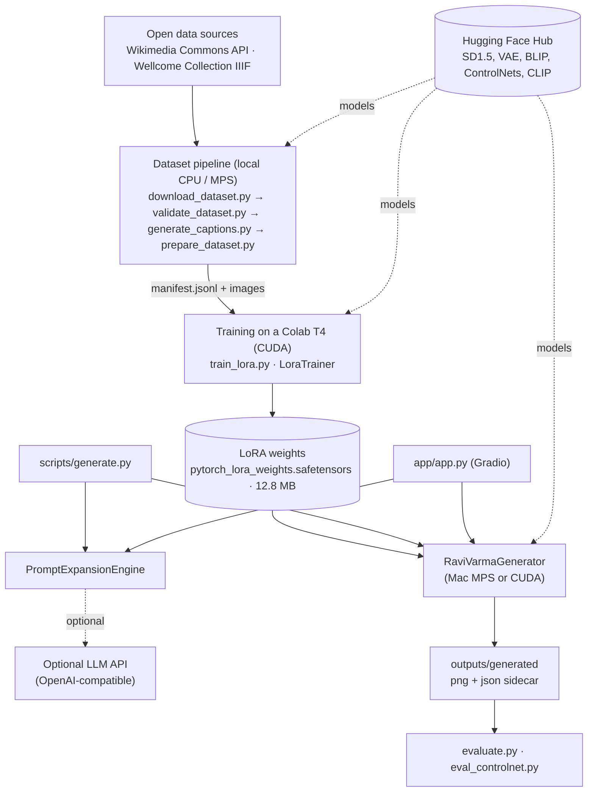

**How to read it:**
- Data flows left to right: **sources → dataset → training → weights → generation → evaluation**.
- Dashed arrows are network downloads or optional calls.
- **Two interfaces share one core.** `scripts/generate.py` and `app/app.py` both construct a `RaviVarmaGenerator` and a `PromptExpansionEngine`, so CLI and app behave identically.
- **The weights are the only hand-off between training and inference.** Training writes `checkpoints/lora/ravi_varma_v3/`; generation reads it through `configs/generation.yaml` → `model.lora_path`. Training on a T4 and generating on a Mac therefore needs only one 12.8 MB file to cross machines.
- **Evaluation reads files, not objects.** It consumes the images and `.json` sidecars written by generation, so any image the project produced can be re-scored later.

## 3.3 Module and component relationships

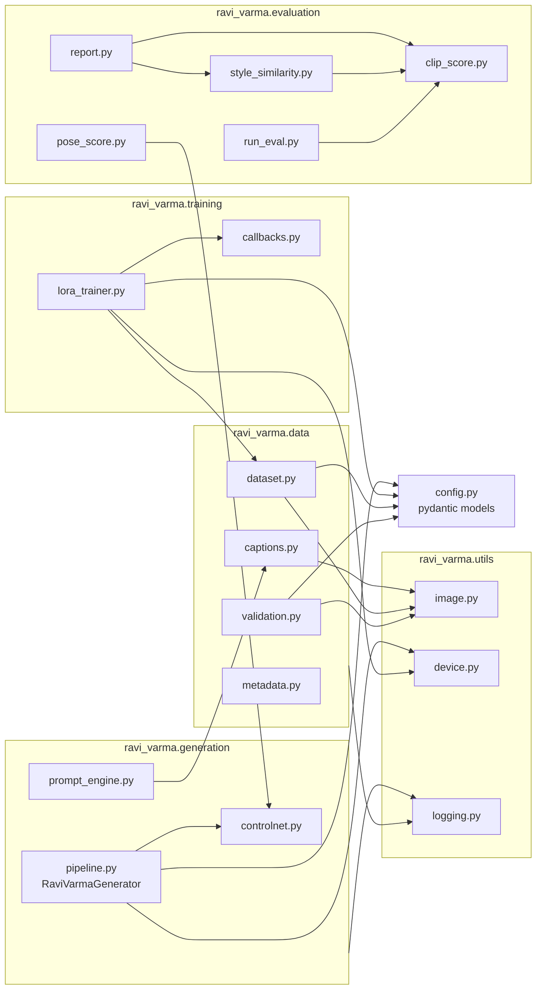

**Dependency rules (Implemented):**
- **`utils` depends on nothing project-specific.** `config.py` depends only on pydantic and YAML.
- **`data` never imports `training` or `generation`.** It can run without PyTorch: heavy imports are lazy (`captions.py`) or absent (`validation.py`). That's why validation and preparation work on a machine without the ML stack.
- **`generation` doesn't import `training`.** The only coupling is the weights file format.
- **`prompt_engine` imports `captions.clip_token_counter`.** Captions and prompts are both measured with the same tokenizer as the SD1.5 text encoder, so the 77-token rule is enforced identically at training time and generation time.
- **`pose_score` reuses the cached OpenPose detector** from `controlnet.py` (`_openpose_detector`), so the detector loads once per process.

## 3.4 The dataset pipeline

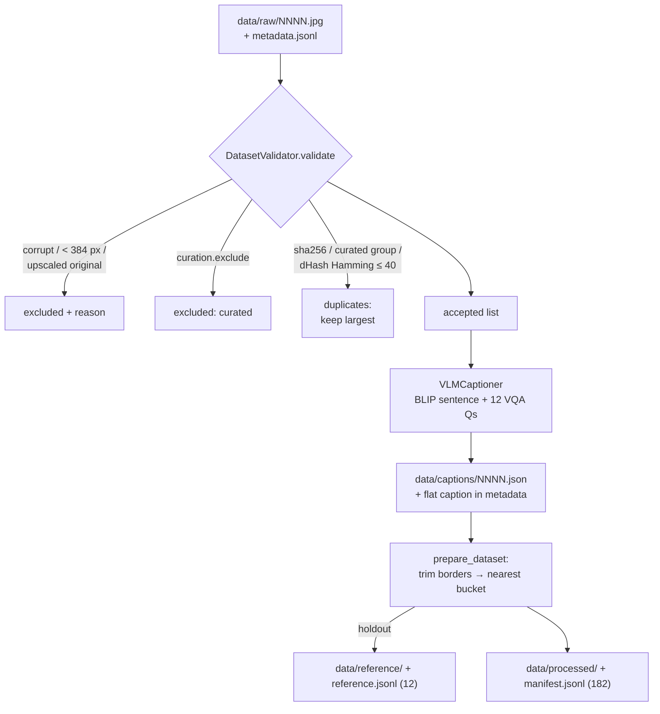

The same `DatasetValidator` runs inside `validate_dataset.py`, `generate_captions.py` and `prepare_dataset.py`
(**Confirmed**, module docstring). All three stages therefore agree on exactly which files are in the dataset; a
curation edit in `configs/dataset.yaml` propagates everywhere.

## 3.5 Training pipeline

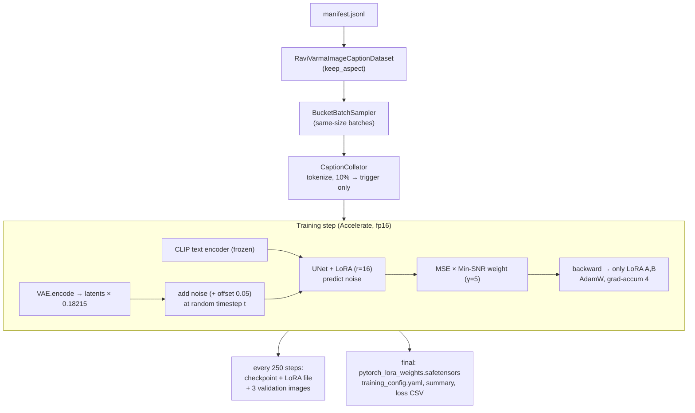

**Frozen vs trained:** the VAE, text encoder and UNet base weights are frozen and cast to fp16. Only the LoRA matrices
are trained, in fp32. `_apply_lora` asserts this: it raises if any trainable parameter name lacks "lora".

## 3.6 Inference: one loaded model, many pipelines

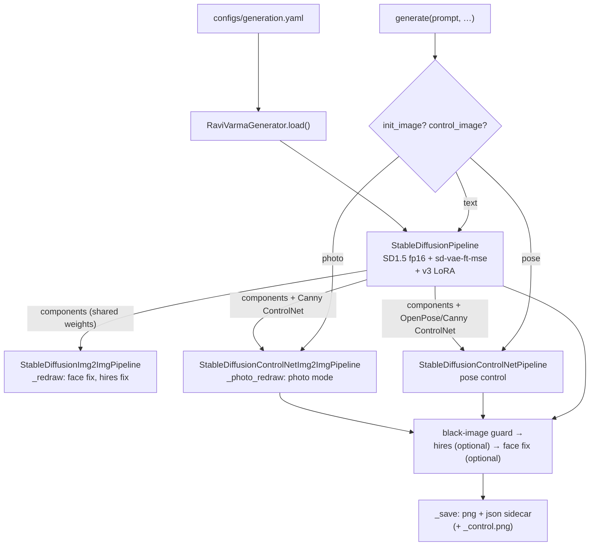

**The key design point:**
- SD1.5 is loaded **once**. Every other pipeline is assembled from `self._pipeline.components`, the same UNet (with the LoRA already injected), VAE and text encoder; only the small ControlNet is added.
- Without this, the original scaffold loaded a second full SD1.5 for ControlNet, which an 8 GB Mac cannot hold (**Confirmed**, the comment in `_load_controlnet_pipeline` and commit `737a8da`).
- ControlNet pipelines are cached per type in `self._controlnet_pipelines`.

## 3.7 External integrations

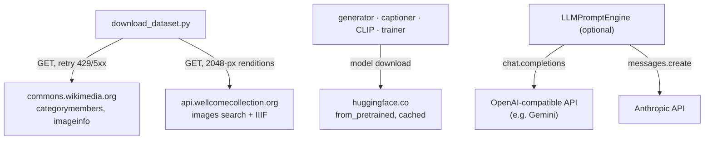

- **Wikimedia Commons.** Recursive category walk plus `imageinfo` queries for licence, original size and a 2048-px rendition. 429 responses honour `Retry-After` (`api_get`). Downloads sleep 2 s per file to stay under rate limits.
- **Wellcome Collection.** Image search, then the IIIF `info.json` for the original size. Only `pdm`, `cc-0` and `cc-by` licences are accepted, and the title must mention Varma (`download_wellcome`).
- **Hugging Face Hub.** All models are pulled with `from_pretrained` and cached locally; no token is needed, because all models are public.
- **LLM (optional).** Off unless `.env` sets `PROMPT_EXPANSION_PROVIDER`. Only scene text is sent; failures fall back to the local engine (`PromptExpansionEngine.expand`).

## 3.8 Deployment and environments

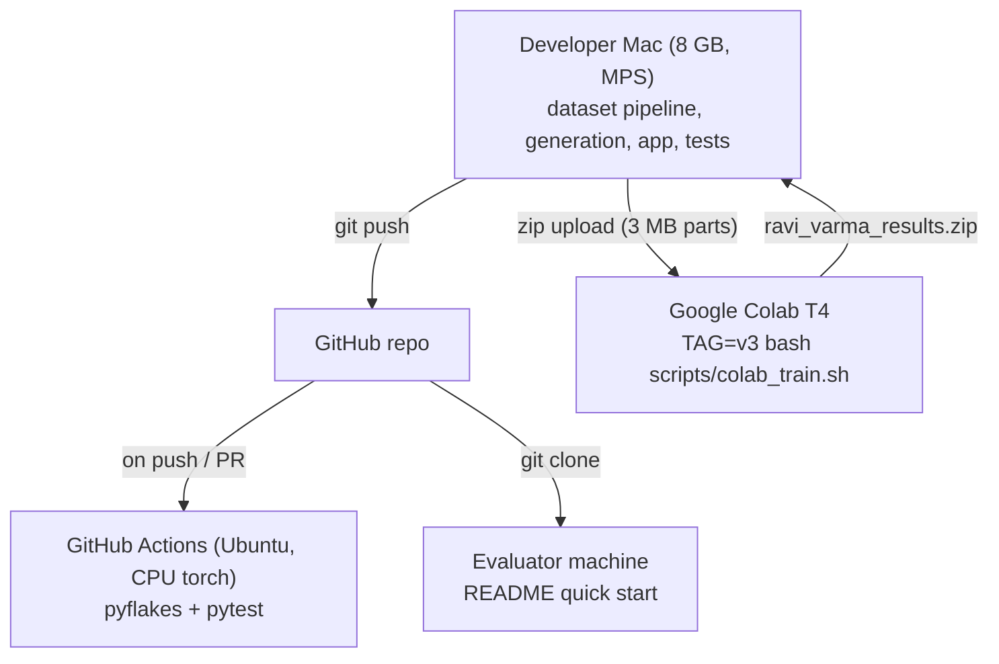

There is **no hosted deployment**. "Deployment" means three environments: the developer laptop, a Colab GPU for
training, and CI. The **proposed future architecture** (not implemented) would add a Hugging Face Space for a public
demo and the Hub for weights (§11).

## 3.9 Request lifecycle in the web app

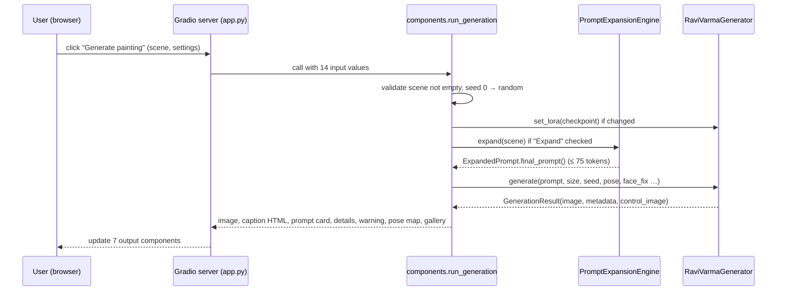

Each click runs synchronously in the Gradio worker. There is no streaming or progress callback; the user waits about
1–2 minutes on a Mac. Errors raised as `RuntimeError` are caught and shown as a warning instead of crashing the app.

# 4. Features

## 4.1 Feature inventory

| # | Feature | Status | Entry point |
|---|---|---|---|
| F1 | Dataset download with provenance | Implemented, used | `scripts/download_dataset.py` |
| F2 | Validation, curation and de-duplication | Implemented, tested | `scripts/validate_dataset.py`, `DatasetValidator` |
| F3 | BLIP + VQA captioning within 77 tokens | Implemented, tested, used | `scripts/generate_captions.py`, `VLMCaptioner` |
| F4 | Aspect-bucket preparation and hold-out split | Implemented, tested, used | `scripts/prepare_dataset.py`, `prepare_dataset` |
| F5 | Packaging and the one-command Colab run | Implemented, used | `scripts/package_dataset.py`, `scripts/colab_train.sh` |
| F6 | LoRA training with checkpoint / resume | Implemented, tested (tiny model), run on T4 | `scripts/train_lora.py`, `LoraTrainer` |
| F7 | Text → painting generation | Implemented, tested, used | `scripts/generate.py`, `RaviVarmaGenerator.generate` |
| F8 | Prompt expansion (lexicon + optional LLM) | Implemented, tested; no measured gain | `PromptExpansionEngine` |
| F9 | ControlNet pose / edge control | Implemented, evaluated | `--pose-image`, `_load_controlnet_pipeline` |
| F10 | Face fix | Implemented, tested | `--face-fix`, `_fix_faces`, `detect_faces` |
| F11 | Hires fix | Implemented; GPU > 8 GB only | `--hires-scale`, `_redraw` |
| F12 | Photo → Varma | Implemented, run on T4 and Mac | `--init-image`, `_photo_redraw`, app tab |
| F13 | Paired CLIP evaluation | Implemented, tested, used | `scripts/evaluate.py`, `evaluate_run` |
| F14 | Pose adherence (PCK) evaluation | Implemented, tested, used | `scripts/eval_controlnet.py`, `pose_pck` |
| F15 | Gradio web app (5 tabs) | Implemented, browser-tested | `app/app.py` |
| F16 | Checkpoint Hub | Implemented | `list_checkpoints`, `loss_chart_svg` |
| F17 | Logging with secret redaction | Implemented, tested | `setup_logging`, `_RedactSecretsFilter` |
| F18 | Continuous integration | Implemented, passing | `.github/workflows/tests.yml` |
| F19 | SDXL training | **Not implemented** (scaffold only) | `configs/lora_sdxl.yaml` |

Each feature below is described with the same 18 points so they can be compared:
1. purpose
2. user value
3. entry point
4. inputs
5. outputs
6. main code
7. flow
8. data touched
9. configuration
10. dependencies
11. error handling
12. edge cases
13. performance
14. security / privacy
15. tests
16. status / evidence
17. limitations
18. improvements

---

## F1. Dataset download with provenance

| Point | Detail |
|---|---|
| 1 Purpose | Fetch public-domain Ravi Varma reproductions with their licence and source recorded |
| 2 User value | A legally clean, reproducible corpus; anyone can rebuild it with `--from-metadata` |
| 3 Entry | `python scripts/download_dataset.py --source commons|wellcome --limit N --min-side 800`; `make download` |
| 4 Inputs | Root Wikimedia category (`--category`), source, limit, minimum original side |
| 5 Outputs | `data/raw/NNNN.jpg`, one JSON line per file in `data/metadata/metadata.jsonl` (title, year, licence, source URL, original width / height) |
| 6 Main code | `api_get`, the category walk, `download_wellcome`, `next_free_index` |
| 7 Flow | Walk the category tree → query `imageinfo` (licence, size, 2048-px rendition URL) → skip known files and small originals → download → append metadata |
| 8 Data | `data/raw/`, `data/metadata/metadata.jsonl` |
| 9 Config | CLI flags only |
| 10 Dependencies | `requests`; Wikimedia Commons API; Wellcome catalogue + IIIF |
| 11 Errors | 429 / 5xx retried, honouring `Retry-After`; failed files are logged and skipped |
| 12 Edge cases | Re-runs never overwrite: `next_free_index` continues numbering, and already-recorded source URLs are skipped |
| 13 Performance | Sleeps about 2 s per file for rate limits; around 10 minutes per 300 files (**Inferred** from the sleep) |
| 14 Security | Public data only; a descriptive User-Agent; no credentials |
| 15 Tests | None directly (network); its outputs are covered by the validation tests |
| 16 Status | Used: 300 metadata records |
| 17 Limitations | The Commons category tree also contains non-paintings (stamps, photos); curation removes them (F2) |
| 18 Improvements | Cache API responses; add tests against a recorded HTTP fixture |

## F2. Validation, curation and de-duplication

| Point | Detail |
|---|---|
| 1 Purpose | Decide exactly which raw files may be trained on, with a reason for every exclusion |
| 2 User value | Garbage-in protection: no corrupt, upscaled, duplicated or non-painting images |
| 3 Entry | `python scripts/validate_dataset.py` (`--manifest` checks the prepared set); `make validate` |
| 4 Inputs | `data/raw/`, `metadata.jsonl`, `configs/dataset.yaml` (`validation`, `curation`) |
| 5 Outputs | `ValidationReport` (accepted, excluded with reasons, duplicate groups); `data/metadata/validation_report.json` |
| 6 Main code | `DatasetValidator.validate`, `perceptual_hash`, `safe_open_image`, `ValidationConfig`, `CurationConfig` |
| 7 Flow | Open each file safely → reject corrupt or < 384 px (checked against the **original** size) → curated exclusions → exact SHA-256 duplicates → curated duplicate groups → dHash near-duplicates (Hamming ≤ 40 of 256 bits) → keep the largest copy |
| 8 Data | Reads raw and metadata; writes the report only |
| 9 Config | `min_resolution`, `near_duplicate_threshold: 40`, `curation.exclude`, `curation.duplicate_groups`, `holdout` |
| 10 Dependencies | Pillow, NumPy |
| 11 Errors | Unreadable files become `DatasetIssue` entries; nothing crashes the run |
| 12 Edge cases | Decompression-bomb limit; files missing metadata fall back to the local size |
| 13 Performance | Near-duplicate search compares every pair, O(n²); fine for 300 files, slow for 30,000 |
| 14 Security | Pillow bomb protection (`safe_open_image`) |
| 15 Tests | `tests/test_curation.py` (13), `tests/test_dataset.py` (11) |
| 16 Status | 194 accepted (182 train + 12 hold-out); 26 upscaled copies caught |
| 17 Limitations | Perceptual hashing misses heavily cropped re-scans; those needed the curated groups |
| 18 Improvements | A BK-tree or LSH for near-duplicate search; CLIP-embedding duplicate suggestions |

## F3. Captioning (BLIP + VQA, 77-token budget)

| Point | Detail |
|---|---|
| 1 Purpose | Describe each painting's *content* so the trigger token learns only the *style* |
| 2 User value | Better prompt following and less leakage of frames or printed text into the style |
| 3 Entry | `python scripts/generate_captions.py`; `make captions`; `--reflatten` rebuilds flat captions without models |
| 4 Inputs | Accepted images, metadata titles, `caption_notes` in `configs/dataset.yaml` |
| 5 Outputs | `data/captions/NNNN.json` (sentence, VQA answers, palette); a flat caption in metadata |
| 6 Main code | `VLMCaptioner`, `assemble_caption`, `as_flat_caption`, `_short_title`, `measure_visual_properties`, `clip_token_counter` |
| 7 Flow | BLIP-large sentence → 12 BLIP-VQA questions (clothing, colour, jewellery, posture, action, expression, held object, setting, time of day…) → gate answers (drop "none", meta and anachronistic words) → add a measured palette, title and note → trim lowest-priority parts until ≤ 69 tokens (plus a 6-token trigger prefix) |
| 8 Data | `data/captions/`, `metadata.jsonl` |
| 9 Config | `--vlm-model`, `--vqa-model`, `caption_notes` |
| 10 Dependencies | Transformers BLIP models; the SD1.5 CLIP tokenizer |
| 11 Errors | Refuses to silently fall back to placeholder captions (a v2 bug, **Confirmed** in `docs/RESULTS.md`); `--no-vlm` is an explicit opt-in |
| 12 Edge cases | Long titles shortened; `--overwrite` needed to recaption |
| 13 Performance | About 1–2 s per image on MPS (**Inferred**) |
| 14 Security | Local models only |
| 15 Tests | `tests/test_captions.py` (10): token budget, filters, assembly |
| 16 Status | 194 sidecars |
| 17 Limitations | BLIP misreads mythological identities; the VQA answers are generic |
| 18 Improvements | A stronger VLM (e.g. Florence-2 / Qwen-VL); human review of the hold-out captions |

## F4. Aspect-bucket preparation and hold-out

| Point | Detail |
|---|---|
| 1 Purpose | Produce training-ready images without cropping heads and feet off tall canvases |
| 2 User value | Whole figures in training → whole figures in output |
| 3 Entry | `python scripts/prepare_dataset.py`; `make prepare` |
| 4 Inputs | The validator's accepted list and captions |
| 5 Outputs | `data/processed/*.png` + `manifest.jsonl` (182); `data/reference/` + `reference.jsonl` (12) |
| 6 Main code | `prepare_dataset`, `load_manifest`, `check_manifest`, border trimming in `utils/image.py` |
| 7 Flow | Trim scanner borders → pick the bucket nearest the aspect ratio with ~512² area (e.g. 448×640) → resize → write the image and a manifest row; hold-out files go to `data/reference/` |
| 8 Data | `data/processed/`, `data/reference/` |
| 9 Config | `target_resolution: 512`, `aspect_bucketing: true`, `holdout` list |
| 10 Dependencies | Pillow, NumPy |
| 11 Errors | `check_manifest` reports missing files, empty captions and over-long captions |
| 12 Edge cases | Extremely wide images snap to the most extreme bucket |
| 13 Performance | Seconds |
| 14 Security | n/a |
| 15 Tests | `tests/test_dataset.py` |
| 16 Status | 182 / 12 split in the repo |
| 17 Limitations | A fixed 12-image hold-out; evaluation variance is high |
| 18 Improvements | Stratify the hold-out by subject (portrait / mythology / group) |

## F5. Packaging and the Colab run

| Point | Detail |
|---|---|
| 1 Purpose | Move the prepared dataset to a free GPU and run the whole training + evaluation sequence with one command |
| 2 User value | Repeatable training without a local GPU |
| 3 Entry | `make package-data` → `dist/ravi_varma_dataset.zip`; in Colab `TAG=v3 bash scripts/colab_train.sh` |
| 4 Inputs | `data/processed/`, `data/reference/`, the repo |
| 5 Outputs | `checkpoints/lora/ravi_varma_<TAG>/`, sample images, evaluations, `ravi_varma_results.zip` |
| 6 Main code | `scripts/package_dataset.py`, `scripts/colab_train.sh`, `requirements-colab.txt` |
| 7 Flow | Install pinned packages → smoke test → full training → samples (with and without LoRA) → evaluation → hires samples → zip |
| 8 Data | Writes only under `outputs/` and `checkpoints/` |
| 9 Config | `TAG`, `configs/lora_sd15.yaml` |
| 10 Dependencies | A Colab T4 runtime (pinned to 2026.07) |
| 11 Errors | `set -e`; the smoke test fails fast before the hour-long run |
| 12 Edge cases | Re-running with the same `TAG` resumes from checkpoints |
| 13 Performance | About 58 min of training for 1500 steps on a T4 (**Measured**: 3492.8 s in `training_summary.json`) |
| 14 Security | No secrets needed; the dataset zip contains only public-domain images |
| 15 Tests | Not unit-tested (shell); exercised by real runs |
| 16 Status | Used for v2 and v3 |
| 17 Limitations | Colab sessions expire; manual upload and download |
| 18 Improvements | Push weights to the Hugging Face Hub from the notebook |

## F6. LoRA training

| Point | Detail |
|---|---|
| 1 Purpose | Teach SD1.5 the `<rvvarma>` style by training small low-rank adapters on the UNet attention layers |
| 2 User value | A 12.8 MB style file instead of a 4 GB model |
| 3 Entry | `python scripts/train_lora.py --config configs/lora_sd15.yaml [--smoke-test]`; `make train` |
| 4 Inputs | `manifest.jsonl`, processed images, config |
| 5 Outputs | `pytorch_lora_weights.safetensors`, `checkpoint-250…1500/`, `training_config.yaml`, `training_summary.json`, `loss_history.csv`, validation images |
| 6 Main code | `LoraTrainer` (`_load_models`, `_apply_lora`, `train`), `CaptionCollator`, `BucketBatchSampler`, `_min_snr_weights`, `CheckpointManager`, `ValidationImageCallback`, `LossLogger` |
| 7 Flow | See §3.5: encode → noise (+ offset) → UNet+LoRA predicts noise → Min-SNR-weighted MSE → update LoRA only |
| 8 Data | Reads the dataset; writes `checkpoints/` and `outputs/logs/` |
| 9 Config | rank 16, alpha 16, dropout 0.05, `to_q/k/v/out.0`, lr, 1500 steps, grad-accum 4, fp16, Min-SNR γ 5, noise offset 0.05, caption dropout 0.1 |
| 10 Dependencies | PyTorch, Diffusers, PEFT, Accelerate, CUDA |
| 11 Errors | `check_ml_stack_available`; SDXL raises `NotImplementedError`; `_apply_lora` asserts that only LoRA parameters are trainable |
| 12 Edge cases | Resume from the latest checkpoint; the warm-up counted in optimizer steps (a v2 fix) |
| 13 Performance | ~58 min on a T4; 3.2 M trainable parameters |
| 14 Security | Weights saved as safetensors (no pickle) |
| 15 Tests | `tests/test_training.py` (5) on the 1 MB tiny SD model: train + checkpoint export + resume, exported LoRA loads into a pipeline, only LoRA parameters trainable, v3 options run, caption dropout keeps only the trigger |
| 16 Status | v3 trained: 182 images, 1500 steps, mean loss of the last 50 steps 0.118 |
| 17 Limitations | The loss doesn't track style; no rank ablation |
| 18 Improvements | Rank 8 / 32 ablation; separate the data changes from the training changes |

## F7. Text → painting

| Point | Detail |
|---|---|
| 1 Purpose | Render a prompt in Varma's style |
| 2 User value | The core demo |
| 3 Entry | `scripts/generate.py --prompt …`; app **Generate** tab |
| 4 Inputs | Prompt, negative prompt, seed(s), steps, guidance, size, LoRA scale, LoRA path |
| 5 Outputs | `outputs/generated/<time>_<hash>.png` + `.json` sidecar |
| 6 Main code | `RaviVarmaGenerator.load / generate / _save`, `resolve_lora_weights`, `SCHEDULER_MAP` |
| 7 Flow | Load SD1.5 fp16 + VAE + LoRA once → add the trigger if missing → a CPU `torch.Generator(seed)` → run the pipeline → black-image guard → optional hires / face fix → save |
| 8 Data | Writes `outputs/generated/` |
| 9 Config | `configs/generation.yaml`: model, `lora_path` (v3), `vae`, scheduler `dpmsolver_multistep`, steps 30, guidance 7.5, **512×512** default size (the app defaults to 448×640 and the docs pass `--width 448 --height 640`), negative prompt, hardware options |
| 10 Dependencies | Diffusers, the HF Hub on first run |
| 11 Errors | `parser.error` for an empty prompt or missing files; a NaN / black image raises a clear `RuntimeError` |
| 12 Edge cases | Seed 0 in the app means random; `--no-lora` for baselines; `--skip-existing` for prompt suites |
| 13 Performance | ~1.5–2.5 min per image on an 8 GB Mac (139 s **Measured** in the README screenshot); ~5 s on a T4 |
| 14 Security | Local only |
| 15 Tests | `tests/test_generation.py` (24, using the tiny model) |
| 16 Status | Used for all results |
| 17 Limitations | Hands, crowds, complex actions |
| 18 Improvements | Progress callback in the app; make 448×640 the config default to match the app |

## F8. Prompt expansion (Milestone 3)

| Point | Detail |
|---|---|
| 1 Purpose | Turn a story sentence into a prompt with each character's standard iconography, within 75 tokens |
| 2 User value | Users needn't know that Krishna is "blue-skinned with a peacock-feather crown" |
| 3 Entry | `--expand` (`--dry-run` prints only); the app's "Expand" checkbox |
| 4 Inputs | Scene text; `configs/epic_lexicon.yaml` (27 characters, 18 places) |
| 5 Outputs | `ExpandedPrompt` (trigger, scene, looks, environment, style cues) → `final_prompt()` |
| 6 Main code | `LocalPromptEngine`, `LLMPromptEngine`, `PromptExpansionEngine`, `_find_characters`, `_extract_environment` |
| 7 Flow | Find characters by name or alias → add looks and setting → optional LLM adds short phrases (JSON mode) → assemble by priority, dropping the lowest first until ≤ 75 tokens |
| 8 Data | Reads the lexicon |
| 9 Config | `.env`: `PROMPT_EXPANSION_PROVIDER`, `OPENAI_BASE_URL`, model name, key |
| 10 Dependencies | Optional `openai` / `anthropic` SDK |
| 11 Errors | Any LLM failure falls back to the local engine |
| 12 Edge cases | The user's scene is always kept verbatim; the negative prompt is never replaced |
| 13 Performance | Local: milliseconds. LLM: about 1 s network |
| 14 Security | Only scene text leaves the machine; keys read from env and never logged |
| 15 Tests | `tests/test_prompt_engine.py` (18) |
| 16 Status | **Measured:** CLIP raw 0.326, local 0.317, LLM 0.320 on 4 scenes: no gain |
| 17 Limitations | Cannot fix complex actions |
| 18 Improvements | Regional prompting per character; a larger evaluation set |

## F9. ControlNet pose / edge control (Milestone 4)

| Point | Detail |
|---|---|
| 1 Purpose | Fix *where* figures are while the LoRA decides *how they look* |
| 2 User value | Correct figure count and pose in multi-figure scenes |
| 3 Entry | `--pose-image ref.jpg --controlnet-type openpose|canny`; the app's pose reference box |
| 4 Inputs | Reference image, type, strength |
| 5 Outputs | Image + `*_control.png` (skeleton or edge map) |
| 6 Main code | `make_conditioning_image`, `make_canny_conditioning`, `OpenPoseDetector`, `_load_controlnet_pipeline` |
| 7 Flow | Crop the reference to the output aspect → extract the skeleton / edges → build a ControlNet pipeline from shared components → generate |
| 8 Data | Writes the control map next to the output |
| 9 Config | `controlnet:` models and default strength in `generation.yaml` |
| 10 Dependencies | `controlnet-aux`, OpenCV, the lllyasviel ControlNet weights |
| 11 Errors | No person detected → an empty skeleton map, and the image is still generated (**Inferred** from the code path; there is no explicit warning) |
| 12 Edge cases | Aspect mismatch handled by cropping |
| 13 Performance | +~1.4 GB memory; ~1.5–2 min on the Mac |
| 14 Security | Local |
| 15 Tests | `tests/test_generation.py`: Canny map keeps the size and is greyscale-as-RGB; no test loads a real ControlNet (too large for CI) |
| 16 Status | **Measured:** PCK 0.17 → 0.86; style 0.704 → 0.692 |
| 17 Limitations | OpenPose fails on crowded paintings; hands are not controlled |
| 18 Improvements | DWPose; multi-ControlNet (pose + depth) |

## F10. Face fix

| Point | Detail |
|---|---|
| 1 Purpose | Sharpen small faces (≈40 px at 448×640) that the VAE cannot render cleanly |
| 2 User value | Clear eyes and lips without a bigger model |
| 3 Entry | `--face-fix`; on by default in the app |
| 4 Inputs | The generated image, the prompt |
| 5 Outputs | The image with redrawn faces; face boxes in the metadata |
| 6 Main code | `detect_faces` (Haar + eye check), `_fix_faces`, `_redraw` |
| 7 Flow | Detect faces → keep boxes with an eye inside → crop with margin → img2img at 512 px, strength 0.4, prompt + "detailed face" → paste back with a feathered oval mask |
| 8 Data | In memory |
| 9 Config | `generation.face_fix` (pydantic default `false`, not set in `generation.yaml`); `--face-fix` turns it on; the app's checkbox is on by default |
| 10 Dependencies | OpenCV Haar cascades |
| 11 Errors | No faces → unchanged image |
| 12 Edge cases | The eye check prevents redrawing medals or cloth folds as faces |
| 13 Performance | +~20 s per face on the Mac |
| 14 Security | n/a |
| 15 Tests | `test_face_fix_redraws_and_blends_only_the_face` (stubbed detector and redraw) |
| 16 Status | Visual evidence: `outputs/evaluations/face_fix_compare.jpg` (not measured) |
| 17 Limitations | Misses profiles and small faces in crowds |
| 18 Improvements | A DNN face detector; measure with a face-quality metric |

## F11. Hires fix

| Point | Detail |
|---|---|
| 1 Purpose | Higher resolution and detail: upscale ×1.5, then redraw at strength 0.4 |
| 2 User value | Sharper texture for presentation images |
| 3 Entry | `--hires-scale 1.5` |
| 4–5 I/O | Generated image → 672×960 image |
| 6 Main code | `generate(hires_scale=…)`, `_redraw` |
| 7 Flow | Lanczos upscale → img2img over the whole image with the same prompt and seed |
| 8–10 | In memory; `generation.hires_scale` (default 1.0 = off); no extra dependency |
| 11 Errors | Out-of-memory on 8 GB (documented, not caught) |
| 12 Edge cases | Sizes rounded to multiples of 8 |
| 13 Performance | ~2.3× the pixels; needs > 8 GB |
| 14 Security | n/a |
| 15 Tests | No dedicated test |
| 16 Status | Run on the T4 (`outputs/evaluations/v2_v3_hires_compare.jpg`) |
| 17 Limitations | Not usable on the target Mac |
| 18 Improvements | Tiled VAE decoding to fit 8 GB |

## F12. Photo → Varma

| Point | Detail |
|---|---|
| 1 Purpose | Repaint a user's photo in Varma's style while keeping its composition and likeness |
| 2 User value | The most intuitive demo |
| 3 Entry | App **Photo → Varma** tab; `--init-image photo.jpg --strength 0.55` |
| 4 Inputs | Photo, optional description, strength |
| 5 Outputs | Painting + edge map (`*_control.png`); the photo itself is **not** saved |
| 6 Main code | `_photo_redraw`, `_load_controlnet_pipeline("canny", img2img=True)`, `run_photo_to_painting` |
| 7 Flow | Crop to 2:1 if more extreme → resize to the ~448×640 area → Canny edges → ControlNet-img2img with a neutral prompt → face fix |
| 8 Data | Writes outputs only |
| 9 Config | Strength default 0.55 |
| 10 Dependencies | The Canny ControlNet |
| 11 Errors | Missing photo → a UI warning |
| 12 Edge cases | Facial-hair terms are stripped from the negative prompt so a real moustache survives |
| 13 Performance | ~15 s on a T4; on the Mac, needs other apps closed |
| 14 Security | Processed locally; no upload anywhere |
| 15 Tests | `test_photo_to_painting_uses_img2img_at_training_size`, `test_photo_mode_keeps_facial_hair_out_of_the_negative_prompt`, `test_photo_of_any_shape_gets_a_bounded_size` |
| 16 Status | `outputs/evaluations/photo_to_varma.jpg` |
| 17 Limitations | Masks and modern costumes get reinterpreted; small round objects can become faces at high strength |
| 18 Improvements | IP-Adapter for identity; a depth ControlNet |

## F13. Paired CLIP evaluation

| Point | Detail |
|---|---|
| 1 Purpose | Measure the style shift against the base model honestly |
| 2 User value | Numbers that can be defended |
| 3 Entry | `python scripts/evaluate.py --input … --baseline …`; `make evaluate` |
| 4 Inputs | Generated images + sidecars, base images, `data/reference/`, training manifest |
| 5 Outputs | `summary.json`, per-image CSV, contact sheet in `outputs/evaluations/<run>/` |
| 6 Main code | `evaluate_run`, `_score_directory`, `_paired`, `text_image_similarity`, `embed_images` |
| 7 Flow | Embed references and training images once → per image: prompt adherence (trigger stripped), mean / top-3 style, nearest training similarity → diversity per prompt → paired deltas |
| 8 Data | Read-only, except the outputs |
| 9 Config | CLI flags |
| 10 Dependencies | open_clip ViT-B/32 |
| 11 Errors | CLIP missing → a clear message; affected tests are skipped |
| 12 Edge cases | Images without a sidecar → no prompt-adherence score |
| 13 Performance | Seconds on CPU for 30 images |
| 14 Security | n/a |
| 15 Tests | `tests/test_evaluation.py` (14) |
| 16 Status | **Measured:** style 0.669 → 0.701 (12/15 pairs), top-3 0.734 → 0.770, adherence 0.328 → 0.330, diversity 0.106 → 0.092, max training similarity 0.898 |
| 17 Limitations | CLIP is a coarse style judge; only 15 pairs |
| 18 Improvements | A human study; Gram-matrix or CSD style metrics; more seeds |

## F14. Pose adherence (PCK)

| Point | Detail |
|---|---|
| 1 Purpose | Measure whether ControlNet output matches the reference pose |
| 3 Entry | `python scripts/eval_controlnet.py render|report` |
| 5 Outputs | `outputs/evaluations/m4_controlnet/summary.json`, `grid.jpg` |
| 6 Main code | `pose_keypoints`, `_person_pck`, `pose_pck` |
| 7 Flow | OpenPose on the reference and the output → match people → share of reference joints within 0.1 of the image size |
| 11 / 12 | No person in the reference → `None` (nothing to compare); a reference person with no generated match → 0 |
| 15 Tests | `test_identical_pose_scores_one_and_missing_person_zero`, `test_partial_match_and_best_person_chosen` |
| 16 Status | **Measured:** LoRA 0.17, OpenPose 0.86, Canny 0.86 (6 references, seed 42) |
| 17 Limitations | It depends on OpenPose reading paintings; small sample |
| 2, 4, 8–10, 13, 14, 18 | Same as F9 and F13 |

## F15. Gradio web app

| Point | Detail |
|---|---|
| 1 Purpose | A demo UI over the same generator |
| 3 Entry | `python app/app.py [--server-port 7860] [--share]` → http://127.0.0.1:7860 |
| 4 / 5 | Tabs: Generate, Photo → Varma, Checkpoint Hub, Evaluation, About |
| 6 Main code | `build_app`, `_theme`, `run_generation`, `run_photo_to_painting`, `recent_images`, `app/styles.css` |
| 7 Flow | §3.9 |
| 11 Errors | `_require_gradio` gives a friendly message; `RuntimeError` is shown as a warning |
| 13 Performance | One model in memory; requests run one at a time |
| 14 Security | Bound to localhost; `--share` makes it public, so use it deliberately |
| 15 Tests | `test_checkpoint_hub_lists_steps_with_mean_loss`; the UI itself was browser-tested by hand (screenshots in `docs/screenshots/`), with no automated UI test |
| 17 Limitations | No progress bar; single user |
| 18 Improvements | A progress callback; a Hugging Face Space |

## F16. Checkpoint Hub

| Point | Detail |
|---|---|
| 1 Purpose | Compare checkpoints 250–1500 and switch the LoRA live |
| 6 Main code | `list_checkpoints`, `checkpoint_table_html`, `loss_chart_svg`, `RaviVarmaGenerator.set_lora` |
| 7 Flow | Scan `checkpoints/lora/*/checkpoint-*` → table of step, mean loss, size → inline SVG loss chart → the dropdown feeds `set_lora` |
| 17 Limitations | Only the final v3 weights ship with the repo; intermediate checkpoints exist only where training ran |

## F17. Logging with secret redaction

| Point | Detail |
|---|---|
| 1 Purpose | Consistent logs; never write tokens to logs |
| 6 Main code | `setup_logging`, `get_logger`, `_RedactSecretsFilter` |
| 7 Flow | Any message containing a sensitive key fragment (token, api_key, …) next to `=` or `:` is replaced wholesale |
| 15 Tests | `tests/test_logging.py` (4) |
| 17 Limitations | Best-effort and pattern-based; a bare secret without a key name is not caught |

## F18. Continuous integration

| Point | Detail |
|---|---|
| 1 Purpose | Every push runs lint and tests on a clean Ubuntu machine |
| 6 Main code | `.github/workflows/tests.yml` |
| 7 Flow | CPU torch → requirements → pyflakes → pre-fetch the tiny SD model and SD1.5 tokenizer → `pytest -q -rs` |
| 16 Status | Passing; 119 passed, 2 skipped (CLIP weights cached) |
| 17 Limitations | No GPU tests; nothing checks real image quality |

## F19. SDXL training (not implemented)

`configs/lora_sdxl.yaml` exists, but `LoraTrainer._load_models` raises `NotImplementedError` for SDXL: scaffolding
from the proposal, **not a feature**. It would need two text encoders, time-id conditioning and a ≥ 24 GB GPU (D-01).

# 5. Decision register

**Sources.** Each decision cites its evidence. `docs/DECISIONS.md` records the team's stated reasons, but it was
written *after* most of the choices were made (it was added late in the project), so it is a record of the
rationale, not a contemporaneous log. Where neither that document nor a commit message gives a reason, the rationale
is marked **Inferred**.

**Confidence scale:**
- **High:** documented, and the code or measurements agree.
- **Medium:** documented, but not measured.
- **Low:** inferred.

## Register summary

| ID | Decision | Confidence |
|---|---|---|
| D-01 | SD1.5 as the base model, not SDXL | High |
| D-02 | LoRA instead of full fine-tuning / DreamBooth / textual inversion | High |
| D-03 | Rank 16, alpha 16, attention projections only | Medium |
| D-04 | A trigger token `<rvvarma>` in every caption | High |
| D-05 | Only Wikimedia Commons + Wellcome Collection as sources | High |
| D-06 | Validate resolution against the original scan | High |
| D-07 | Aggressive de-duplication (keep the sharpest copy) | High |
| D-08 | Keep the chromolithograph prints, tagged | Medium |
| D-09 | Hold out 12 paintings; no validation split | Medium |
| D-10 | Aspect-ratio buckets | High |
| D-11 | Name artefacts in captions; template BLIP + VQA captions in 77 tokens | High |
| D-12 | Train on Colab; pinned runtime; smoke test first | High |
| D-13 | Share one loaded model across all pipelines | High |
| D-14 | Mac settings: fp16, no attention slicing, CPU seeds, `empty_cache` | High |
| D-15 | Fine-tuned VAE as decoder | Medium |
| D-16 | v3 training additions: Min-SNR, noise offset, caption dropout | Medium |
| D-17 | Local lexicon first, LLM optional, priority assembly | High |
| D-18 | OpenPose as the main control; PCK as its metric | High |
| D-19 | Face fix as a second pass; hires fix only on GPU | Medium |
| D-20 | Photo mode = img2img + Canny ControlNet lock | High |
| D-21 | Gradio, styled from a Figma design | Medium |
| D-22 | Paired, held-out CLIP evaluation; report null results | High |
| D-23 | pydantic config models with defaults | Low |
| D-24 | Ship the final 12.8 MB LoRA in git | High |

---

### D-01 SD1.5 as the base model

| Field | Content |
|---|---|
| Decision | Fine-tune `stable-diffusion-v1-5/stable-diffusion-v1-5` |
| Evidence | `configs/lora_sd15.yaml`; SDXL raises `NotImplementedError` in `LoraTrainer._load_models`; DECISIONS §1.1 |
| Problem | Hardware: a free T4 for training, an 8 GB Mac for generation |
| Rationale | SD1.5 trains in ~1 h on a T4 and generates in ≈3.5 GB; SDXL needs ~3× the memory. Mature SD1.5 ControlNets exist |
| Alternatives | SDXL; DiT-based models (SD3, Flux); training from scratch |
| Trade-offs | ~512 px native resolution → soft faces in full-body shots |
| Consequences | The face fix and hires fix were needed (D-19) |
| Reconsider when | A ≥ 24 GB GPU is available for training *and* inference |
| Confidence | High |

### D-02 LoRA instead of full fine-tuning

| Field | Content |
|---|---|
| Decision | Train PEFT LoRA adapters only; freeze the 860 M UNet |
| Evidence | `_apply_lora` asserts that only LoRA parameters are trainable; a 12.8 MB weights file; DECISIONS §1.2 |
| Problem | 182 images would be memorised by a full fine-tune |
| Rationale | 3.2 M parameters (0.37 %); can be switched on and off and scaled |
| Alternatives | Full fine-tune, DreamBooth, textual inversion |
| Trade-offs | Lower capacity, so a subtle style may be under-learned |
| Consequences | **Measured:** max training-image similarity 0.898 < 0.95, so no copying |
| Reconsider when | Thousands of images are available |
| Confidence | High |

### D-03 Rank 16, alpha 16, attention only

| Field | Content |
|---|---|
| Decision | `r=16, alpha=16, dropout=0.05`, targets `to_q, to_k, to_v, to_out.0` |
| Evidence | `training_summary.json`; DECISIONS §1.3 |
| Problem | Choosing the capacity |
| Rationale | A common middle ground; α/r = 1 keeps the update scale neutral; cross-attention ties text to image |
| Alternatives | r 4 / 8 / 32 / 64; adding feed-forward and conv layers (LoCon) |
| Trade-offs | **Not measured.** No ablation was run |
| Consequences | Results can't say whether another rank would be better |
| Reconsider when | Time for a 3-run ablation (~3 GPU-hours) |
| Confidence | Medium |

### D-04 Trigger token

| Field | Content |
|---|---|
| Decision | Every caption starts with `<rvvarma>, `; generation adds it if missing |
| Evidence | `CaptionCollator`, `test_trigger_token_added_once`, DECISIONS §1.4 |
| Problem | Separating style from content |
| Rationale | Whatever the captions don't describe gets attached to the only word present in every caption |
| Alternatives | No trigger (the style is always on); a rare real word (e.g. "sks") |
| Trade-offs | CLIP splits it into 5 tokens, costing budget |
| Consequences | A clean on/off comparison; caption dropout (D-16) strengthens it |
| Reconsider when | Never, for this design |
| Confidence | High |

### D-05 Data sources

| Field | Content |
|---|---|
| Decision | Wikimedia Commons + Wellcome Collection only |
| Evidence | `download_dataset.py`; licence field in `metadata.jsonl`; DECISIONS §2.1 |
| Problem | Legally usable, high-resolution images with provenance |
| Rationale | Open APIs, per-image licences, public domain (Varma died in 1906). Google Arts & Culture's terms forbid downloading; other museum APIs had no relevant works |
| Alternatives | Scraping galleries; Google Arts & Culture; museum APIs |
| Trade-offs | Variable scan quality; prints mixed with oils |
| Consequences | D-06, D-07 and D-08 were needed |
| Reconsider when | A museum releases high-resolution open scans |
| Confidence | High |

### D-06 Resolution checked against the original

| Field | Content |
|---|---|
| Decision | Validate `source_width/height`, not the local file size |
| Evidence | `DatasetValidator`; DECISIONS §2.2; commit history (v2) |
| Problem | 26 files were upscaled to exactly 384 px from originals as small as 200 px |
| Rationale | Upscaling adds blur, not detail |
| Alternatives | A blur / sharpness metric |
| Trade-offs | Needs metadata at download time |
| Consequences | The second download used `--min-side 800`; median short side 2,400 px for the new images |
| Reconsider when | — |
| Confidence | High |

### D-07 De-duplication

| Field | Content |
|---|---|
| Decision | SHA-256 + curated groups + dHash ≤ 40; keep the largest copy |
| Evidence | `configs/dataset.yaml` (`duplicate_groups`); `tests/test_curation.py`; DECISIONS §2.4 |
| Problem | Up to 7 copies of one painting (the Saraswati oleograph) |
| Rationale | Duplicates are learned several times as strongly, which reduces variety |
| Alternatives | Exact hash only; CLIP clustering alone |
| Trade-offs | O(n²) comparison; human review time |
| Consequences | Groups are auditable in config |
| Reconsider when | The dataset passes ~10k images (use LSH) |
| Confidence | High |

### D-08 Keep the prints, tagged

| Field | Content |
|---|---|
| Decision | 29 accepted chromolithographs kept, tagged `medium: chromolithograph` |
| Evidence | `metadata.jsonl`; DECISIONS §2.6 |
| Problem | Prints may flatten colour, but they are genuine compositions |
| Rationale | The dataset is small; tagging allows dropping them later in one line |
| Alternatives | Exclude all prints |
| Trade-offs | Their effect on style is **unknown** |
| Consequences | An open question (Appendix A) |
| Reconsider when | An ablation run without prints |
| Confidence | Medium |

### D-09 Hold-out of 12

| Field | Content |
|---|---|
| Decision | 12 accepted paintings never trained on; no validation split |
| Evidence | `configs/dataset.yaml` → `holdout`; `data/reference/` |
| Problem | Style must be measured without rewarding memorisation |
| Rationale | Every training image counts at n < 200; 12 references suffice for mean similarity |
| Alternatives | 80/20 split; k-fold |
| Trade-offs | High variance; no validation loss |
| Consequences | Checkpoints are judged by eye from fixed prompts |
| Reconsider when | The dataset grows past ~500 |
| Confidence | Medium |

### D-10 Aspect buckets

| Field | Content |
|---|---|
| Decision | Resize to the nearest ~512²-area bucket (multiples of 64); batch per bucket |
| Evidence | `BucketBatchSampler`; 122 / 182 images in 448×640 |
| Problem | Square crops cut off heads and feet |
| Rationale | Most canvases are portrait format |
| Alternatives | Centre crop; padding |
| Trade-offs | Smaller effective batches per bucket |
| Consequences | 448×640 became the default generation size |
| Reconsider when | — |
| Confidence | High |

### D-11 Caption strategy

| Field | Content |
|---|---|
| Decision | BLIP sentence + 12 gated VQA answers + palette + title + artefact notes, ≤ 69 + 6 tokens |
| Evidence | `captions.py`; `tests/test_captions.py`; DECISIONS §2.9–2.11 |
| Problem | v1 learned gilt frames; 24 captions overflowed 77 tokens |
| Rationale | Content words absorb content; named artefacts don't leak into the trigger |
| Alternatives | BLIP only; LLaVA; hand-written captions |
| Trade-offs | Generic VQA phrasing; BLIP can't name deities |
| Consequences | **Measured:** frames 5/15 → 0/15 |
| Reconsider when | A strong local VLM fits the hardware |
| Confidence | High |

### D-12 Training on Colab

| Field | Content |
|---|---|
| Decision | Train only on a Colab T4, with a pinned runtime, no bitsandbytes / xformers, and a smoke test first |
| Evidence | `scripts/colab_train.sh`, `requirements-colab.txt`; DECISIONS §3.1–3.3 |
| Problem | No CUDA on the Mac; Colab package churn |
| Rationale | A free GPU; the smoke test caught a crash in 1 minute instead of 1 hour |
| Alternatives | Kaggle; a paid cloud GPU; training on MPS |
| Trade-offs | Session limits; manual file transfer |
| Consequences | `TAG` folders separate runs |
| Reconsider when | A local CUDA GPU is available |
| Confidence | High |

### D-13 One loaded model, many pipelines

| Field | Content |
|---|---|
| Decision | Build img2img / ControlNet pipelines from `self._pipeline.components` |
| Evidence | `_load_controlnet_pipeline`, `_redraw`; commit `737a8da`; DECISIONS §6.2 |
| Problem | Two SD1.5 copies don't fit in 8 GB |
| Rationale | Same weights, different sampling loops |
| Alternatives | Separate pipelines; offloading |
| Trade-offs | The pipelines share state (e.g. LoRA scale) |
| Consequences | All features run on the Mac |
| Reconsider when | — |
| Confidence | High |

### D-14 Apple-silicon settings

| Field | Content |
|---|---|
| Decision | fp16 on MPS without attention slicing; CPU `torch.Generator`; `empty_cache` between images |
| Evidence | `resolve_optimizations`; `test_no_auto_attention_slicing_on_mps`; DECISIONS §4.2–4.3 |
| Problem | Slicing + fp16 → NaN (black images); memory filled up |
| Rationale | Observed failures |
| Alternatives | fp32 (2× memory) |
| Trade-offs | Peak memory slightly higher |
| Consequences | A black-image guard raises instead of saving |
| Reconsider when | Torch / Diffusers upgrades |
| Confidence | High |

### D-15 Fine-tuned VAE

| Field | Content |
|---|---|
| Decision | `stabilityai/sd-vae-ft-mse` as decoder |
| Evidence | `configs/generation.yaml`; DECISIONS §4.4 |
| Problem | Mushy faces and detail |
| Rationale | Same latent space, so no retraining |
| Alternatives | The default VAE |
| Trade-offs | +~330 MB download (one-off) |
| Consequences | `vae: null` reproduces older images |
| Reconsider when | — |
| Confidence | Medium (visual, not measured) |

### D-16 v3 training additions

| Field | Content |
|---|---|
| Decision | Min-SNR γ=5, noise offset 0.05, caption dropout 0.1; other hyperparameters unchanged |
| Evidence | `_min_snr_weights`, `CaptionCollator._text`; `test_v3_training_options_run`; DECISIONS §3.5 |
| Problem | Weak v2 style shift |
| Rationale | Published techniques; off by default for backward compatibility |
| Alternatives | Raising LR or steps |
| Trade-offs | **Confounded** with the new data, so effects can't be separated |
| Consequences | **Measured:** style 0.681 → 0.701; diversity 0.119 → 0.092 |
| Reconsider when | Ablations are run |
| Confidence | Medium |

### D-17 Prompt expansion design

| Field | Content |
|---|---|
| Decision | A deterministic lexicon by default; optional grounded LLM; priority assembly ≤ 75 tokens |
| Evidence | `prompt_engine.py`; `tests/test_prompt_engine.py`; DECISIONS §5 |
| Problem | Users don't know the iconography; an earlier version produced ~120-token prompts |
| Rationale | Offline and reliable for a viva; the LLM is optional and falls back |
| Alternatives | LLM only; no expansion |
| Trade-offs | The lexicon covers only 27 characters |
| Consequences | **Measured:** no CLIP gain, reported as such |
| Reconsider when | A larger evaluation shows a gain |
| Confidence | High |

### D-18 OpenPose + PCK

| Field | Content |
|---|---|
| Decision | OpenPose is the main control; Canny optional; PCK@0.1 as the metric |
| Evidence | `eval_controlnet.py`; `m4_controlnet/summary.json`; DECISIONS §6.1, §6.3 |
| Problem | Multi-figure compositions collapse |
| Rationale | OpenPose transfers pose without copying the image; Canny traces it |
| Alternatives | Depth; regional prompting |
| Trade-offs | OpenPose on paintings is imperfect |
| Consequences | **Measured:** PCK 0.17 → 0.86 |
| Reconsider when | — |
| Confidence | High |

### D-19 Face fix and hires fix

| Field | Content |
|---|---|
| Decision | Detect, crop and redraw faces at 512 px; hires ×1.5 only on GPUs > 8 GB |
| Evidence | `_fix_faces`, `detect_faces`; DECISIONS §7.1–7.2 |
| Problem | ~40 px faces |
| Rationale | ADetailer-style second pass, cheaper than a bigger model |
| Alternatives | SDXL; GFPGAN / CodeFormer face restoration |
| Trade-offs | Haar misses profiles; hires doesn't fit the Mac |
| Consequences | The eye check was added after a medal got a face |
| Reconsider when | A DNN detector or more VRAM |
| Confidence | Medium |

### D-20 Photo mode with a Canny lock

| Field | Content |
|---|---|
| Decision | ControlNet-img2img with Canny edges of the photo; neutral prompt; facial-hair terms dropped from the negative |
| Evidence | `_photo_redraw`; DECISIONS §7.3; the Spider-Man failure recorded there |
| Problem | Plain img2img at 0.7 replaced the subject entirely |
| Rationale | Edges hold the structure; the LoRA repaints texture and colour |
| Alternatives | Plain img2img at low strength (barely stylises); IP-Adapter |
| Trade-offs | Costumes reinterpreted |
| Consequences | Composition and likeness kept |
| Reconsider when | — |
| Confidence | High |

### D-21 Gradio, Figma-styled

| Field | Content |
|---|---|
| Decision | Gradio 4.44 with custom CSS from a Figma design; fastapi pinned |
| Evidence | `app/`, `requirements.txt` comment; DECISIONS §6.4 |
| Problem | A demo UI quickly, in Python |
| Rationale | One button = one function; no JS build |
| Alternatives | Streamlit; FastAPI + React |
| Trade-offs | Less layout control; CSS depends on Gradio internals |
| Consequences | `_theme` filters unsupported keys via `inspect` |
| Reconsider when | Public deployment |
| Confidence | Medium |

### D-22 Evaluation philosophy

| Field | Content |
|---|---|
| Decision | Paired vs base, held-out references, memorisation and diversity checks; failures reported |
| Evidence | `run_eval.py` docstring; DECISIONS §8 |
| Problem | Absolute CLIP scores mix content with style |
| Rationale | Only deltas on identical prompts and seeds are meaningful |
| Alternatives | FID (needs thousands of images); human study only |
| Trade-offs | CLIP is a coarse style judge |
| Consequences | Honest but modest numbers |
| Reconsider when | Human ratings are available |
| Confidence | High |

### D-23 pydantic configs with defaults

| Field | Content |
|---|---|
| Decision | YAML → pydantic models with defaults |
| Evidence | `config.py` |
| Rationale (**Inferred**) | Typed access and validators (e.g. multiple-of-8 sizes) |
| Trade-offs | Unknown keys are ignored silently (a typo falls back to the default) |
| Reconsider when | Always; add `extra="forbid"` (§10) |
| Confidence | Low |

### D-24 Ship the final LoRA in git

| Field | Content |
|---|---|
| Decision | Un-ignore only `checkpoints/lora/ravi_varma_v3/` final files (12.8 MB) |
| Evidence | `.gitignore`; commit `f49f890` |
| Problem | A fresh clone couldn't reproduce results without retraining |
| Rationale | Small enough for git; Git LFS or the Hub would add setup |
| Alternatives | Hugging Face Hub; GitHub release asset; Git LFS |
| Trade-offs | Binary in history |
| Consequences | `checkpoints/README.md` is now stale (Appendix A) |
| Reconsider when | Weights change often, or exceed ~50 MB |
| Confidence | High |

# 6. Codebase guide

## 6.1 Repository layout

```text
the-next-ravi-varma/
├── src/ravi_varma/          library (pip install -e .)
│   ├── config.py            pydantic models for the 3 YAML configs
│   ├── data/                download metadata, validation, captions, preparation
│   ├── training/            LoRA trainer + callbacks
│   ├── generation/          generator, prompt engine, ControlNet helpers
│   ├── evaluation/          CLIP metrics, paired runs, PCK
│   └── utils/               image, device, logging helpers
├── scripts/                 one CLI per pipeline stage (thin wrappers)
├── app/                     Gradio UI (app.py layout, components.py logic, styles.css)
├── configs/                 dataset.yaml, lora_sd15.yaml, lora_sdxl.yaml, generation.yaml,
│                            epic_lexicon.yaml, prompts/sample_prompts.yaml
├── data/                    metadata, captions, processed, reference (raw images not committed)
├── checkpoints/lora/ravi_varma_v3/   shipped LoRA + training record
├── outputs/                 generated images, evaluations, logs
├── tests/                   pytest suite (121 tests)
├── notebooks/               Colab training notebook(s)
├── docs/                    README companions, screenshots, this handbook
└── Makefile, requirements*.txt, pyproject.toml, .github/workflows/tests.yml
```

**Size.** About 6,700 lines of Python in `src/`, `scripts/` and `app/`, plus about 1,300 lines of tests. That's
8,068 lines including tests (measured with `wc -l`).

**Convention.** Scripts are thin: they parse arguments, load a config and call one library function. All logic
that is worth testing lives in `src/`.

## 6.2 Module-by-module

| Module (lines) | Responsibility | Key symbols | Called by |
|---|---|---|---|
| `config.py` (280) | Typed configs with defaults and validators | `DatasetConfig`, `LoraTrainingConfig`, `GenerationConfig`, `load_config`, `GenerationParamsConfig._multiple_of_8` | every script, the app |
| `data/metadata.py` (133) | Read and write `metadata.jsonl`; clean titles; parse years | `load_metadata`, `save_metadata`, `clean_title`, `extract_year` | downloader, validator |
| `data/validation.py` (373) | Accept or exclude raw images with reasons | `DatasetValidator.validate`, `ValidationReport`, `DatasetIssue`, `check_manifest` | validate / caption / prepare scripts |
| `data/captions.py` (504) | Structured captions, the token budget | `VLMCaptioner`, `HeuristicCaptioner`, `StructuredCaption.as_flat_caption`, `assemble_caption`, `clip_token_counter`, `measure_visual_properties`, `get_captioner` | `generate_captions.py`, `prompt_engine.py`, `check_manifest` |
| `data/dataset.py` (330) | Prepared images + manifest; PyTorch dataset; bucket sampler | `prepare_dataset`, `load_manifest`, `ManifestRecord`, `RaviVarmaImageCaptionDataset`, `BucketBatchSampler` | `prepare_dataset.py`, trainer |
| `training/lora_trainer.py` (539) | The training loop | `LoraTrainer` (`_load_models`, `_apply_lora`, `train`), `CaptionCollator`, `_min_snr_weights`, `check_ml_stack_available` | `train_lora.py`, tests |
| `training/callbacks.py` (192) | Checkpoints, validation images, loss logs | `CheckpointManager`, `ValidationImageCallback`, `LossLogger` | trainer |
| `generation/pipeline.py` (520) | Load SD1.5 + LoRA; every generation mode | `RaviVarmaGenerator` (`load`, `set_lora`, `generate`, `_redraw`, `_fix_faces`, `_photo_redraw`, `_load_controlnet_pipeline`, `_save`), `detect_faces`, `resolve_lora_weights`, `GenerationResult`, `LoraCheckpointMissingError` | `generate.py`, the app, `eval_controlnet.py` |
| `generation/prompt_engine.py` (282) | Milestone 3 expansion | `PromptExpansionEngine`, `LocalPromptEngine`, `LLMPromptEngine`, `ExpandedPrompt.final_prompt`, `load_lexicon`, `DEFAULT_NEGATIVE_PROMPT` | `generate.py`, the app |
| `generation/controlnet.py` (94) | Conditioning images | `make_conditioning_image`, `make_canny_conditioning`, `OpenPoseDetector`, `_openpose_detector` | pipeline, `pose_score.py`, `create_pose_control.py` |
| `evaluation/clip_score.py` (137) | open_clip wrapper | `clip_available`, `text_image_similarity`, `embed_images`, `embed_texts`, `strip_trigger_tokens` | all evaluation modules |
| `evaluation/run_eval.py` (338) | Paired run evaluation | `evaluate_run`, `ImageRecord`, `RunEvaluation`, `contact_sheet`, `_paired` | `evaluate.py`, Colab script |
| `evaluation/style_similarity.py` (93) | Style score for one image | `compute_style_similarity`, `StyleSimilarityResult` | `report.py`, the app's Evaluation tab |
| `evaluation/report.py` (119) | Per-image report | `evaluate_image`, `batch_evaluate`, `ImageEvaluation` | `evaluate.py --image`, the app |
| `evaluation/pose_score.py` (44) | PCK | `pose_keypoints`, `pose_pck` | `eval_controlnet.py` |
| `utils/image.py` (198) | Safe IO, hashing, borders, buckets | `safe_open_image`, `difference_hash`, `hamming_distance`, `file_sha256`, `trim_uniform_border`, `aspect_buckets`, `nearest_bucket`, `resize_to_bucket` | data modules |
| `utils/device.py` (191) | Device and dtype choice | `detect_device`, `DeviceInfo`, `resolve_optimizations`, `MemoryOptimizationPlan` | trainer, generator, captioner |
| `utils/logging.py` (75) | Logging with redaction | `setup_logging`, `get_logger`, `_RedactSecretsFilter` | everywhere |
| `app/app.py` (252) | Gradio layout and wiring | `build_app`, `_theme`, `_require_gradio`, `main` | user |
| `app/components.py` (268) | UI logic, testable without Gradio | `run_generation`, `run_photo_to_painting`, `run_evaluation`, `list_checkpoints`, `checkpoint_table_html`, `loss_chart_svg`, `recent_images` | `app.py`, tests |

## 6.3 Scripts

| Script (lines) | Stage | Calls |
|---|---|---|
| `download_dataset.py` (882) | M1 download | `api_get`, `download_wellcome`, `save_metadata` |
| `validate_dataset.py` (62) | M1 validate | `DatasetValidator`, `check_manifest` |
| `generate_captions.py` (148) | M1 caption | `get_captioner`, `StructuredCaption.reassemble` |
| `prepare_dataset.py` (61) | M1 prepare | `prepare_dataset` |
| `package_dataset.py` (60) | M1 → M2 | zipfile |
| `train_lora.py` (87) | M2 train | `LoraTrainer` |
| `colab_train.sh` | M2 orchestration | the scripts above, in order |
| `generate.py` (194) | M2–M4 generate | `RaviVarmaGenerator`, `PromptExpansionEngine` |
| `evaluate.py` (72) | Evaluate | `evaluate_run`, `evaluate_image` |
| `create_pose_control.py` (45) | M4 helper | `make_conditioning_image` |
| `eval_controlnet.py` (141) | M4 evaluate | generator, `pose_pck`, CLIP |

## 6.4 Dependency map

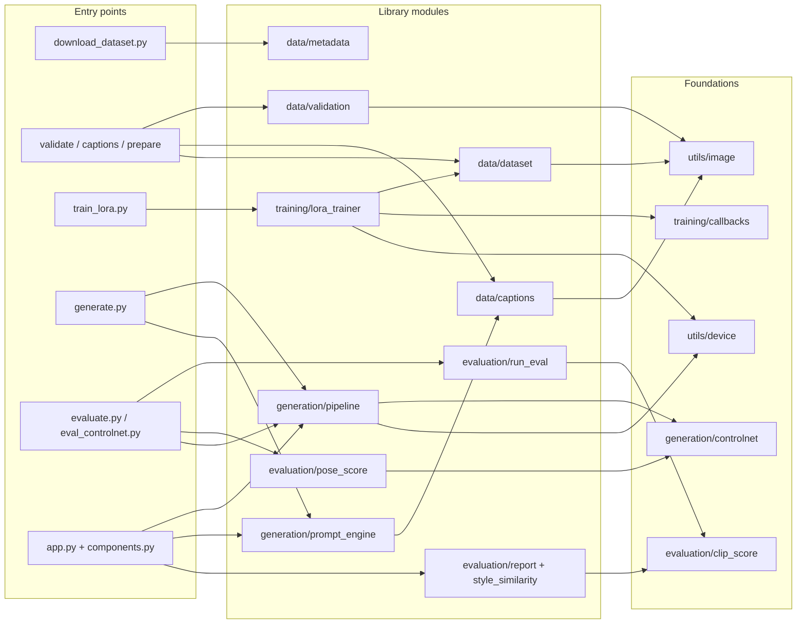

**Where to start reading:**
1. `RaviVarmaGenerator.generate` in `generation/pipeline.py` is the heart of inference.
2. `LoraTrainer.train` in `training/lora_trainer.py` is the heart of training.
3. `DatasetValidator.validate` decides the dataset.

## 6.5 Coding conventions observed

- **Lazy heavy imports.** torch, diffusers and transformers are imported inside functions, so data tools and tests run without the ML stack (`check_ml_stack_available`, `_try_import_torch`).
- **Configs drive behaviour.** Scripts accept `--config` and a few overrides; defaults live in pydantic models.
- **Every artefact has a sidecar.** Images have `.json`, captions have `.json`, runs have `training_summary.json` and `summary.json`.
- **Explicit failure over silent fallback.** Examples: `LoraCheckpointMissingError`, the all-black-image guard, refusing placeholder captions.
- **Tests use a 1 MB SD model** (`hf-internal-testing/tiny-stable-diffusion-pipe`) or monkeypatched stubs instead of real weights.

## 6.6 Known code-level debts

| Debt | Location | Effect |
|---|---|---|
| Style similarity implemented three times | `style_similarity.py`, `run_eval.py`, `report.py` | Risk of drift between the app's score and the report's |
| `DEFAULT_NEGATIVE_PROMPT` ≠ config negative prompt | `prompt_engine.py` vs `generation.yaml` | Two sources of truth |
| SSIM / LPIPS fields declared, never computed | `report.py` / `ImageEvaluation` | Always `None` |
| O(n²) near-duplicate search | `validation.py` | Doesn't scale |
| pydantic models accept unknown keys | `config.py` | YAML typos are silently ignored |
| SDXL config without implementation | `configs/lora_sdxl.yaml` | Misleading |

# 7. Data, interfaces and end-to-end flows

## 7.1 Data model (files, not tables)

There is no database. The persistent entities are files, linked by file names and paths.

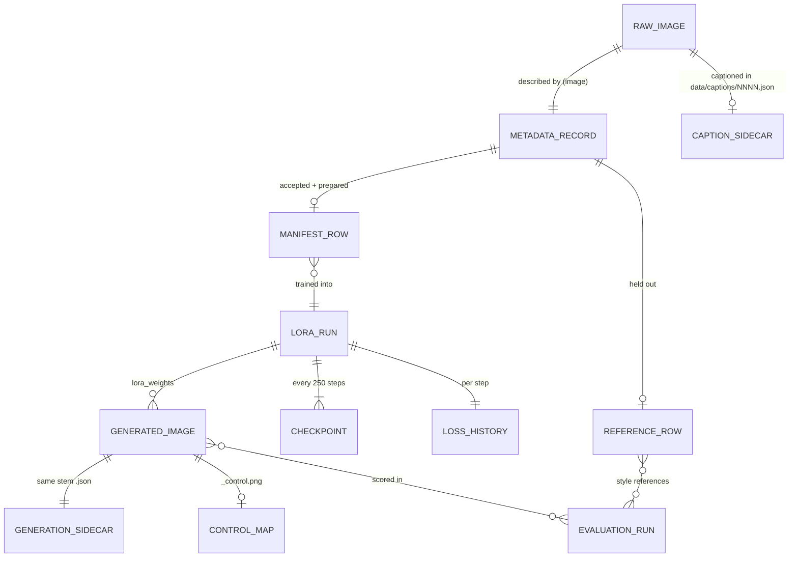

| Entity | Path | Format | Key fields (verified from the files) |
|---|---|---|---|
| Raw image | `data/raw/NNNN.jpg` | JPEG (not committed) | — |
| Metadata record | `data/metadata/metadata.jsonl` | JSON lines (300) | `image`, `caption`, `artist`, `title`, `commons_file`, `license`, `source`, `year`, `source_width`, `source_height` (+ `medium` for prints) |
| Caption sidecar | `data/captions/NNNN.json` | JSON (194) | `subject`, `composition`, `pose`, `clothing`, `jewelry`, `expression`, `objects`, `environment`, `lighting`, `visual_characteristics`, `raw_caption`, `title`, `source`, `qa{…}` |
| Manifest row | `data/processed/manifest.jsonl` | JSON lines (182) | `image`, `text` (the training caption, starting `<rvvarma>, `), `artist`, `source`, `year`, `title`, `source_image`, `width`, `height`, `license` |
| Reference row | `data/reference/reference.jsonl` | JSON lines (12) | same as the manifest |
| LoRA run | `checkpoints/lora/<run>/` | safetensors + YAML + JSON | `pytorch_lora_weights.safetensors`, `training_config.yaml`, `training_summary.json` |
| Loss history | `…/loss_history.csv` | CSV | `step, loss, lr` |
| Generated image | `outputs/generated/<unix>_<uuid8>.png` | PNG | — |
| Generation sidecar | same stem `.json` | JSON | `prompt`, `negative_prompt`, `seed`, `steps`, `guidance_scale`, `width`, `height`, `lora_scale`, `hires_scale`, `photo_strength`, `faces_fixed`, `lora_loaded`, `lora_weights`, `base_model`, `scheduler`, `vae`, `controlnet_*`, `device`, `dtype`, `timestamp`, `disclaimer` |
| Evaluation run | `outputs/evaluations/<run>/` | JSON / CSV / JPEG | `summary.json`, `metrics.csv`, `contact_sheet*.jpg`, `qualitative_review.csv` (never overwritten) |

**Lifecycle.** Raw files and metadata are append-only (`next_free_index`). Captions are recomputed with
`--overwrite`. `prepare_dataset` clears `data/processed/` and rebuilds it (`_clear_processed_dir`). Each training
`TAG` gets its own run folder. Generated images are never overwritten, because their names contain a timestamp and
a UUID.

## 7.2 Configuration files

| File | Controls | Loaded by |
|---|---|---|
| `configs/dataset.yaml` | Paths, validation thresholds, curation (`exclude`, `duplicate_groups`, `caption_notes`), `holdout`, preprocessing | `DatasetConfig.load` |
| `configs/lora_sd15.yaml` | Base model, LoRA rank / alpha / targets, optimiser, steps, v3 options, checkpointing, validation prompts | `LoraTrainingConfig.load` |
| `configs/generation.yaml` | Base model, `lora_path`, scheduler, VAE, defaults, negative prompt, ControlNet ids, hardware | `GenerationConfig.load` |
| `configs/epic_lexicon.yaml` | 27 characters (aliases, looks), 18 places, style cues | `load_lexicon` |
| `configs/prompts/sample_prompts.yaml` | The 5-prompt evaluation suite | `generate.py --prompt-file` |
| `.env` (from `.env.example`) | `PROMPT_EXPANSION_PROVIDER`, `PROMPT_EXPANSION_MODEL`, `OPENAI_API_KEY`, `OPENAI_BASE_URL`, `ANTHROPIC_API_KEY`, `HF_TOKEN`, `MODEL_CACHE_DIR` | `python-dotenv` in `generate.py` |

## 7.3 Interfaces

### Command-line interface (the project's "API")

| Command | Important options |
|---|---|
| `download_dataset.py` | `--source commons|wellcome`, `--limit 40`, `--min-side`, `--from-metadata`, `--category`, `--raw-dir`, `--metadata-file` |
| `validate_dataset.py` | `--config`, `--json-out`, `--manifest` |
| `generate_captions.py` | `--vlm-model`, `--vqa-model` (`none` to skip), `--device`, `--all`, `--overwrite`, `--no-vlm`, `--reflatten` |
| `prepare_dataset.py` | `--config`, `--skip-validation` |
| `train_lora.py` | `--config` (required), `--max-train-steps`, `--resume-from-checkpoint`, `--output-dir`, `--smoke-test` |
| `generate.py` | `--prompt` / `--prompt-file`, `--expand`, `--dry-run`, `--seed` / `--seeds` / `--num-images`, `--steps`, `--guidance-scale`, `--width`, `--height`, `--lora-scale`, `--lora-path`, `--no-lora`, `--negative-prompt`, `--face-fix`, `--hires-scale`, `--init-image`, `--strength 0.55`, `--pose-image`, `--controlnet-type`, `--controlnet-strength`, `--output-dir`, `--skip-existing` |
| `evaluate.py` | `--input`, `--baseline`, `--reference`, `--train-manifest`, `--output-dir`, `--image`, `--prompt`, `--device` |
| `eval_controlnet.py` | `render|report`, `--variant`, `--seed` |
| `create_pose_control.py` | `--image`, `--type`, `--low-threshold`, `--high-threshold`, `--out` |
| `app/app.py` | `--config`, `--server-port 7860`, `--share` |

**Validation at the boundary.** `generate.py` rejects an empty prompt and missing `--init-image` / `--pose-image`
files with `parser.error`. pydantic rejects sizes that aren't multiples of 8.

### Web app events (Gradio)

| Tab | Trigger | Handler | Inputs → outputs |
|---|---|---|---|
| Generate | "Generate painting" (+ example chips fill the scene box) | `run_generation` | scene, expand, style strength, checkpoint, pose image, control mode, strength, seed, steps, guidance, size, negative prompt, face fix → image, caption, prompt card, details, warning, pose map, gallery |
| Photo → Varma | "Paint it like Ravi Varma" | `run_photo_to_painting` | photo, description, strength, faces, seed → painting, details, warning (the edge map is saved to disk, not shown) |
| Checkpoint Hub | built once when the app starts | `checkpoint_table_html`, `loss_chart_svg` | — → HTML table, SVG chart, v2 progression image |
| Evaluation | "Calculate metrics" | `run_evaluation` | image, prompt, reference dir → Markdown with CLIP scores |
| About | static | — | — |

### External APIs used

| API | Calls | Auth | Failure handling |
|---|---|---|---|
| Wikimedia Commons `w/api.php` | `categorymembers`, `imageinfo` (`url`, `size`, `extmetadata`) | none (a User-Agent is sent) | retry 429 / 5xx with `Retry-After` |
| Wellcome Collection catalogue + IIIF | `/catalogue/v2/images?query=…`, `info.json`, `full/!2048,2048/0/default.jpg` | none | skip on error |
| Hugging Face Hub | `from_pretrained` for all models | none (all public); `HF_TOKEN` optional | the library's exceptions; cached after the first run |
| OpenAI-compatible chat | `chat.completions.create` (JSON response) | `OPENAI_API_KEY` | fall back to the local engine |
| Anthropic | `messages.create` | `ANTHROPIC_API_KEY` | fall back to the local engine |

## 7.4 End-to-end flows

### Flow 1: rebuilding the dataset from committed metadata

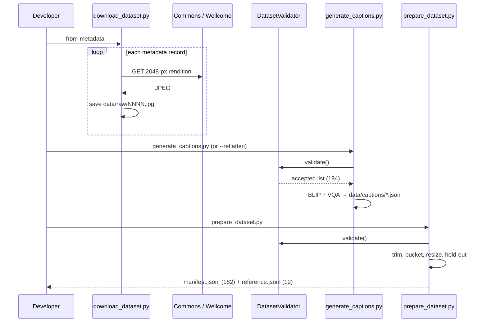

The captions are committed, so `--reflatten` rebuilds the flat captions without running BLIP. The raw images are
the only thing that must be downloaded again.

### Flow 2: training a LoRA on Colab

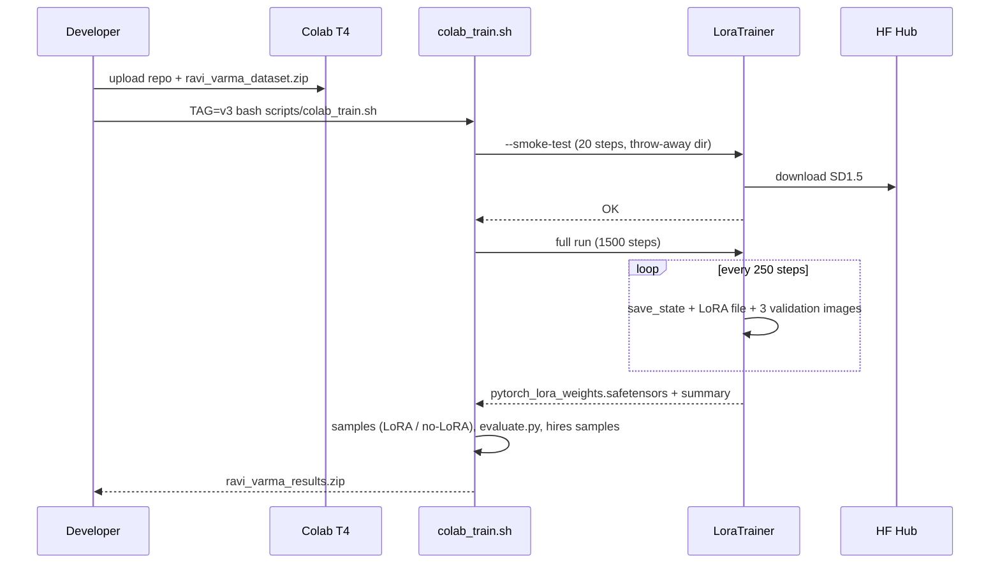

### Flow 3: CLI text → painting with expansion

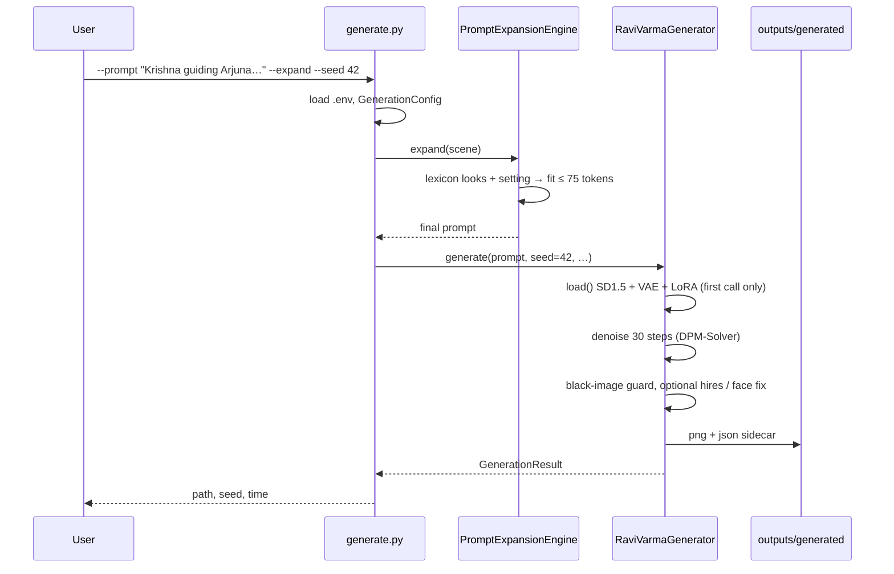

### Flow 4: Photo → Varma in the app

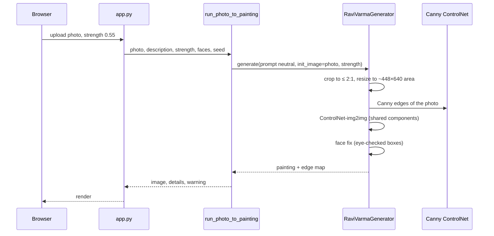

The uploaded photo lives only in memory. Only the painting, the edge map and the sidecar are written.

### Flow 5: pose-controlled generation and PCK evaluation

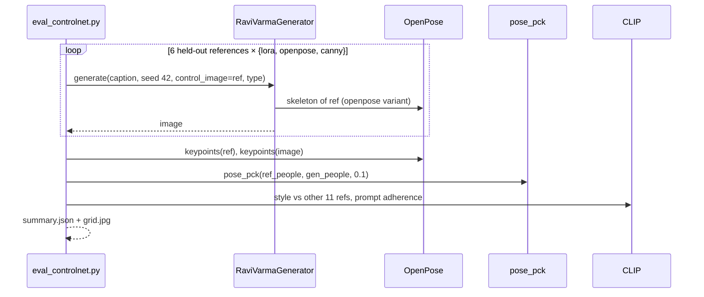

### Flow 6: LLM expansion with fallback

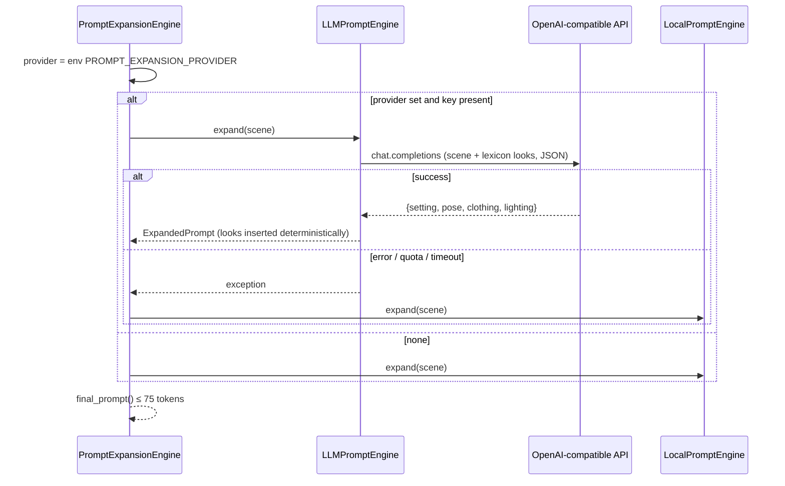

# 8. First principles

This chapter explains the ideas the code relies on, from the ground up, using this project's numbers. Formulas are
written in plain notation.

## 8.1 What a diffusion model learns

**Forward process (fixed, no learning).** Take an image x₀ and add Gaussian noise in T = 1000 small steps until
nothing is left but noise. At any step t there's a closed form:

  xₜ = √ᾱₜ · x₀ + √(1 − ᾱₜ) · ε,  with ε ~ N(0, I)

ᾱₜ goes from ≈1 (clean) to ≈0 (pure noise) along a fixed schedule.

**What the network learns.** Given the noisy xₜ, the step t and a text condition c, predict the noise ε that was
added. The training loss is simply:

  L = ‖ ε − ε_θ(xₜ, t, c) ‖²

That's the `F.mse_loss(model_pred, target)` in `LoraTrainer.train`.

**Generation (sampling).** Start from pure noise and repeatedly subtract a bit of predicted noise. A *scheduler*
decides the step sizes. This project uses DPM-Solver multistep (`scheduler: dpmsolver_multistep`), which reaches good
images in about 30 steps instead of 1000.

**Why loss doesn't show style.** Each training step picks a random t. Predicting noise at high t is easy and at low t
is hard, so the per-step loss jumps around a flat mean (0.17–0.18 for v2) whatever the style quality. That's why
checkpoints are judged by images, not by loss (the Checkpoint Hub says so in the UI).

## 8.2 Latent diffusion: why 448×640 becomes 56×80

Stable Diffusion doesn't denoise pixels. A **VAE** compresses a 448×640×3 image into a 56×80×4 latent (8× smaller
per side). Diffusion runs in that latent space, and the VAE decoder turns the result back into pixels.

**Consequences in this project:**
- **Small faces.** A face 40 px wide is only 5 latent pixels, too few for eyes and lips. The *face fix* (F10) crops the face, enlarges it to 512 px (64 latent pixels) and redraws it.
- **Latent scaling.** Latents are multiplied by 0.18215 (`vae.config.scaling_factor`) so they have roughly unit variance.
- **Swappable decoder.** The fine-tuned VAE `sd-vae-ft-mse` decodes the *same* latent space better. That's why it was swapped in without retraining (D-15).
- **Sizes must be multiples of 8** (a pydantic validator). In practice multiples of 64 are used, for the UNet's downsampling.

## 8.3 The UNet and cross-attention

The noise predictor is a UNet: it downsamples, processes and upsamples, with skip connections. Text enters through
**cross-attention** layers. In each one:

  Attention(Q, K, V) = softmax(Q·Kᵀ / √d) · V

- Q (query) comes from the image features.
- K, V (keys, values) come from the 77 text-token embeddings.

So each image location "looks up" the words relevant to it. The projections `to_q`, `to_k`, `to_v` and `to_out` are
exactly where this project's LoRA is attached (D-03). They're the parts that connect words such as `<rvvarma>` to
visual features.

## 8.4 CLIP: text encoder and judge

CLIP was trained to put matching images and texts close together in a shared embedding space. It plays two roles here:

1. **Inside SD1.5:** its text encoder (ViT-L/14) turns the prompt into 77 token embeddings. **Hard limit:** 77 tokens including start and end. Anything after is silently dropped. That's why captions are capped at 69 + 6 (trigger) and prompts at 75, and why the 100-token negative prompt bug mattered (D-11; DECISIONS §4.1).
2. **As a judge (evaluation):** a separate, smaller CLIP ViT-B/32 embeds generated images, prompts and reference paintings. **Cosine similarity** measures closeness: cos(a, b) = a·b / (‖a‖‖b‖).

## 8.5 Classifier-free guidance

At each step the UNet runs twice: with the prompt and with the negative prompt (or empty). The final prediction
pushes away from the negative:

  ε = ε_neg + s · (ε_prompt − ε_neg),  with s = guidance_scale = 7.5

Higher s gives more literal prompt following but harsher images. This is also why a **negative prompt** works: it
replaces the "unconditional" branch, so the result moves away from "moustache, frame, blurry". It too is limited to
77 tokens.

## 8.6 LoRA: low-rank adaptation

A frozen weight matrix W (for example 320×320 in `to_q`) gets a trainable update:

  W' = W + (α / r) · B · A,  with A: r×320, B: 320×r, r = 16

- B starts at zero, so training starts from the unchanged base model (PEFT's Gaussian init sets A; B = 0).
- **Parameters:** 2·320·16 instead of 320² for this layer. Across the attention layers that's **3.2 M trainable** instead of 860 M (0.37 %).
- **Scale:** α = r = 16 gives a scale of 1. At generation time `lora_scale` multiplies the update again (`cross_attention_kwargs={"scale": …}`), which is the app's "style strength" slider.
- **Why it doesn't overfit as easily:** a rank-16 update can only move the weights in 16 directions per layer. That's enough for a style, and not enough to store 182 paintings. **Measured:** max similarity to any training image 0.898 < 0.95.

## 8.7 Training tricks used in v3

**Min-SNR-γ weighting.** The signal-to-noise ratio at step t is SNR(t) = ᾱₜ / (1 − ᾱₜ). Low-noise steps (high SNR) are
easy and dominate the gradient. The weighting:

  w(t) = min(SNR(t), γ) / SNR(t),  γ = 5

This caps their influence, which is reported in the literature to speed convergence (`_min_snr_weights`).

**Noise offset (0.05).** Adds a small per-channel constant to the noise, so the model can learn to shift an image's
overall brightness. Plain noise is zero-mean per image, which biases SD toward medium brightness. Varma's dark
backgrounds benefit.

**Caption dropout (0.1).** In 10 % of samples the caption is replaced by just `<rvvarma>`, so the trigger alone must
carry the style (`CaptionCollator._text`).

**Mixed precision.** The frozen model runs in fp16 to halve memory. The LoRA weights stay fp32, because small updates
would underflow in fp16 (`cast_training_params`).

**Gradient accumulation (4).** Four micro-batches are summed before one optimiser step, which simulates a larger
batch on a 16 GB GPU.

## 8.8 img2img and "strength"

Instead of starting from pure noise, img2img encodes an existing image, adds noise up to step `strength × T`, and
denoises from there:
- **Strength 0.4** (face and hires fix) keeps structure and refines detail.
- **Strength 0.55** (photo mode) repaints texture.
- **Strength 0.7+** without a lock invents a new picture. That's exactly the Spider-Man failure (D-20).

## 8.9 ControlNet

ControlNet is a trainable copy of the UNet's encoder that reads a **control image** (a pose skeleton or an edge map)
and adds its features into the frozen UNet through zero-initialised convolutions.
- The pre-trained `lllyasviel` ControlNets were trained on SD1.5, so they plug into *our* UNet + LoRA unchanged.
- **Division of labour:** the LoRA decides *how it looks*; ControlNet decides *where things are*.
- **Canny** keeps every outline. **OpenPose** keeps only 18 body joints per person.
- **Strength** (0.8 default) scales the ControlNet's contribution.

## 8.10 The metrics

| Metric | Definition | Reads as |
|---|---|---|
| Prompt adherence | cos(CLIP(image), CLIP(prompt without the trigger)) | Does it show what was asked? ~0.30–0.35 is typical for ViT-B/32 |
| Style similarity (mean / top-3) | Mean cosine to the 12 held-out paintings (or the 3 nearest) | Closer to real Varma paintings |
| Nearest-training similarity | Max cosine to any training image | > 0.95 would suggest copying |
| Diversity | Mean (1 − cos) between seeds of one prompt | Low = the same picture each time |
| PCK@0.1 | Share of reference joints whose generated counterpart lies within 0.1 × image size | Pose adherence (0 to 1) |

**Why paired:** CLIP scores mix content and style. Comparing LoRA and base on the *same* prompt and seed cancels
the content part, so the delta reflects the LoRA.

## 8.11 Perceptual hashing (de-duplication)

dHash shrinks an image to a tiny greyscale grid and records, for each pixel, whether it is brighter than its right
neighbour. That gives a bit string (256 bits here). Two copies of the same painting (a different scan, resize or
JPEG quality) differ in only a few bits.
- **Hamming distance** counts differing bits; ≤ 40 / 256 is treated as "the same painting".
- **Crops and recolourings** defeat it, which is why curated groups exist (D-07).

## 8.12 Haar cascades

OpenCV's Haar detectors slide a window of simple light/dark rectangle features over the image, with a cascade of
cheap classifiers rejecting non-faces early.
- **Fast, no extra model**, but tuned for frontal faces in photographs.
- **Hence the misses** on profiles, and false positives on round ornaments.
- **The eye cascade inside each face box** is a second check (`detect_faces`).

# 9. Setup, operation and troubleshooting

## 9.1 Requirements

| Item | Needed for | Notes |
|---|---|---|
| Python 3.11 | everything | Newer versions lack wheels for some pins (Colab 3.13 was the reason for pinning its runtime) |
| ~10 GB disk | models cache + data | SD1.5 ≈ 4 GB, ControlNets ≈ 1.4 GB each, BLIP ≈ 2 GB, VAE ≈ 0.3 GB |
| Internet on first run | model downloads from the HF Hub | Afterwards everything runs offline, except the optional LLM |
| Apple-silicon Mac (8 GB+) or a CUDA GPU | generation | CPU works but takes many minutes per image |
| CUDA GPU ≥ 16 GB (Colab T4) | training, hires fix | Not on the Mac |
| No accounts or keys | default use | Optional: an LLM key in `.env` |

## 9.2 Install

```bash
git clone https://github.com/f20240684-cmd/the-next-ravi-varma-v2.git
cd the-next-ravi-varma-v2
python3.11 -m venv .venv && source .venv/bin/activate
pip install -r requirements.txt && pip install -e .
cp .env.example .env        # optional; leave values empty for offline use
```

**Verify the installation:**

```bash
pytest -q                   # expect: all pass, ≤ 2 skipped (CLIP weights not cached)
python scripts/generate.py --prompt "Saraswati playing the veena" --expand --dry-run
```

## 9.3 Everyday commands

| Goal | Command |
|---|---|
| One painting | `python scripts/generate.py --prompt "a royal woman reading a letter" --seed 42 --width 448 --height 640 --face-fix` |
| Base model (no LoRA) | add `--no-lora` |
| Story → prompt only | `--expand --dry-run` |
| Pose transfer | `--pose-image data/reference/0225.jpg --controlnet-type openpose` |
| Photo → painting | `--init-image photo.jpg --strength 0.55 --face-fix` |
| Older checkpoint | `--lora-path checkpoints/lora/ravi_varma_v3/checkpoint-1000` |
| Web app | `python app/app.py` → http://127.0.0.1:7860 |
| Evaluation suite | `make samples && make baseline && make evaluate` |
| Tests / lint | `make test`, `make lint` |
| Retrain | §7.4 Flow 2; `TAG=v4 bash scripts/colab_train.sh` on Colab |

## 9.4 Environment variables

| Variable | Default | Effect |
|---|---|---|
| `PROMPT_EXPANSION_PROVIDER` | `none` | `openai` or `anthropic` enables LLM mode |
| `PROMPT_EXPANSION_MODEL` | empty | Model name at that provider (e.g. a Gemini model through `OPENAI_BASE_URL`) |
| `OPENAI_API_KEY` / `ANTHROPIC_API_KEY` | empty | `<your-key-here>`; never commit it |
| `OPENAI_BASE_URL` | unset | Any OpenAI-compatible endpoint. **Leave it commented out** for real OpenAI, because an empty value breaks the client |
| `HF_TOKEN` | empty | Only for gated models (none are used by default) |
| `MODEL_CACHE_DIR` | `~/.cache/huggingface` | Where weights are cached |

## 9.5 Resetting state

| To reset | Do |
|---|---|
| Generated images | Delete files under `outputs/generated/` (keep the committed subfolders used by the docs) |
| Prepared data | `python scripts/prepare_dataset.py` (it clears `data/processed/` itself) |
| Captions | `python scripts/generate_captions.py --overwrite` (slow) or `--reflatten` (fast, no models) |
| Model cache | Delete `~/.cache/huggingface/hub/models--…` for that model |
| Training run | Use a new `TAG`; old runs stay untouched |

## 9.6 Troubleshooting

| Symptom | Likely cause | Fix |
|---|---|---|
| `TypeError: unhashable type: 'dict'` when starting the app | starlette 1.x with Gradio 4.44 | `pip install fastapi==0.115.0` (pinned in requirements) |
| All-black image / `RuntimeError: … all-black image` | fp16 NaN; attention slicing forced on MPS | Keep `attention_slicing: auto`; or `dtype: float32` |
| Mac extremely slow (20+ min per image), heavy swap | Not enough free unified memory (SD + ControlNet ≈ 3.5 GB) | Close other apps; avoid hires fix; use Colab for batches |
| `CUDA out of memory` with `--hires-scale` | Hires needs > 8 GB | Drop `--hires-scale`, or use a 16 GB GPU |
| `LoraCheckpointMissingError` | `lora_path` points to a missing folder | Check `configs/generation.yaml` → `model.lora_path`, or pass `--lora-path` |
| `lora_loaded: false` in the sidecar | `--no-lora`, or a missing path with fallback allowed | See above |
| Style looks weak | No trigger in a custom pipeline, or `lora_scale` low | The generator adds `<rvvarma>` automatically; set the style strength to 1.0–1.2 |
| Prompt details ignored | Prompt over 77 tokens | Use `--expand` (fits 75), or shorten |
| Moustache on women | Negative prompt truncated (old configs) | Keep facial-hair terms first, under 77 tokens |
| Photo mode changes the subject | Strength too high | 0.5–0.6; the Canny lock keeps outlines |
| Faces not sharpened | Profile view or no eye found | Expected Haar limit; use frontal compositions |
| `--expand` ignores the LLM | Provider `none`, missing key, quota error | Check `.env`; the log says "falling back to local" |
| OpenAI client error with Gemini | `OPENAI_BASE_URL` empty or wrong model name | Set the full base URL and a model that the endpoint lists |
| Download 429 errors | Wikimedia rate limit | The script retries; just rerun (it skips existing files) |
| Tests skipped | CLIP weights or the tiny SD model not cached and offline | Run once with internet; `pytest -rs` shows the reasons |
| Colab: `triton.ops` import error | bitsandbytes installed | `pip uninstall bitsandbytes`; use `requirements-colab.txt` |
| Colab: torch downgraded | xformers pin | Don't install xformers; SDPA is used |

## 9.7 Where to look when something fails

1. **Console logs.** `setup_logging` prints stage summaries; secrets are redacted.
2. **The sidecar `.json`** of any image: exact prompt, seed, LoRA file, device, dtype.
3. **`data/metadata/validation_report.json`:** why an image was excluded.
4. **`training_summary.json` and `loss_history.csv`:** what a run actually did.
5. **`pytest -rs`:** which tests were skipped and why.

# 10. Testing, reliability and security audit

## 10.1 What the tests prove

**121 tests**: 99 test functions, some parametrised (`pytest --collect-only`). On CI (Ubuntu, CPU) 119 pass and 2 are
skipped; locally all can run when CLIP weights are cached.

| File | Tests | What it proves |
|---|---|---|
| `test_curation.py` | 13 (+ parametrised) | Accepted / excluded sets, auditable report JSON, hold-out, stale processed files cleared, manifest check (placeholder captions, missing trigger), bucket sizes, the 448×640 mapping, bucket sampler, border trimming, title / year cleaning, metadata round-trip |
| `test_dataset.py` | 11 | Low-resolution and corrupt images flagged, empty dataset, missing / invalid metadata, preparation from captions, manifest round-trip, downloader numbering after the highest existing file |
| `test_captions.py` | 10 (+ parametrised) | Priority order and budget trimming, sidecar round-trip, meta / anachronistic answers dropped, period rewrites, heuristic captioner opt-in only, note kept inside the budget, title shortening |
| `test_training.py` | 5 | **A real LoRA training run** on the 1 MB tiny SD: checkpoint, resume, export, reload; only LoRA trainable; v3 options; caption dropout |
| `test_generation.py` | 24 (+ parametrised) | Config validation, Canny maps, seed recording, metadata keys, LoRA path resolution, missing-LoRA errors, ML-stack-missing message, trigger insertion, the sample suite, MPS slicing rule, negative prompt ≤ 77 tokens, Checkpoint Hub, face-fix blend, photo sizing and negative-prompt stripping |
| `test_prompt_engine.py` | 18 | Trigger on / off, verbatim scene, empty scene rejected, no invented environment, characters in scene order, aliases, budget trimming, default vs custom negative prompt, LLM fallback when unconfigured or raising (mocked), LLM output grounded in the lexicon |
| `test_evaluation.py` | 14 | CLIP unavailable paths, sidecar prompts, paired metrics, the review sheet is never overwritten, trigger stripping, PCK cases |
| `test_logging.py` | 4 | Secret redaction |

**Not proven by tests:**
- fp16 CUDA training (proven by the Colab runs)
- real image quality (CLIP evaluation and eyes)
- real ControlNet / BLIP / OpenPose model loading (too large for CI)
- the downloader against live APIs
- the Gradio layout

## 10.2 Reliability review

| Area | Strength | Weakness |
|---|---|---|
| Reproducibility | Seeds via a CPU generator; sidecars; pinned versions; committed metadata and captions; shipped weights | Raw images must be downloaded again (and Commons can change or delete files) |
| Failure visibility | Explicit errors (missing LoRA, black image, placeholder captions) | YAML typos are silently ignored (pydantic default `extra="ignore"`) |
| Resource limits | Shared components; `empty_cache`; photo sizes bounded (`test_photo_of_any_shape_gets_a_bounded_size`) | No memory pre-check; hires can OOM without a friendly message |
| Concurrency | Gradio processes one event at a time per handler | One shared generator: concurrent users would queue; `set_lora` changes state for everyone |
| Long jobs | Checkpoint/resume every 250 steps | The app has no progress indicator or cancel |
| Dependencies | Pins; a CI on a clean machine | Older Diffusers/PEFT; upgrades are untested |

## 10.3 Security and privacy review

| Topic | Finding | Severity |
|---|---|---|
| Secrets | `.env` is git-ignored; `.env.example` has empty values; history was scanned for key patterns during the audit (commit `dd26570`); logs redact key-like messages | Low risk |
| Network exposure | The app binds to `127.0.0.1` by default. `--share` creates a public Gradio URL with **no authentication**, which would expose the GPU and the filesystem output folder to anyone with the link | Medium if misused |
| Uploaded photos | Processed in memory; not stored; not sent anywhere. The edge map *is* saved and could reveal the photo's outlines | Low |
| Third-party data flow | Only the scene text goes to the LLM provider, only when it is enabled | Low |
| Model loading | safetensors (no pickle) for LoRA; Hub models from known publishers; no `trust_remote_code` anywhere in `src/` | Low |
| Malicious images | Pillow's decompression-bomb guard; aspect clamp 2:1 | Low |
| Path inputs | The Evaluation tab accepts a free-text reference directory: a local user can point it at any folder they can read. Acceptable for a local tool, not for a hosted one | Low (local) / Medium (if hosted) |
| Content | No safety checker is used (`safety_checker=None` in `RaviVarmaGenerator.load` and the trainer's validation pipeline). Outputs are labelled AI-generated | Medium for public hosting |
| Licences | Training images are public domain / CC BY with recorded provenance. SD1.5 is under CreativeML OpenRAIL-M, which carries use restrictions that apply to outputs and redistribution | Note |

## 10.4 Prioritised risks and improvements

| # | Priority | Item | Why | Effort |
|---|---|---|---|---|
| 1 | High | Add `model_config = ConfigDict(extra="forbid")` to the config models | Typos silently fall back to defaults, which could change results unnoticed | 30 min + test |
| 2 | High | Remove the stale statements (Appendix A): `checkpoints/README.md`, the `run_eval.py` docstring, the ControlNet comment in `generation.yaml`, `IMPLEMENTATION_MANUAL.md` / notebook 03 | Reviewers read these first | 1 h |
| 3 | High | Run a blind human evaluation (base vs v3, real vs generated) | CLIP is a weak style judge; it's the main evidence gap | 1 day |
| 4 | Medium | One style-similarity implementation, used everywhere | Three copies can drift | 2 h |
| 5 | Medium | One negative-prompt source (config), deleting or deriving `DEFAULT_NEGATIVE_PROMPT` | Two sources of truth | 30 min |
| 6 | Medium | Warn and refuse `--share` unless a username / password is set (`auth=`) | Public exposure | 30 min |
| 7 | Medium | Ablations: rank 8/16/32; with and without prints; data vs training changes | Unknown causes of the v3 gain | 3–4 GPU-hours |
| 8 | Medium | Make the config default size 448×640 to match the app and docs | CLI users get 512×512 unexpectedly | 5 min |
| 9 | Low | Remove the unused SSIM / LPIPS fields, or implement them | Misleading empty fields | 15 min |
| 10 | Low | Replace the O(n²) near-duplicate search (BK-tree) | Only matters at scale | 2 h |
| 11 | Low | Progress bar and memory pre-check in the app | UX on 8 GB machines | 2 h |
| 12 | Low | Delete `configs/lora_sdxl.yaml`, or label it "not implemented" in its header | Avoid the impression of SDXL support | 5 min |

# 11. Alternatives and improvements

## 11.1 Could it be simpler?

| Part | Simpler option | Verdict |
|---|---|---|
| Dataset pipeline (4 scripts) | One script | Separate stages let one step rerun without redoing the others (captioning is the slow one). Keep |
| BLIP + 12 VQA captions | BLIP sentence only | Measured: frames 5/15 → 0/15 came partly from the caption notes. The richer captions are justified |
| pydantic configs | argparse only | Configs are shared by CLI, app and Colab. Keep, but forbid unknown keys |
| Local lexicon + LLM | Raw prompts | Expansion gave **no measured CLIP gain**. The local lexicon is cheap; the LLM mode is the part that could be dropped without loss on current evidence |
| Three style-similarity implementations | One | Yes, merge them (§10.4 #4) |
| Gradio + custom CSS | Plain Gradio | The CSS is cosmetic. It depends on Gradio internals, which is a maintenance cost |

## 11.2 Alternative approaches to the whole problem

| Alternative | Pros | Cons | When better |
|---|---|---|---|
| SDXL + LoRA | 1024 px, better faces and hands | ~3× memory; won't run on the 8 GB Mac; slower | With a ≥ 24 GB GPU |
| Flux / SD3 + LoRA | State-of-the-art prompt following | Much larger; licence terms; heavier training | With rented GPUs |
| DreamBooth (full UNet + prior preservation) | Stronger style | Overfitting at n = 182; 4 GB checkpoints | With far more data |
| Textual inversion | Tiny (KB) | Too weak for rendering technique | Concepts, not styles |
| IP-Adapter (style from reference images, no training) | No training at all | Style is copied from the given image; less consistent | Quick demos |
| Neural style transfer (Gatys) | Simple, classic | Texture only; no composition or subject knowledge | Photo filters |
| Prompt-only on base SD | Zero work | Measured: calendar-art look, frames 5/15 | Baseline only |

## 11.3 Ranked improvements (impact ÷ effort)

| Rank | Improvement | Expected impact | Effort | Evidence basis |
|---|---|---|---|---|
| 1 | Human evaluation study | High (credibility) | Low | The main gap named in README / DECISIONS |
| 2 | Config hygiene: `extra="forbid"`, one negative prompt, 448×640 default | Medium | Very low | §6.6 |
| 3 | Fix the stale docs (Appendix A) | Medium (reviewer trust) | Very low | Appendix A |
| 4 | Ablation runs (rank, prints, data vs training) | High (understanding) | Medium (GPU hours) | D-03, D-08, D-16 confounds |
| 5 | Hugging Face Space + weights on the Hub | High (reach) | Medium | Not deployed now |
| 6 | DNN face detector (e.g. RetinaFace / MediaPipe) | Medium (faces in profile / crowds) | Low–medium | Known Haar misses |
| 7 | Tiled VAE to allow hires on 8 GB | Medium | Medium | Hires is GPU-only now |
| 8 | Stronger captioner (Florence-2 / Qwen-VL) for v4 | Medium | Medium | BLIP can't name deities |
| 9 | SDXL port | High (quality) | High | D-01 |
| 10 | Regional prompting / multi-ControlNet for multi-figure actions | Medium | High | M3 failure on complex actions |

## 11.4 Proposed future architecture (not implemented)

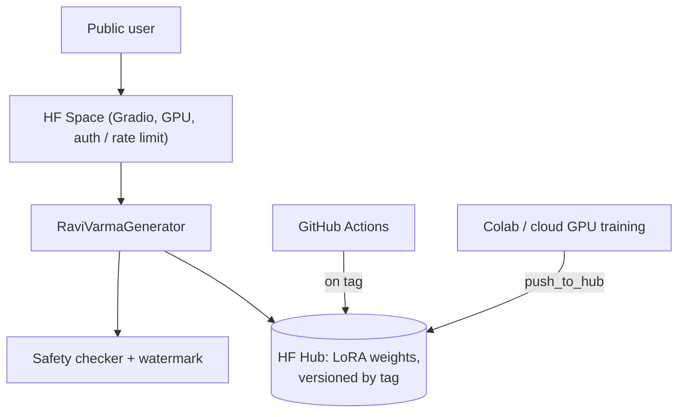

This is a **proposal only**. Nothing here is deployed. It would need the team's agreement to publish (DECISIONS §9).

# 12. Demonstration and interview preparation

> Use only the numbers in this handbook. Each comes from a file in `outputs/evaluations/` or
> `checkpoints/lora/ravi_varma_v3/`. Don't claim users, deployment or results that don't exist.

## 12.1 The 30-second explanation

"We taught Stable Diffusion 1.5 to paint like Raja Ravi Varma using LoRA, a 12.8 MB add-on trained on 182 curated
public-domain paintings on a free Colab GPU. On top of that we built prompt expansion for Indian-epic stories, pose
control with ControlNet, face sharpening and a photo-to-painting mode, all running on an 8 GB Mac. We measured it
against the base model on held-out paintings: style similarity rose from 0.669 to 0.701 with no loss in prompt
adherence, and pose adherence went from 0.17 to 0.86 with ControlNet."

## 12.2 The 2-minute explanation

1. **Problem.** Base SD1.5 gives glossy "calendar art" for Varma-style prompts and even paints gilt frames (5 of 15 images).
2. **Data.** 300 candidate images from Wikimedia Commons and the Wellcome Collection, with licences recorded.
   - We checked resolution against the original scan (26 upscaled copies caught).
   - We removed duplicates: exact, perceptual and curated (7 copies of one print).
   - We excluded non-paintings.
   - Result: 182 training images, 12 held out.
3. **Captions.** BLIP + 12 VQA questions describe the content, so the trigger `<rvvarma>` learns only the style. Frames and printed text are *named* in captions so they don't leak into the style. Everything fits CLIP's 77 tokens.
4. **Training.** LoRA rank 16 on the UNet attention layers: 3.2 M of 860 M parameters, 1500 steps, 58 minutes on a T4. v3 added Min-SNR weighting, noise offset and caption dropout.
5. **Features.** Everything shares one loaded model (that's how it fits in 8 GB):
   - text → painting
   - lexicon-based prompt expansion
   - OpenPose / Canny ControlNet
   - face fix
   - photo → painting with a Canny lock
6. **Evaluation.** Paired against the base model, with the same prompts and seeds, on held-out references:
   - style 0.669 → 0.701 (12 of 15 pairs)
   - no memorisation (max 0.898 < 0.95)
   - PCK 0.17 → 0.86
   - prompt expansion showed **no** CLIP gain, and we report that.

## 12.3 The 5-minute explanation

Use the 2-minute version and add:
- **Architecture (§3.2 diagram).** The weights file is the only hand-off between training and inference. CLI and app share one `RaviVarmaGenerator`.
- **The two bugs that mattered most:**
  - A 100-token negative prompt was silently cut at 77, so "frame, blurry" were never applied. Shortening it fixed a moustache artefact on women in 3 of 5 cases.
  - 24 captions overflowed and lost their artefact notes.
- **The photo-mode failure and fix.** Plain img2img turned a Spider-Man photo into a turbaned man. A Canny ControlNet lock fixed it.
- **Honest limitations** (§12.6) and the next steps: a human study and ablations.

## 12.4 Live demo script (about 6 minutes)

| Step | Action | Say |
|---|---|---|
| 0 (before) | `python app/app.py`; warm up with one image; close other apps | — |
| 1 | **Generate** tab: chip "Damayanti and the swan" (or type "Saraswati playing the veena by a lotus lake"), seed 42, Portrait 448×640, face fix on | "The scene is expanded with standard iconography, within 75 tokens." Show the prompt card |
| 2 | While it renders (~2 min on the Mac) | Explain the trigger token and the LoRA |
| 3 | Show the result and the details card | "Seed, LoRA file and decoder are recorded, so this exact image can be regenerated." |
| 4 | Same scene with style strength 0 | Base-model look, side by side |
| 5 | **Checkpoint Hub** | Loss is flat, which is why checkpoints are chosen by eye |
| 6 | **Photo → Varma** with a prepared portrait | The outline lock; moustache preserved |
| 7 | README results table | The numbers and their caveats |

**Fallback if the Mac is too slow:** show the pre-rendered images in `outputs/evaluations/` and the screenshots in `docs/screenshots/`.

## 12.5 Questions and answers

**Data**

1. *Why so few images?* That's all the public-domain, decent-resolution Varma reproductions with clear provenance. LoRA is designed for small data, and memorisation was checked (max similarity 0.898).
2. *How do you know the images are legal to use?* Every record stores its source file and licence (public domain / CC BY). Varma died in 1906.
3. *How were duplicates found?* In three ways: an exact SHA-256 hash, a 256-bit dHash with Hamming ≤ 40, and curated groups that CLIP suggested and a human confirmed. The highest-resolution copy is kept.
4. *Why check the original resolution?* 26 files had been upscaled to 384 px from originals as small as 200 px. They would pass a local size check but teach blur.
5. *What is the data split?* 182 train, 12 held out, no validation split. Too little data to spare; the checkpoints are judged visually.
6. *Why keep prints?* Genuine compositions, and the data is scarce. They're tagged, so a run without them is a one-line change. Their effect is untested.

**Captions**

7. *Why not use BLIP captions directly?* One vague sentence. The VQA template gives consistent attributes, so content words absorb content and the trigger absorbs style.
8. *What's the 77-token limit?* CLIP's text encoder reads 77 tokens; the rest is silently dropped. Captions are capped at 69 + 6 for the trigger.
9. *How did the frames disappear?* By naming "frame" in captions where one was present, so the trigger didn't absorb it. Measured: 5/15 → 0/15.

**Model and training**

10. *Why SD1.5 not SDXL?* Training on a T4 and inference on an 8 GB Mac; SDXL needs ~3× the memory. SD1.5 also has mature ControlNets.
11. *What does LoRA do mathematically?* W' = W + (α/r)·B·A with rank 16. Only A and B train: 3.2 M parameters, a 12.8 MB file.
12. *Why rank 16?* A common middle ground. It wasn't ablated; that's future work.
13. *Which layers?* The attention projections q, k, v, out, where text meets image.
14. *What's the trigger token for?* It switches the style on or off and collects everything the captions don't describe.
15. *What are Min-SNR, noise offset and caption dropout?* Respectively: they reweight easy timesteps, allow darker or brighter images, and force the trigger alone to carry the style. They were added in v3.
16. *Why does the loss stay flat?* It depends on a random noise level per step; style quality isn't visible in it.
17. *How long did training take?* 3,493 s ≈ 58 min for 1500 steps on a Tesla T4 (`training_summary.json`).
18. *How do you know it's not copying?* The highest CLIP similarity of any output to any training image is 0.898, below the 0.95 threshold.

**Generation**

19. *How does ControlNet work with your LoRA?* ControlNet adds features from a pose or edge map to the frozen UNet. The LoRA changes the attention weights. They're independent, so they combine.
20. *Why OpenPose over Canny?* OpenPose transfers only the pose. Canny traces the whole image (its higher style score comes from copying).
21. *How does it run on 8 GB?* SD1.5 is loaded once, and every pipeline reuses its components; plus fp16, no attention slicing on MPS, and `empty_cache`.
22. *What is the face fix?* Detect faces (Haar + eye check), redraw each at 512 px with img2img strength 0.4, and blend back with a feathered mask.
23. *Why did photo mode change Spider-Man into another person?* Plain img2img at 0.7 kept nothing structural. Locking the Canny edges fixed it.
24. *Why do seeds reproduce across machines?* The noise comes from a CPU generator, which is identical on CUDA, MPS and CPU.

**Evaluation**

25. *Why CLIP and not FID?* FID needs thousands of images; we have 15 pairs. CLIP similarity to held-out paintings is usable at small n, but coarse.
26. *Why is the evaluation paired?* Absolute CLIP scores mix content and style. Same prompt + seed isolates the LoRA's effect.
27. *Is 0.669 → 0.701 significant?* It's consistent (12 of 15 pairs), but no significance test was run, and n is small. The images are the stronger evidence.
28. *What is PCK?* The share of reference joints reproduced within 10 % of the image size. LoRA only 0.17, with OpenPose 0.86, on 6 references.
29. *Did prompt expansion help?* Not measurably: CLIP 0.326 raw vs 0.317 local vs 0.320 LLM on 4 scenes. It helps single iconic figures visually; complex actions fail either way.
30. *What got worse in v3?* Seed diversity, 0.119 → 0.092.

**Engineering**

31. *How is it tested?* 121 tests, including a real LoRA training run on a 1 MB tiny SD model. CI on every push.
32. *What isn't tested?* Real GPU training, real image quality, real ControlNet / BLIP loading, the UI layout.
33. *How are secrets handled?* `.env` is git-ignored with an empty example; keys are only read from env; logs redact key-like lines. No key is needed by default.
34. *What would you do with more time?* A human study, ablations, a Hugging Face Space, an SDXL port, a better face detector.
35. *What was your contribution?* (Answer from your own role in the team. This handbook doesn't attribute individual work.)

## 12.6 Weaknesses to state before you are asked

- **Hands and crowds** remain poor (an SD1.5 limit). Pose control fixes the count, not the hands.
- **Complex actions** fail with or without expansion.
- **Small samples:** 15 pairs, 6 pose references, 4 expansion scenes. No human study.
- **Confounded v3:** data and training changes went into one run.
- **Native resolution ~448×640.** Hires needs a bigger GPU.
- **Haar face detection** misses profiles.
- **Diversity dropped** in v3.
- **Stale documents** remain in the repo (Appendix A).

# 13. Glossary

| Term | Meaning in this project |
|---|---|
| Accelerate | Hugging Face library handling mixed precision, gradient accumulation and checkpoint state in training |
| α (alpha) | LoRA scaling numerator; the update is multiplied by α/r (16/16 = 1 here) |
| Aspect bucket | One of a fixed set of training sizes (e.g. 448×640); each image goes to the nearest one |
| BLIP / BLIP-VQA | Salesforce vision-language models: one writes a caption, the other answers questions about an image |
| Canny | Edge detector; its edge map conditions the Canny ControlNet |
| Checkpoint | Saved training state every 250 steps, including a loadable LoRA file |
| CFG / guidance scale | Classifier-free guidance; how strongly the prompt (vs the negative prompt) steers each step (7.5) |
| CLIP | Contrastive image-text model. ViT-L/14 is SD1.5's text encoder; ViT-B/32 is the evaluation judge |
| Colab T4 | Google Colab's free 16 GB NVIDIA GPU, used for training |
| ControlNet | A network that adds spatial conditioning (pose, edges) to a frozen diffusion UNet |
| Cosine similarity | a·b / (‖a‖‖b‖); 1 = same direction |
| dHash | Difference hash; a perceptual fingerprint for near-duplicate detection |
| Diffusers | Hugging Face library with SD pipelines, schedulers and model classes |
| Diversity | Mean CLIP distance between images of one prompt across seeds |
| DPM-Solver | Fast diffusion sampler (scheduler) used for 30-step generation |
| Face fix | Second-pass redraw of each detected face at 512 px (ADetailer-style) |
| fp16 / fp32 | 16- / 32-bit floating point. Frozen weights fp16, LoRA fp32 |
| Gradio | Python web-UI library used for the app |
| Hamming distance | The number of differing bits between two hashes |
| Hires fix | Upscale then img2img redraw at low strength |
| Hold-out / reference set | The 12 paintings never trained on, used for style scoring |
| img2img | Diffusion starting from a noised version of an existing image |
| Latent | The 8×-downsampled 4-channel representation that diffusion operates on |
| Lexicon | `configs/epic_lexicon.yaml`: characters, aliases, iconography, places |
| LoRA | Low-Rank Adaptation: trainable low-rank matrices added to frozen weights |
| Manifest | `data/processed/manifest.jsonl`: one training row per image (path + caption) |
| Min-SNR-γ | Loss weighting that caps the influence of easy low-noise timesteps |
| MPS | Apple's Metal Performance Shaders backend for PyTorch on Apple silicon |
| Negative prompt | Text the sampler steers away from; also limited to 77 tokens |
| Noise offset | Small constant added to training noise to allow very dark or bright images |
| OpenPose | Body-keypoint detector (18 joints); its skeleton conditions the OpenPose ControlNet |
| Paired evaluation | Comparing LoRA vs base on identical prompts and seeds |
| PCK@0.1 | Percentage of Correct Keypoints within 0.1 × image size |
| PEFT | Hugging Face Parameter-Efficient Fine-Tuning library (provides LoRA) |
| Rank (r) | Inner dimension of the LoRA matrices (16) |
| safetensors | A safe tensor file format without executable pickle code |
| Scheduler | The algorithm that sets denoising step sizes |
| SD1.5 | Stable Diffusion 1.5, the base text-to-image model |
| Sidecar | A `.json` file next to an image or caption recording how it was made |
| Strength | img2img: how much noise is added (0 = unchanged, 1 = new image) |
| Token | A sub-word unit of CLIP's tokenizer; `<rvvarma>` is 5 tokens |
| Trigger token | `<rvvarma>`; the word in every caption that carries the learned style |
| UNet | The noise-prediction network inside SD |
| VAE | Variational autoencoder mapping pixels ↔ latents; `sd-vae-ft-mse` is the decoder used |
| VQA | Visual question answering |

# 14. Quick reference

| | |
|---|---|
| **What** | SD1.5 + LoRA (r16) style model of Raja Ravi Varma, with prompt expansion, ControlNet, face fix, photo mode, evaluation, a Gradio app |
| **Data** | 300 candidates → 194 accepted → 182 train + 12 held out; Commons + Wellcome; provenance in `metadata.jsonl` |
| **Training** | Colab T4, 1500 steps, 58 min, fp16 frozen + fp32 LoRA, grad-accum 4, Min-SNR 5, noise offset 0.05, caption dropout 0.1 |
| **Weights** | `checkpoints/lora/ravi_varma_v3/pytorch_lora_weights.safetensors` (12.8 MB, in git) |
| **Results** | Style 0.669 → 0.701 (12/15); top-3 0.734 → 0.770; prompt 0.328 → 0.330; diversity 0.106 → 0.092; max training sim 0.898; PCK 0.17 → 0.86 |
| **Null result** | Prompt expansion: CLIP 0.326 / 0.317 / 0.320 (raw / local / LLM) |
| **Tests** | 121 (119 + 2 skipped on CI) |

**Commands**

```bash
source .venv/bin/activate
python scripts/generate.py --prompt "SCENE" --expand --seed 42 --width 448 --height 640 --face-fix
python scripts/generate.py --prompt "SCENE" --pose-image REF.jpg --controlnet-type openpose
python scripts/generate.py --init-image PHOTO.jpg --strength 0.55 --face-fix
python app/app.py                       # http://127.0.0.1:7860
pytest -q && python -m pyflakes src scripts app tests
```

**Files to know**

| File | Why |
|---|---|
| `src/ravi_varma/generation/pipeline.py` | All generation modes |
| `src/ravi_varma/training/lora_trainer.py` | The training loop |
| `src/ravi_varma/data/validation.py` | What gets into the dataset |
| `configs/generation.yaml` | LoRA path, VAE, negative prompt, defaults |
| `configs/dataset.yaml` | Curation, duplicates, notes, hold-out |
| `docs/DECISIONS.md`, `docs/RESULTS.md` | Reasons and the full results record |

**Key numbers:** 77 CLIP tokens · captions 69 + 6 · prompts ≤ 75 · rank 16 / α 16 · 3.2 M params (0.37 %) ·
448×640 · 30 steps · CFG 7.5 · face fix 512 px at strength 0.4 · photo strength 0.55 · dHash ≤ 40/256 ·
PCK threshold 0.1 · copy threshold 0.95.

# Appendix A. Inconsistencies, assumptions, limitations and open questions

## A.1 Documentation that disagrees with the code

Found while writing this handbook. Nothing was changed (documentation-only task). The code is taken as the truth.

| # | Where | Says | Reality | Suggested fix |
|---|---|---|---|---|
| 1 | `checkpoints/README.md` | Weights are "**not** committed to git" | The v3 final weights are committed (commit `f49f890`, `.gitignore` exception) | Update the paragraph |
| 2 | `src/ravi_varma/evaluation/run_eval.py` docstring | "evaluation framework planned for Milestone 4" | Milestone 4 is implemented | Reword |
| 3 | `configs/generation.yaml` comment | ControlNet "Milestone 4 (not yet implemented end-to-end)" | Implemented and evaluated; used whenever a pose image is given (`enabled: false` only means "no control by default") | Reword |
| 4 | `configs/lora_sdxl.yaml` | A full SDXL config | `NotImplementedError` in the trainer | Header comment or delete |
| 5 | `DEFAULT_NEGATIVE_PROMPT` (`prompt_engine.py`) | Its own negative prompt | Differs from `generation.yaml`'s (no facial-hair terms) | Single source |
| 6 | `ImageEvaluation.ssim / lpips` (`report.py`) | Metric fields | Never computed (always `None`) | Remove or implement |
| 7 | `IMPLEMENTATION_MANUAL.md`, `notebooks/03_lora_training.ipynb` | Older workflow | `scripts/colab_train.sh` is the maintained path (the README says so for the notebook) | Mark as historical |
| 8 | `docs/screenshots/05_about.png` | About tab | Captured before the About text was corrected in commit `e2cae62` | Re-capture |
| 9 | `configs/generation.yaml` default size | 512×512 | App and docs use 448×640 | Align |
| 10 | Checkpoint Hub image caption | Progression image labelled "(v2 run)" while the table shows v3 | Correctly labelled, but mixes runs | Render a v3 progression |

## A.2 Assumptions made in this handbook

- **Timings** for downloading and captioning are estimates from sleep intervals and model sizes (marked **Inferred**).
- **Model download sizes** are approximate public sizes, not measured on this machine.
- **Rationales in `docs/DECISIONS.md`** are treated as the team's recorded reasoning, although that file was written after the fact.
- **The evaluator** has internet on first run and Python 3.11.

## A.3 Limitations (consolidated)

1. SD1.5 resolution and anatomy (hands, crowds).
2. Complex actions are not rendered.
3. Small evaluation samples; CLIP is a coarse style judge; no human study.
4. v3 data and training changes are confounded.
5. The effect of the prints is untested.
6. Diversity dropped in v3.
7. Hires fix is GPU-only; the Mac needs free memory for ControlNet.
8. Haar face detection misses profiles.
9. Single-user local app, no authentication. `--share` is public.
10. No safety checker.

## A.4 Open questions

- Would rank 8 or 32 give a better style / diversity trade-off?
- Do the 29 chromolithograph prints help or flatten the style?
- Which v3 change (data vs Min-SNR / noise offset / dropout) produced the gain?
- Would humans prefer v3 over base in a blind test, and at what rate?
- Does the face fix measurably improve faces (e.g. with a face-quality model), or only visually?
- Is the LLM expansion useful on a larger, action-free evaluation set?

# Appendix B. Verification report

How this handbook and its PDF were checked. The checks are repeatable: the build script prints the diagram and
overflow statistics, and the PDF checks used PyMuPDF.

## B.1 Scope check: documentation only

| Check | Method | Result |
|---|---|---|
| No application code, configuration, dependency or data changed | `git status --short` and `git diff --stat` after the build | Only the new `docs/handbook/` folder is added; `git diff` (tracked files) is empty |
| No existing file overwritten | All outputs are written inside `docs/handbook/` | Confirmed |
| No secrets included | Only placeholders (`<your-key-here>`) and variable names appear; `.env` was never read | Confirmed |

## B.2 Content accuracy checks

Every factual statement was checked against the repository at commit `e2cae62`:
- **File paths, symbols and CLI flags:** `grep` over `src/`, `scripts/`, `app/`.
- **Numbers:** read from these files:
  - `checkpoints/lora/ravi_varma_v3/training_summary.json`
  - `outputs/evaluations/m4_controlnet/summary.json`
  - `README.md` and `docs/RESULTS.md` (which cite `outputs/evaluations/lora_v3_vs_base/summary.json`)
  - `data/*` record counts
- **Test claims:** matched to test function names.

Draft statements that the checks **corrected** before publication:

| Draft claim | Corrected to | Evidence |
|---|---|---|
| Default generation size 448×640 | Config default is **512×512**; the app and docs use 448×640 | `configs/generation.yaml`, `GenerationParamsConfig` |
| Face fix has no config key | `generation.face_fix` exists (default `false`) | `config.py` |
| Training tests cover "Min-SNR maths" | They cover train/export/resume, reload, LoRA-only params, v3 options, caption dropout | `tests/test_training.py` |
| PCK with no person is 0 | `None` when the reference has no person; 0 for an unmatched person | `pose_score.pose_pck` |
| Photo tab shows the edge map | The edge map is saved, not shown; the outputs are image, details, warning | `app/app.py` wiring |
| Checkpoint Hub loads on tab open | Built once when the app starts | `app/app.py` |
| Safety checker absence "inferred" | Confirmed: `safety_checker=None` | `pipeline.py`, `lora_trainer.py` |
| Demo chip "Saraswati" | The chips are Damayanti, Krishna and Arjuna, Shakuntala | `app/components.py` `EXAMPLES` |
| VAE download ~160 MB | ~330 MB | Public model size (approximate) |

## B.3 PDF checks

| Check | Method | Result |
|---|---|---|
| PDF exists and opens | PyMuPDF `open` | `docs/handbook/Project_Complete_Technical_Handbook.pdf`, **77 pages**, A4 |
| Text is extractable (not images) | `page.get_text()` on every page | **about 135,000 characters** extracted |
| Diagrams render | Mermaid 10.9.1 in headless Chromium; each diagram rendered separately with errors captured | **17 / 17 rendered, 0 errors** |
| Diagrams readable | Rendered ÷ natural width per diagram | All ≥ **0.59**; the wide flowcharts were redrawn top-to-bottom after a first build showed them at 0.39 |
| Nothing overflows the page | Tables, code blocks and SVGs wider than the body | **0** (a module table overflowed once; fixed with soft breaks in long identifiers) |
| Page numbers | Footer "Page X of Y" searched on every page | Present on all pages |
| Table of contents | Each of the **113** entries (chapters + sections) checked for its heading text on the stated page | **113 / 113 correct** (a first version matched a chapter title inside a table; chapters are now matched at the page top) |
| Visual inspection | Pages rendered to PNG and inspected (cover, contents, architecture, features, flows, appendix) | Layout, tables and diagrams legible |

## B.4 What was not verified

- **Rendering in other PDF viewers.** Only checked with PyMuPDF and the Chromium print engine.
- **Model download sizes and some timings** are approximate and labelled **Inferred** in the text.
- **The rationales in `docs/DECISIONS.md`** are the team's recorded reasoning; their historical accuracy cannot be checked from the code.
- **No code was executed** to re-measure the results. The numbers are quoted from committed result files.

## B.5 How to rebuild

```bash
source .venv/bin/activate
pip install pymupdf          # optional: page numbers in the contents
python docs/handbook/build_handbook.py
```

The script writes `Project_Complete_Technical_Handbook.md`, the extracted deliverables and the PDF, then prints the
diagram and overflow statistics.
