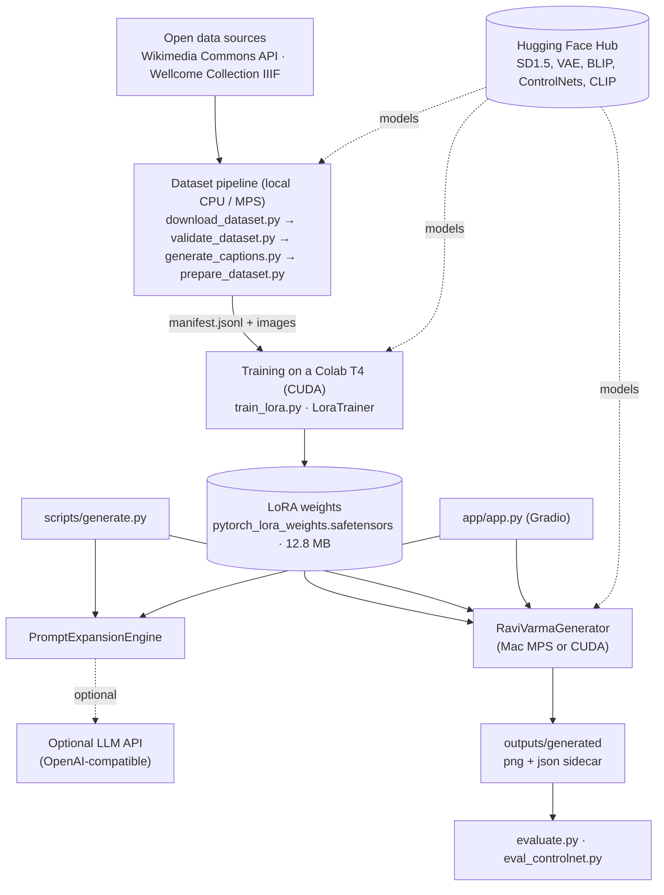
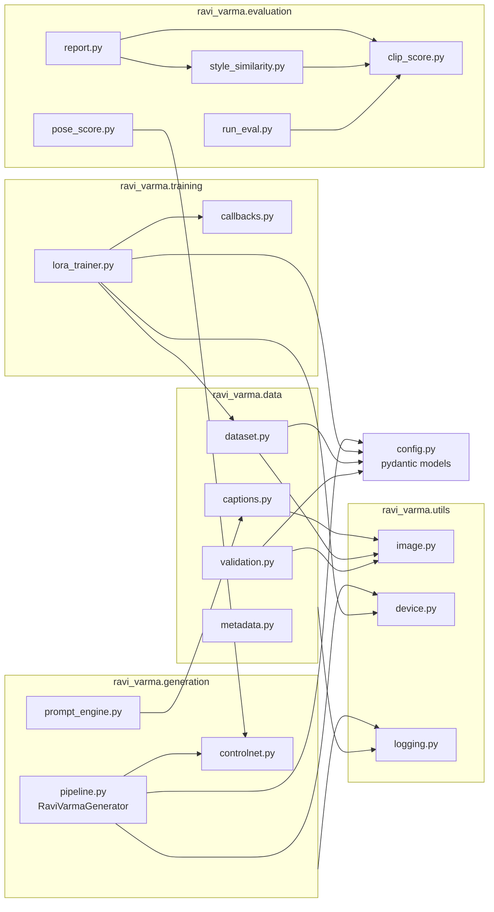
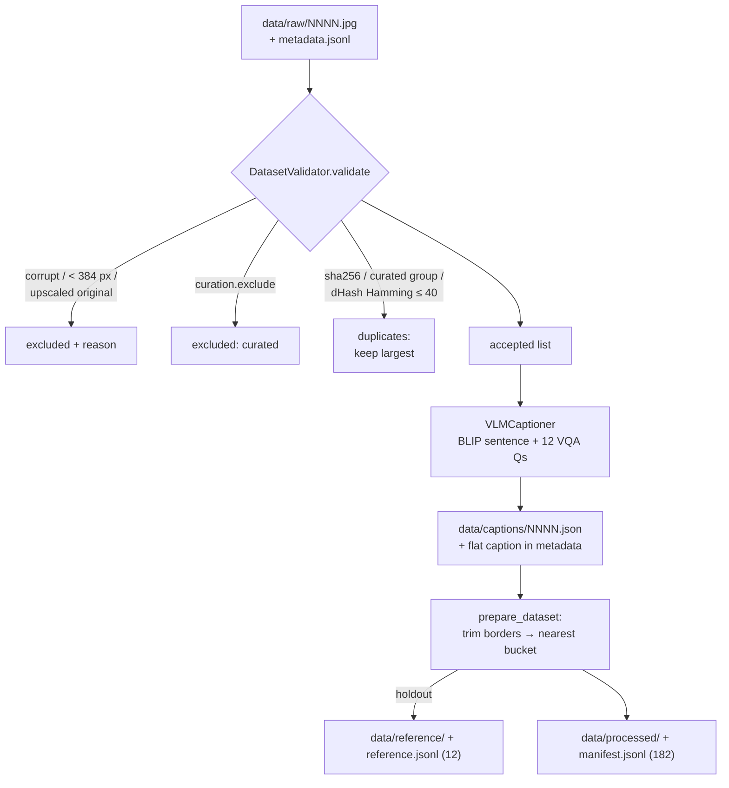
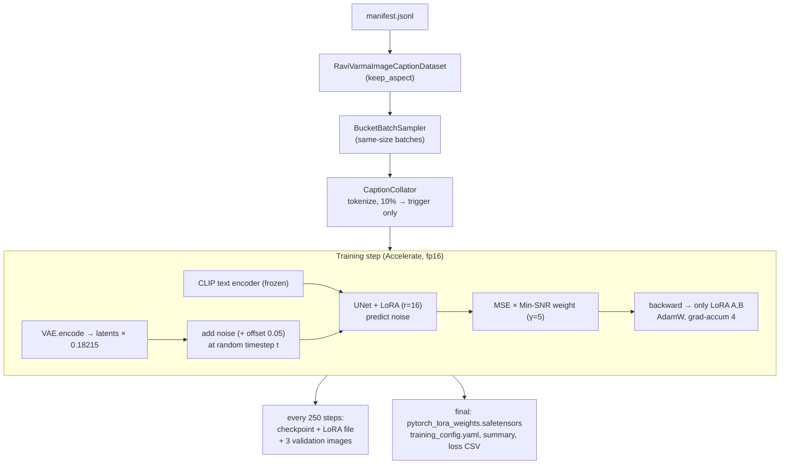
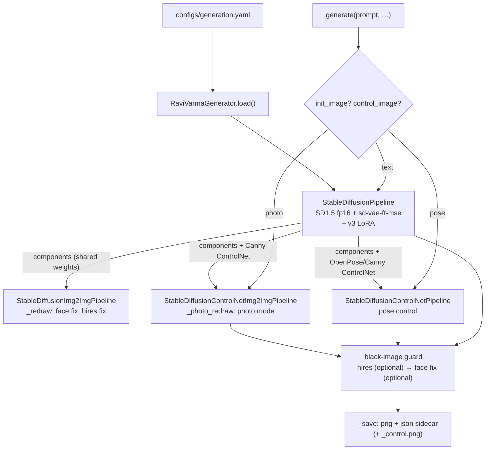
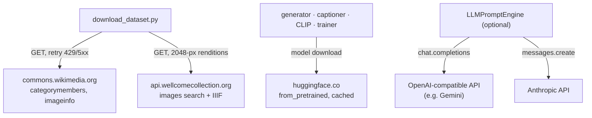
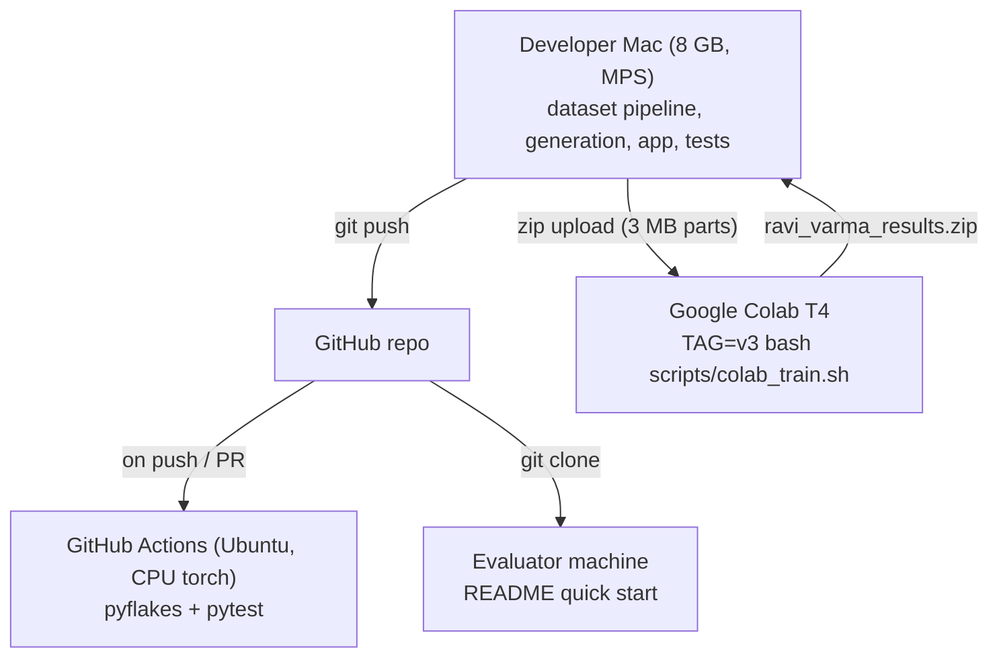
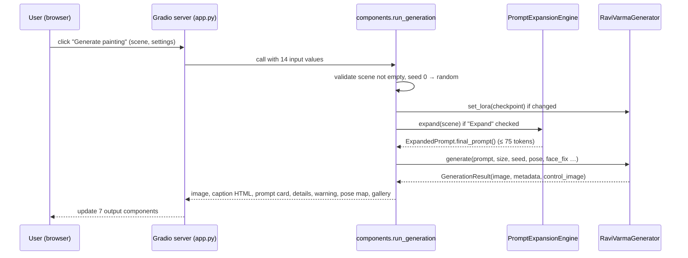

# 3. Architecture

## 3.1 What kind of system this is

The Next Ravi Varma is a **single-process Python application plus a set of batch scripts**.

- **Not here:** a server fleet, a database, authentication, a job queue or a deployment.
- **The "database"** is a set of versioned files (JSONL metadata, manifests, caption sidecars, generation sidecars).
- **The "backend"** is one Python class, `RaviVarmaGenerator`. It is used both by the CLI and by a local Gradio web app.

Keeping this in mind avoids describing infrastructure that isn't there.

| Layer | Present? | Where |
|---|---|---|
| Front end | Yes: Gradio (server-rendered components + CSS) | `app/app.py`, `app/components.py`, `app/styles.css` |
| Back end / business logic | Yes: a Python library | `src/ravi_varma/` |
| Batch pipelines | Yes: CLI scripts | `scripts/` |
| Database | **No.** Versioned files instead | `data/metadata/`, `data/processed/manifest.jsonl`, `outputs/` |
| Authentication / authorization | **No.** Local single-user tool bound to `127.0.0.1` | `demo.launch(server_port=…)` |
| Background jobs | **No.** Requests run synchronously; Gradio queues events | — |
| External services | Hugging Face Hub (models), Wikimedia Commons and Wellcome Collection (data), optional LLM API | see §3.7 |
| Deployment | Local machine + Colab for training + GitHub Actions for CI | §3.8 |

## 3.2 High-level system architecture

**How to read it:**
- Data flows left to right: **sources → dataset → training → weights → generation → evaluation**.
- Dashed arrows are network downloads or optional calls.
- **Two interfaces share one core.** `scripts/generate.py` and `app/app.py` both construct a `RaviVarmaGenerator` and a `PromptExpansionEngine`, so CLI and app behave identically.
- **The weights are the only hand-off between training and inference.** Training writes `checkpoints/lora/ravi_varma_v3/`; generation reads it through `configs/generation.yaml` → `model.lora_path`. Training on a T4 and generating on a Mac therefore needs only one 12.8 MB file to cross machines.
- **Evaluation reads files, not objects.** It consumes the images and `.json` sidecars written by generation, so any image the project produced can be re-scored later.

## 3.3 Module and component relationships

**Dependency rules (Implemented):**
- **`utils` depends on nothing project-specific.** `config.py` depends only on pydantic and YAML.
- **`data` never imports `training` or `generation`.** It can run without PyTorch: heavy imports are lazy (`captions.py`) or absent (`validation.py`). That's why validation and preparation work on a machine without the ML stack.
- **`generation` doesn't import `training`.** The only coupling is the weights file format.
- **`prompt_engine` imports `captions.clip_token_counter`.** Captions and prompts are both measured with the same tokenizer as the SD1.5 text encoder, so the 77-token rule is enforced identically at training time and generation time.
- **`pose_score` reuses the cached OpenPose detector** from `controlnet.py` (`_openpose_detector`), so the detector loads once per process.

## 3.4 The dataset pipeline

The same `DatasetValidator` runs inside `validate_dataset.py`, `generate_captions.py` and `prepare_dataset.py`
(**Confirmed**, module docstring). All three stages therefore agree on exactly which files are in the dataset; a
curation edit in `configs/dataset.yaml` propagates everywhere.

## 3.5 Training pipeline

**Frozen vs trained:** the VAE, text encoder and UNet base weights are frozen and cast to fp16. Only the LoRA matrices
are trained, in fp32. `_apply_lora` asserts this: it raises if any trainable parameter name lacks "lora".

## 3.6 Inference: one loaded model, many pipelines

**The key design point:**
- SD1.5 is loaded **once**. Every other pipeline is assembled from `self._pipeline.components`, the same UNet (with the LoRA already injected), VAE and text encoder; only the small ControlNet is added.
- Without this, the original scaffold loaded a second full SD1.5 for ControlNet, which an 8 GB Mac cannot hold (**Confirmed**, the comment in `_load_controlnet_pipeline` and commit `737a8da`).
- ControlNet pipelines are cached per type in `self._controlnet_pipelines`.

## 3.7 External integrations

- **Wikimedia Commons.** Recursive category walk plus `imageinfo` queries for licence, original size and a 2048-px rendition. 429 responses honour `Retry-After` (`api_get`). Downloads sleep 2 s per file to stay under rate limits.
- **Wellcome Collection.** Image search, then the IIIF `info.json` for the original size. Only `pdm`, `cc-0` and `cc-by` licences are accepted, and the title must mention Varma (`download_wellcome`).
- **Hugging Face Hub.** All models are pulled with `from_pretrained` and cached locally; no token is needed, because all models are public.
- **LLM (optional).** Off unless `.env` sets `PROMPT_EXPANSION_PROVIDER`. Only scene text is sent; failures fall back to the local engine (`PromptExpansionEngine.expand`).

## 3.8 Deployment and environments

There is **no hosted deployment**. "Deployment" means three environments: the developer laptop, a Colab GPU for
training, and CI. The **proposed future architecture** (not implemented) would add a Hugging Face Space for a public
demo and the Hub for weights (§11).

## 3.9 Request lifecycle in the web app

Each click runs synchronously in the Gradio worker. There is no streaming or progress callback; the user waits about
1–2 minutes on a Mac. Errors raised as `RuntimeError` are caught and shown as a warning instead of crashing the app.
