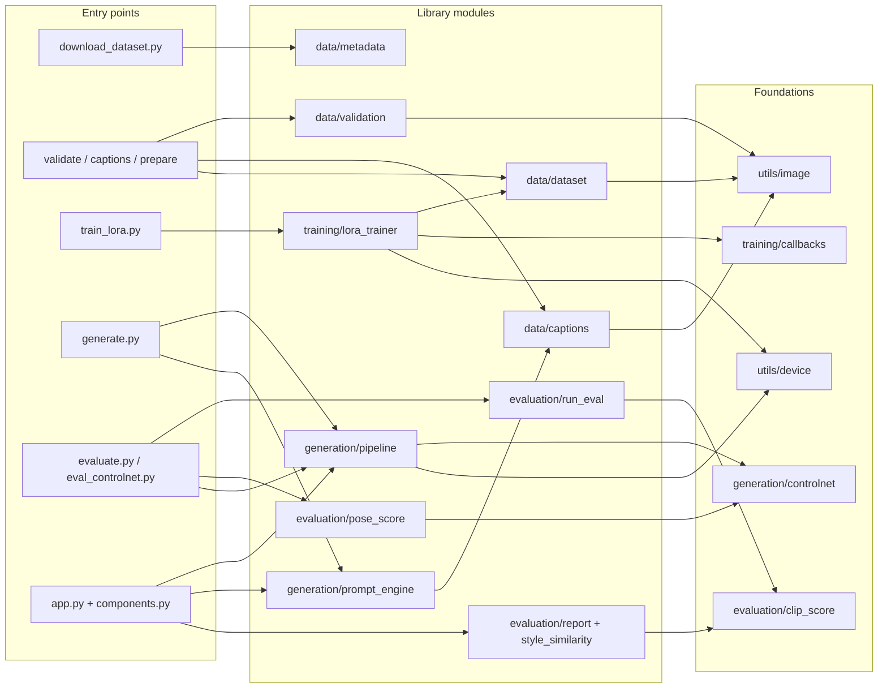

# 6. Codebase guide

## 6.1 Repository layout

```text
the-next-ravi-varma/
├── src/ravi_varma/          library (pip install -e .)
│   ├── config.py            pydantic models for the 3 YAML configs
│   ├── data/                download metadata, validation, captions, preparation
│   ├── training/            LoRA trainer + callbacks
│   ├── generation/          generator, prompt engine, ControlNet helpers
│   ├── evaluation/          CLIP metrics, paired runs, PCK
│   └── utils/               image, device, logging helpers
├── scripts/                 one CLI per pipeline stage (thin wrappers)
├── app/                     Gradio UI (app.py layout, components.py logic, styles.css)
├── configs/                 dataset.yaml, lora_sd15.yaml, lora_sdxl.yaml, generation.yaml,
│                            epic_lexicon.yaml, prompts/sample_prompts.yaml
├── data/                    metadata, captions, processed, reference (raw images not committed)
├── checkpoints/lora/ravi_varma_v3/   shipped LoRA + training record
├── outputs/                 generated images, evaluations, logs
├── tests/                   pytest suite (121 tests)
├── notebooks/               Colab training notebook(s)
├── docs/                    README companions, screenshots, this handbook
└── Makefile, requirements*.txt, pyproject.toml, .github/workflows/tests.yml
```

**Size.** About 6,700 lines of Python in `src/`, `scripts/` and `app/`, plus about 1,300 lines of tests. That's
8,068 lines including tests (measured with `wc -l`).

**Convention.** Scripts are thin: they parse arguments, load a config and call one library function. All logic
that is worth testing lives in `src/`.

## 6.2 Module-by-module

| Module (lines) | Responsibility | Key symbols | Called by |
|---|---|---|---|
| `config.py` (280) | Typed configs with defaults and validators | `DatasetConfig`, `LoraTrainingConfig`, `GenerationConfig`, `load_config`, `GenerationParamsConfig._multiple_of_8` | every script, the app |
| `data/metadata.py` (133) | Read and write `metadata.jsonl`; clean titles; parse years | `load_metadata`, `save_metadata`, `clean_title`, `extract_year` | downloader, validator |
| `data/validation.py` (373) | Accept or exclude raw images with reasons | `DatasetValidator.validate`, `ValidationReport`, `DatasetIssue`, `check_manifest` | validate / caption / prepare scripts |
| `data/captions.py` (504) | Structured captions, the token budget | `VLMCaptioner`, `HeuristicCaptioner`, `StructuredCaption.as_flat_caption`, `assemble_caption`, `clip_token_counter`, `measure_visual_properties`, `get_captioner` | `generate_captions.py`, `prompt_engine.py`, `check_manifest` |
| `data/dataset.py` (330) | Prepared images + manifest; PyTorch dataset; bucket sampler | `prepare_dataset`, `load_manifest`, `ManifestRecord`, `RaviVarmaImageCaptionDataset`, `BucketBatchSampler` | `prepare_dataset.py`, trainer |
| `training/lora_trainer.py` (539) | The training loop | `LoraTrainer` (`_load_models`, `_apply_lora`, `train`), `CaptionCollator`, `_min_snr_weights`, `check_ml_stack_available` | `train_lora.py`, tests |
| `training/callbacks.py` (192) | Checkpoints, validation images, loss logs | `CheckpointManager`, `ValidationImageCallback`, `LossLogger` | trainer |
| `generation/pipeline.py` (520) | Load SD1.5 + LoRA; every generation mode | `RaviVarmaGenerator` (`load`, `set_lora`, `generate`, `_redraw`, `_fix_faces`, `_photo_redraw`, `_load_controlnet_pipeline`, `_save`), `detect_faces`, `resolve_lora_weights`, `GenerationResult`, `LoraCheckpointMissingError` | `generate.py`, the app, `eval_controlnet.py` |
| `generation/prompt_engine.py` (282) | Milestone 3 expansion | `PromptExpansionEngine`, `LocalPromptEngine`, `LLMPromptEngine`, `ExpandedPrompt.final_prompt`, `load_lexicon`, `DEFAULT_NEGATIVE_PROMPT` | `generate.py`, the app |
| `generation/controlnet.py` (94) | Conditioning images | `make_conditioning_image`, `make_canny_conditioning`, `OpenPoseDetector`, `_openpose_detector` | pipeline, `pose_score.py`, `create_pose_control.py` |
| `evaluation/clip_score.py` (137) | open_clip wrapper | `clip_available`, `text_image_similarity`, `embed_images`, `embed_texts`, `strip_trigger_tokens` | all evaluation modules |
| `evaluation/run_eval.py` (338) | Paired run evaluation | `evaluate_run`, `ImageRecord`, `RunEvaluation`, `contact_sheet`, `_paired` | `evaluate.py`, Colab script |
| `evaluation/style_similarity.py` (93) | Style score for one image | `compute_style_similarity`, `StyleSimilarityResult` | `report.py`, the app's Evaluation tab |
| `evaluation/report.py` (119) | Per-image report | `evaluate_image`, `batch_evaluate`, `ImageEvaluation` | `evaluate.py --image`, the app |
| `evaluation/pose_score.py` (44) | PCK | `pose_keypoints`, `pose_pck` | `eval_controlnet.py` |
| `utils/image.py` (198) | Safe IO, hashing, borders, buckets | `safe_open_image`, `difference_hash`, `hamming_distance`, `file_sha256`, `trim_uniform_border`, `aspect_buckets`, `nearest_bucket`, `resize_to_bucket` | data modules |
| `utils/device.py` (191) | Device and dtype choice | `detect_device`, `DeviceInfo`, `resolve_optimizations`, `MemoryOptimizationPlan` | trainer, generator, captioner |
| `utils/logging.py` (75) | Logging with redaction | `setup_logging`, `get_logger`, `_RedactSecretsFilter` | everywhere |
| `app/app.py` (252) | Gradio layout and wiring | `build_app`, `_theme`, `_require_gradio`, `main` | user |
| `app/components.py` (268) | UI logic, testable without Gradio | `run_generation`, `run_photo_to_painting`, `run_evaluation`, `list_checkpoints`, `checkpoint_table_html`, `loss_chart_svg`, `recent_images` | `app.py`, tests |

## 6.3 Scripts

| Script (lines) | Stage | Calls |
|---|---|---|
| `download_dataset.py` (882) | M1 download | `api_get`, `download_wellcome`, `save_metadata` |
| `validate_dataset.py` (62) | M1 validate | `DatasetValidator`, `check_manifest` |
| `generate_captions.py` (148) | M1 caption | `get_captioner`, `StructuredCaption.reassemble` |
| `prepare_dataset.py` (61) | M1 prepare | `prepare_dataset` |
| `package_dataset.py` (60) | M1 → M2 | zipfile |
| `train_lora.py` (87) | M2 train | `LoraTrainer` |
| `colab_train.sh` | M2 orchestration | the scripts above, in order |
| `generate.py` (194) | M2–M4 generate | `RaviVarmaGenerator`, `PromptExpansionEngine` |
| `evaluate.py` (72) | Evaluate | `evaluate_run`, `evaluate_image` |
| `create_pose_control.py` (45) | M4 helper | `make_conditioning_image` |
| `eval_controlnet.py` (141) | M4 evaluate | generator, `pose_pck`, CLIP |

## 6.4 Dependency map



**Where to start reading:**
1. `RaviVarmaGenerator.generate` in `generation/pipeline.py` is the heart of inference.
2. `LoraTrainer.train` in `training/lora_trainer.py` is the heart of training.
3. `DatasetValidator.validate` decides the dataset.

## 6.5 Coding conventions observed

- **Lazy heavy imports.** torch, diffusers and transformers are imported inside functions, so data tools and tests run without the ML stack (`check_ml_stack_available`, `_try_import_torch`).
- **Configs drive behaviour.** Scripts accept `--config` and a few overrides; defaults live in pydantic models.
- **Every artefact has a sidecar.** Images have `.json`, captions have `.json`, runs have `training_summary.json` and `summary.json`.
- **Explicit failure over silent fallback.** Examples: `LoraCheckpointMissingError`, the all-black-image guard, refusing placeholder captions.
- **Tests use a 1 MB SD model** (`hf-internal-testing/tiny-stable-diffusion-pipe`) or monkeypatched stubs instead of real weights.

## 6.6 Known code-level debts

| Debt | Location | Effect |
|---|---|---|
| Style similarity implemented three times | `style_similarity.py`, `run_eval.py`, `report.py` | Risk of drift between the app's score and the report's |
| `DEFAULT_NEGATIVE_PROMPT` ≠ config negative prompt | `prompt_engine.py` vs `generation.yaml` | Two sources of truth |
| SSIM / LPIPS fields declared, never computed | `report.py` / `ImageEvaluation` | Always `None` |
| O(n²) near-duplicate search | `validation.py` | Doesn't scale |
| pydantic models accept unknown keys | `config.py` | YAML typos are silently ignored |
| SDXL config without implementation | `configs/lora_sdxl.yaml` | Misleading |
