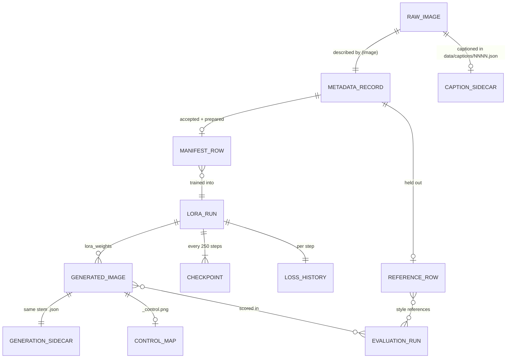
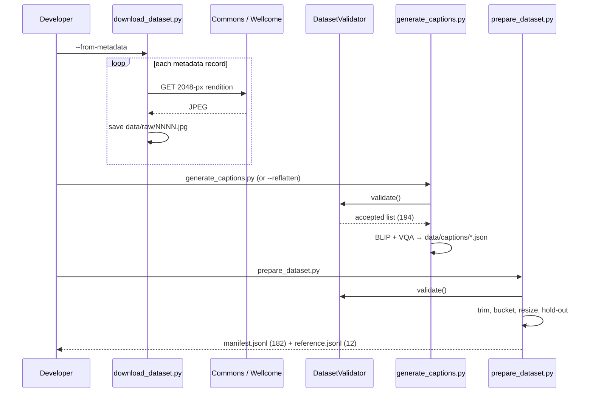
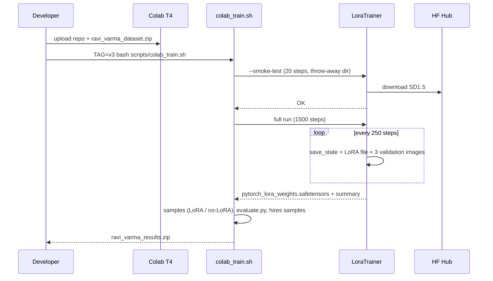
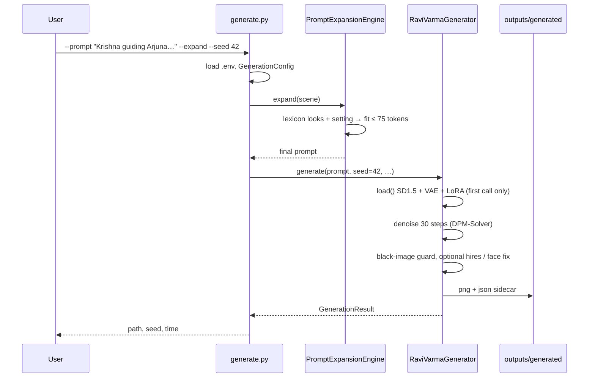
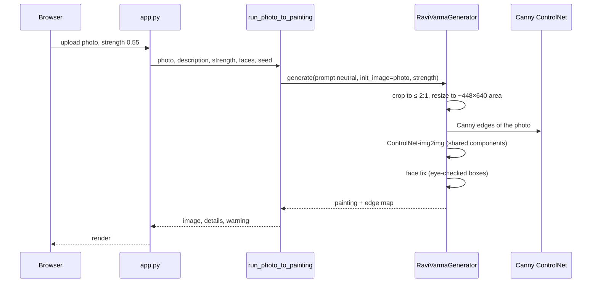
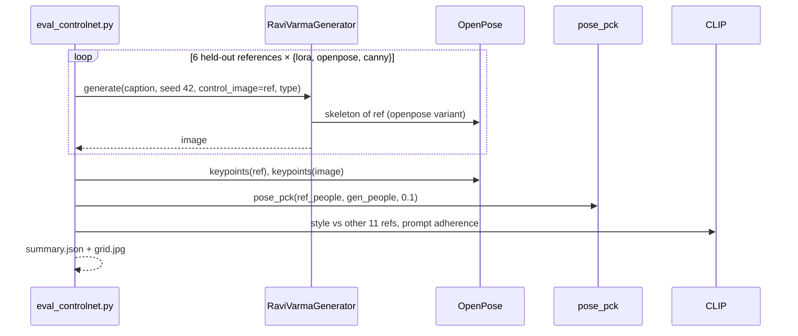
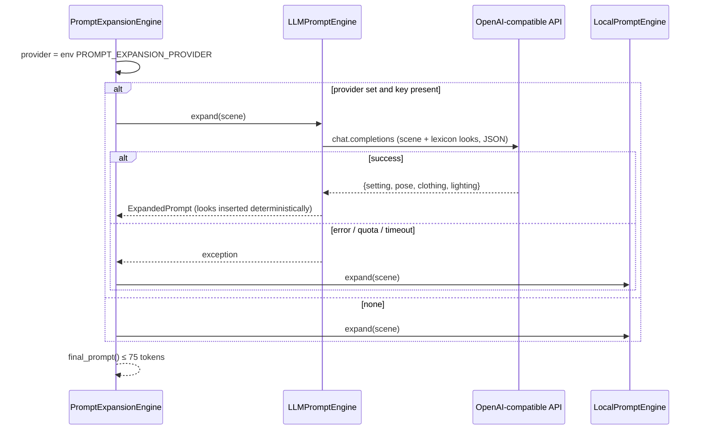

# 7. Data, interfaces and end-to-end flows

## 7.1 Data model (files, not tables)

There is no database. The persistent entities are files, linked by file names and paths.

| Entity | Path | Format | Key fields (verified from the files) |
|---|---|---|---|
| Raw image | `data/raw/NNNN.jpg` | JPEG (not committed) | — |
| Metadata record | `data/metadata/metadata.jsonl` | JSON lines (300) | `image`, `caption`, `artist`, `title`, `commons_file`, `license`, `source`, `year`, `source_width`, `source_height` (+ `medium` for prints) |
| Caption sidecar | `data/captions/NNNN.json` | JSON (194) | `subject`, `composition`, `pose`, `clothing`, `jewelry`, `expression`, `objects`, `environment`, `lighting`, `visual_characteristics`, `raw_caption`, `title`, `source`, `qa{…}` |
| Manifest row | `data/processed/manifest.jsonl` | JSON lines (182) | `image`, `text` (the training caption, starting `<rvvarma>, `), `artist`, `source`, `year`, `title`, `source_image`, `width`, `height`, `license` |
| Reference row | `data/reference/reference.jsonl` | JSON lines (12) | same as the manifest |
| LoRA run | `checkpoints/lora/<run>/` | safetensors + YAML + JSON | `pytorch_lora_weights.safetensors`, `training_config.yaml`, `training_summary.json` |
| Loss history | `…/loss_history.csv` | CSV | `step, loss, lr` |
| Generated image | `outputs/generated/<unix>_<uuid8>.png` | PNG | — |
| Generation sidecar | same stem `.json` | JSON | `prompt`, `negative_prompt`, `seed`, `steps`, `guidance_scale`, `width`, `height`, `lora_scale`, `hires_scale`, `photo_strength`, `faces_fixed`, `lora_loaded`, `lora_weights`, `base_model`, `scheduler`, `vae`, `controlnet_*`, `device`, `dtype`, `timestamp`, `disclaimer` |
| Evaluation run | `outputs/evaluations/<run>/` | JSON / CSV / JPEG | `summary.json`, `metrics.csv`, `contact_sheet*.jpg`, `qualitative_review.csv` (never overwritten) |

**Lifecycle.** Raw files and metadata are append-only (`next_free_index`). Captions are recomputed with
`--overwrite`. `prepare_dataset` clears `data/processed/` and rebuilds it (`_clear_processed_dir`). Each training
`TAG` gets its own run folder. Generated images are never overwritten, because their names contain a timestamp and
a UUID.

## 7.2 Configuration files

| File | Controls | Loaded by |
|---|---|---|
| `configs/dataset.yaml` | Paths, validation thresholds, curation (`exclude`, `duplicate_groups`, `caption_notes`), `holdout`, preprocessing | `DatasetConfig.load` |
| `configs/lora_sd15.yaml` | Base model, LoRA rank / alpha / targets, optimiser, steps, v3 options, checkpointing, validation prompts | `LoraTrainingConfig.load` |
| `configs/generation.yaml` | Base model, `lora_path`, scheduler, VAE, defaults, negative prompt, ControlNet ids, hardware | `GenerationConfig.load` |
| `configs/epic_lexicon.yaml` | 27 characters (aliases, looks), 18 places, style cues | `load_lexicon` |
| `configs/prompts/sample_prompts.yaml` | The 5-prompt evaluation suite | `generate.py --prompt-file` |
| `.env` (from `.env.example`) | `PROMPT_EXPANSION_PROVIDER`, `PROMPT_EXPANSION_MODEL`, `OPENAI_API_KEY`, `OPENAI_BASE_URL`, `ANTHROPIC_API_KEY`, `HF_TOKEN`, `MODEL_CACHE_DIR` | `python-dotenv` in `generate.py` |

## 7.3 Interfaces

### Command-line interface (the project's "API")

| Command | Important options |
|---|---|
| `download_dataset.py` | `--source commons|wellcome`, `--limit 40`, `--min-side`, `--from-metadata`, `--category`, `--raw-dir`, `--metadata-file` |
| `validate_dataset.py` | `--config`, `--json-out`, `--manifest` |
| `generate_captions.py` | `--vlm-model`, `--vqa-model` (`none` to skip), `--device`, `--all`, `--overwrite`, `--no-vlm`, `--reflatten` |
| `prepare_dataset.py` | `--config`, `--skip-validation` |
| `train_lora.py` | `--config` (required), `--max-train-steps`, `--resume-from-checkpoint`, `--output-dir`, `--smoke-test` |
| `generate.py` | `--prompt` / `--prompt-file`, `--expand`, `--dry-run`, `--seed` / `--seeds` / `--num-images`, `--steps`, `--guidance-scale`, `--width`, `--height`, `--lora-scale`, `--lora-path`, `--no-lora`, `--negative-prompt`, `--face-fix`, `--hires-scale`, `--init-image`, `--strength 0.55`, `--pose-image`, `--controlnet-type`, `--controlnet-strength`, `--output-dir`, `--skip-existing` |
| `evaluate.py` | `--input`, `--baseline`, `--reference`, `--train-manifest`, `--output-dir`, `--image`, `--prompt`, `--device` |
| `eval_controlnet.py` | `render|report`, `--variant`, `--seed` |
| `create_pose_control.py` | `--image`, `--type`, `--low-threshold`, `--high-threshold`, `--out` |
| `app/app.py` | `--config`, `--server-port 7860`, `--share` |

**Validation at the boundary.** `generate.py` rejects an empty prompt and missing `--init-image` / `--pose-image`
files with `parser.error`. pydantic rejects sizes that aren't multiples of 8.

### Web app events (Gradio)

| Tab | Trigger | Handler | Inputs → outputs |
|---|---|---|---|
| Generate | "Generate painting" (+ example chips fill the scene box) | `run_generation` | scene, expand, style strength, checkpoint, pose image, control mode, strength, seed, steps, guidance, size, negative prompt, face fix → image, caption, prompt card, details, warning, pose map, gallery |
| Photo → Varma | "Paint it like Ravi Varma" | `run_photo_to_painting` | photo, description, strength, faces, seed → painting, details, warning (the edge map is saved to disk, not shown) |
| Checkpoint Hub | built once when the app starts | `checkpoint_table_html`, `loss_chart_svg` | — → HTML table, SVG chart, v2 progression image |
| Evaluation | "Calculate metrics" | `run_evaluation` | image, prompt, reference dir → Markdown with CLIP scores |
| About | static | — | — |

### External APIs used

| API | Calls | Auth | Failure handling |
|---|---|---|---|
| Wikimedia Commons `w/api.php` | `categorymembers`, `imageinfo` (`url`, `size`, `extmetadata`) | none (a User-Agent is sent) | retry 429 / 5xx with `Retry-After` |
| Wellcome Collection catalogue + IIIF | `/catalogue/v2/images?query=…`, `info.json`, `full/!2048,2048/0/default.jpg` | none | skip on error |
| Hugging Face Hub | `from_pretrained` for all models | none (all public); `HF_TOKEN` optional | the library's exceptions; cached after the first run |
| OpenAI-compatible chat | `chat.completions.create` (JSON response) | `OPENAI_API_KEY` | fall back to the local engine |
| Anthropic | `messages.create` | `ANTHROPIC_API_KEY` | fall back to the local engine |

## 7.4 End-to-end flows

### Flow 1: rebuilding the dataset from committed metadata

The captions are committed, so `--reflatten` rebuilds the flat captions without running BLIP. The raw images are
the only thing that must be downloaded again.

### Flow 2: training a LoRA on Colab

### Flow 3: CLI text → painting with expansion

### Flow 4: Photo → Varma in the app

The uploaded photo lives only in memory. Only the painting, the edge map and the sidecar are written.

### Flow 5: pose-controlled generation and PCK evaluation

### Flow 6: LLM expansion with fallback

