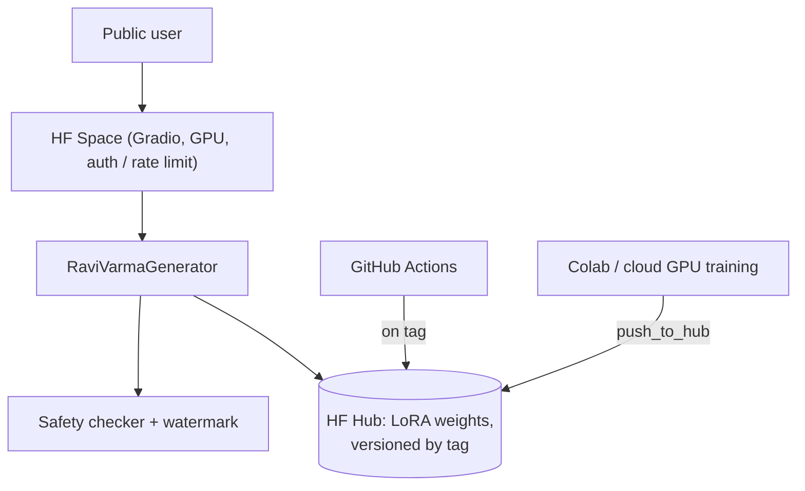

# 11. Alternatives and improvements

## 11.1 Could it be simpler?

| Part | Simpler option | Verdict |
|---|---|---|
| Dataset pipeline (4 scripts) | One script | Separate stages let one step rerun without redoing the others (captioning is the slow one). Keep |
| BLIP + 12 VQA captions | BLIP sentence only | Measured: frames 5/15 → 0/15 came partly from the caption notes. The richer captions are justified |
| pydantic configs | argparse only | Configs are shared by CLI, app and Colab. Keep, but forbid unknown keys |
| Local lexicon + LLM | Raw prompts | Expansion gave **no measured CLIP gain**. The local lexicon is cheap; the LLM mode is the part that could be dropped without loss on current evidence |
| Three style-similarity implementations | One | Yes, merge them (§10.4 #4) |
| Gradio + custom CSS | Plain Gradio | The CSS is cosmetic. It depends on Gradio internals, which is a maintenance cost |

## 11.2 Alternative approaches to the whole problem

| Alternative | Pros | Cons | When better |
|---|---|---|---|
| SDXL + LoRA | 1024 px, better faces and hands | ~3× memory; won't run on the 8 GB Mac; slower | With a ≥ 24 GB GPU |
| Flux / SD3 + LoRA | State-of-the-art prompt following | Much larger; licence terms; heavier training | With rented GPUs |
| DreamBooth (full UNet + prior preservation) | Stronger style | Overfitting at n = 182; 4 GB checkpoints | With far more data |
| Textual inversion | Tiny (KB) | Too weak for rendering technique | Concepts, not styles |
| IP-Adapter (style from reference images, no training) | No training at all | Style is copied from the given image; less consistent | Quick demos |
| Neural style transfer (Gatys) | Simple, classic | Texture only; no composition or subject knowledge | Photo filters |
| Prompt-only on base SD | Zero work | Measured: calendar-art look, frames 5/15 | Baseline only |

## 11.3 Ranked improvements (impact ÷ effort)

| Rank | Improvement | Expected impact | Effort | Evidence basis |
|---|---|---|---|---|
| 1 | Human evaluation study | High (credibility) | Low | The main gap named in README / DECISIONS |
| 2 | Config hygiene: `extra="forbid"`, one negative prompt, 448×640 default | Medium | Very low | §6.6 |
| 3 | Fix the stale docs (Appendix A) | Medium (reviewer trust) | Very low | Appendix A |
| 4 | Ablation runs (rank, prints, data vs training) | High (understanding) | Medium (GPU hours) | D-03, D-08, D-16 confounds |
| 5 | Hugging Face Space + weights on the Hub | High (reach) | Medium | Not deployed now |
| 6 | DNN face detector (e.g. RetinaFace / MediaPipe) | Medium (faces in profile / crowds) | Low–medium | Known Haar misses |
| 7 | Tiled VAE to allow hires on 8 GB | Medium | Medium | Hires is GPU-only now |
| 8 | Stronger captioner (Florence-2 / Qwen-VL) for v4 | Medium | Medium | BLIP can't name deities |
| 9 | SDXL port | High (quality) | High | D-01 |
| 10 | Regional prompting / multi-ControlNet for multi-figure actions | Medium | High | M3 failure on complex actions |

## 11.4 Proposed future architecture (not implemented)

This is a **proposal only**. Nothing here is deployed. It would need the team's agreement to publish (DECISIONS §9).
